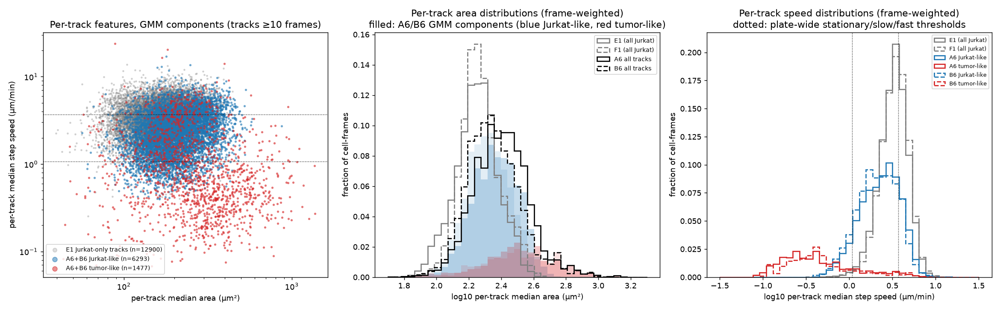
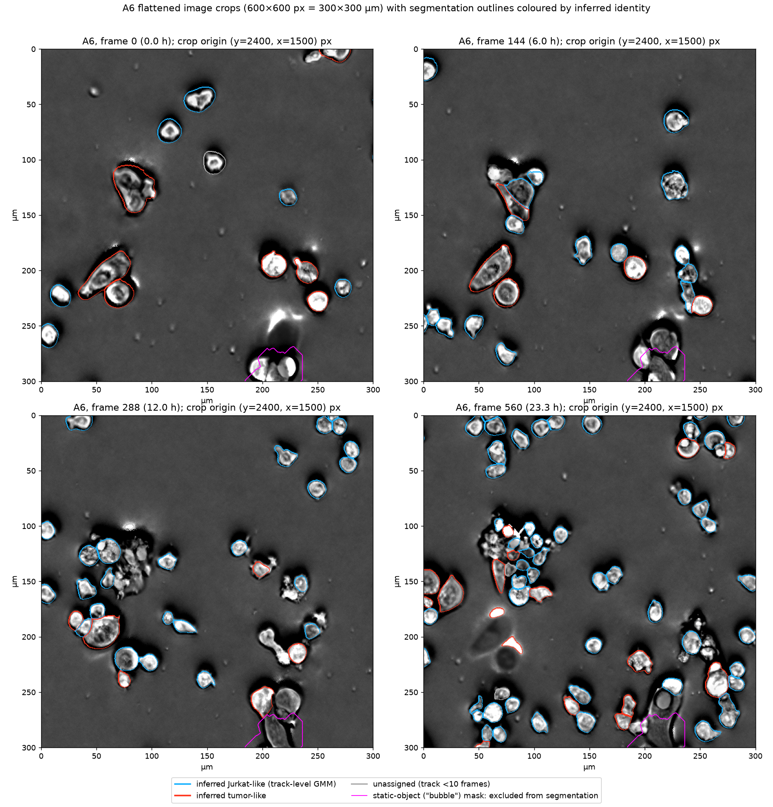
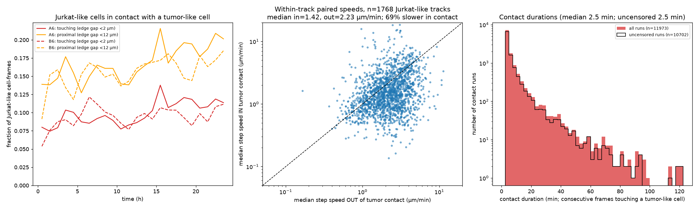
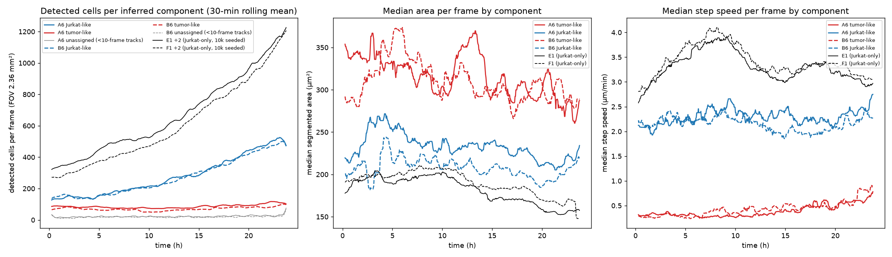

# Tumor–Jurkat coculture (wells A6, B6) vs Jurkat-only controls (E1, F1; C1/D1 as extra reference)

Label-free 24 h movies (0.5 µm/px, 2.5 min/frame, 576 frames, FOV 3072×3072 px = 2.36 mm²). A6/B6: 5000 tumor cells + 5000 CAR-negative Jurkat, no coating. E1/F1: 10 000 Jurkat only, no coating (same total seeding). C1/D1: 5000 Jurkat only, no coating (same Jurkat number) – used as an additional reference where noted. All analysis is on `outputs/wells/<well>/analysis/states_hoct.parquet` (hoct tracks) plus `flat.zarr`, `masks.zarr`, `background.npy`, `bubble_mask.npy`. Speeds are per-frame step displacements converted with 0.5 µm/px / 2.5 min (1 px/frame = 0.2 µm/min); plate-wide state thresholds are 5.37 px/frame (1.07 µm/min, stationary/slow) and 18.57 px/frame (3.71 µm/min, slow/fast).

**Cell identity is inferred from morphology and motility, not labelled.** "Tumor-like" and "Jurkat-like" below are GMM components; the mapping to cell type is interpretation.

## Key findings

1. **A two-component Gaussian mixture on per-track features splits the tracked A6/B6 population into 19 % tumor-like tracks / 22 % tumor-like cell-frames (A6 23.6 %, B6 20.7 % of assigned frames) and 81 % / 78 % Jurkat-like.** Tumor-like: median area 262 µm² (equivalent diameter 18.3 µm), median step 0.74 µm/min, 72 % of frames below the stationary threshold, lower intensity SD (60 vs 68) and solidity (0.952 vs 0.962). Jurkat-like: 202 µm² (16.0 µm), 2.37 µm/min. *Confidence: medium.* The split is stable across seeds (≥98.9 % agreement) and across 1-h windows within tracks (89 % window-level agreement, 69 % of multi-window tracks fully consistent), but it is driven mainly by speed: the per-track area distribution is not bimodal (Ashman D 0.7–1.1, bimodality coefficient 0.28–0.33, both below the bimodal criteria), a morphology-only GMM agrees with it only moderately (Cohen κ = 0.74), and applying the same classifier to E1/F1 (all Jurkat) labels 11 % of tracks / 6 % of cell-frames "tumor-like". Correcting for that false-positive rate puts the tumor-like share of tracked cell-frames at ≈17 %.

2. **Most tumor cells are probably not in the tracked data at all.** The pipeline divides every frame by a temporal-median background, so permanently stationary objects are suppressed, and the static-object ("bubble") mask excludes 6.8 % (A6) and 7.0 % (B6) of the FOV from segmentation vs 0.0 % (E1) and 0.4 % (F1). The A6/B6 background images contain 126/134 static objects ≥50 µm² (median 410/397 µm², total 0.26/0.28 mm² = 11–12 % of the FOV) versus 107/55 small faint blobs in E1/F1 (median ~105 µm², total 0.03 mm²). Tracked tumor-like objects number only 55–105 per frame and are tracked intermittently (median tumor-like track 29 frames; only 4 (A6) and 1 (B6) tumor-like tracks span the full 24 h; 80 % of tumor-like tracks start as "appeared"). *Confidence: high that stationary objects are systematically suppressed (by design of `flat = raw/background`); medium for the static-object counts (simple threshold on the background image; clusters count as one).*

3. **Jurkat-like cells in coculture move ~30 % slower than Jurkats in Jurkat-only wells.** Median step 2.32 / 2.14 µm/min (A6 / B6) vs 3.25 / 3.35 (E1 / F1) and 3.64 / 3.62 (C1 / D1); fraction of fast steps (>18.6 px/frame) 0.30 / 0.27 vs 0.44 / 0.45; MSD(10 min) 806 / 790 µm² vs 1025 / 1077 (E1/F1) and 1411 / 1380 (C1/D1). Isolated (non-touching, non-cluster) Jurkat-like cells are also slower: 2.48 / 2.28 vs 3.33 / 3.44 µm/min. Track-level Mann–Whitney p < 1e-300 (6293 vs 24 914 tracks). *Confidence: medium.* Density does not explain it (the lower-density C1/D1 Jurkat-only wells are the fastest, not the slowest), and misassignment of slow Jurkats to the tumor-like component biases the coculture Jurkat-like speed upward, so the slowing is if anything underestimated; but n = 2 wells per condition and well-level confounds (focus, medium conditioning by tumor cells, plate position) cannot be separated from a cell-contact effect.

4. **The tumor-like population essentially does not move.** Median step 0.37 / 0.42 µm/min (0.75–0.85 px/frame, at the segmentation-jitter floor), 73 % / 72 % of steps below the stationary threshold, 9–10 % "fast" steps (mostly mask merge/split jumps and misassigned cells). MSD(10 min) 262 / 380 µm². *Confidence: high that these objects are stationary; medium that they are tumor cells (see 1).*

5. **Jurkat–tumor contacts are frequent but short.** 10.4 % (A6) / 9.6 % (B6) of Jurkat-like cell-frames touch a tumor-like cell (centroid distance < sum of equivalent radii + 2 µm), 17.6 % / 16.0 % are within 12 µm of a tumor-like cell edge; the touching fraction rises from ~8 % in the first 4 h to ~11 % in the last 4 h. Of 11 973 contact runs, the median duration is 1 frame (2.5 min), 75th percentile 5 min, 90th percentile 12.5 min; 9.6 % last ≥15 min and 0.9 % ≥60 min (11 % of runs are censored by track start/end). The literal centroid-distance < 24 px criterion flags only 1.1 % of frames because the sum of radii alone is ≈34 px. *Confidence: medium (inherits identity uncertainty; 1-frame contacts are at the noise floor of mask adjacency).*

6. **Jurkat-like cells slow down while touching a tumor-like cell and recover immediately afterwards.** Within the same tracks, median step 1.42 µm/min in contact vs 2.23 out of contact (n = 1768 tracks with ≥3 frames in each state; 69 % slower in contact; paired median difference −0.52 µm/min; Wilcoxon p ≈ 1e-62). Speed 2.5–10 min after a contact ends (2.19 µm/min) equals the speed before contact (2.09) and far from contact (2.30). Touching another Jurkat-like cell slows a Jurkat less (1.96 vs 2.41 µm/min, −0.29 µm/min, n = 2414 tracks). *Confidence: medium.* Part of the in-contact slowing is a generic contact/segmentation effect (centroid damping when masks touch or merge), but the drop is ~1.8× larger for tumor contact than for Jurkat–Jurkat contact.

7. **Tracked tumor-like cells: flat count for ~16 h then a late rise, slowly shrinking area, few divisions.** Tumor-like objects per frame 85 → 75 → 105 (A6) and 68 → 55 → 98 (B6) at h 0–1, 11–12, 23–24; median area 350 → 338 → 276 µm² (A6) and 293 → 321 → 279 (B6). Within the 25 / 17 tumor-like tracks lasting ≥12 h the area trend is flat (+2.1 / +0.5 µm²/h). 27 / 31 confirmed divisions occur in tumor-like tracks (vs 204 / 206 in Jurkat-like tracks); 2 / 7 tumor-like tracks end as "died". The late rise in tumor-like count coincides with rising tumor-like speed (0.3 → 0.8 µm/min) and falling area, which is more consistent with slow, clustered Jurkats being absorbed into the tumor-like component as Jurkat density triples than with tumor proliferation (interpretation). *Confidence: low.*

8. **Fewer Jurkats are detected in the coculture wells than expected from seeding.** At h 0–1 the coculture wells contain 243 / 234 detected cells vs 657 / 542 (E1 / F1, 10 000 Jurkat) and 180 / 208 (C1 / D1, 5000 Jurkat); Jurkat-like cells are 131 / 146, i.e. ≈70 % of the C1/D1 count. By h 23–24 Jurkat-like cells reach 498 / 484 (3.8× / 3.4× increase) vs 1021 / 967 in C1/D1 (5.7× / 4.7×) and 1197 / 1184 for E1/F1 ÷ 2. *Confidence: medium that detected Jurkat numbers are lower; the cause (fewer cells seeded/settled in the FOV, Jurkats hidden in the excluded static-object regions and in undetected tumor clusters, or slower expansion in coculture) cannot be resolved from these data.*

## Task 1 – Separating the two populations label-free

Method: per-track medians (tracks ≥10 frames) of log10 area, eccentricity, solidity, intensity SD and log10 step speed; standardised; 2-component full-covariance GMM fitted on pooled A6+B6 tracks (n = 7770); the component with the lower speed mean is called tumor-like. Cell-frames inherit their track's label; frames in tracks <10 frames (6.0 % A6, 5.6 % B6) are unassigned.

| Component | Tracks | Frames | Median area (µm²) | Eq. diameter (µm) | Ecc. | Solidity | Intensity SD | Intensity mean | Median step (µm/min) | Median track length (frames) | Tracks with posterior >0.9 |
|---|---|---|---|---|---|---|---|---|---|---|---|
| Jurkat-like | 6293 (81.0 %) | 316 390 (77.8 %) | 202 | 16.0 | 0.618 | 0.962 | 67.6 | 142 | 2.37 | 32 | 85 % |
| Tumor-like | 1477 (19.0 %) | 90 187 (22.2 %) | 262 | 18.3 | 0.672 | 0.952 | 60.3 | 128 | 0.74 | 29 | 73 % |
| E1/F1 Jurkat (reference) | 24 914 | 1.44 M | 171 | 14.8 | 0.684 | 0.955 | 65.1 | 150 | 3.45 | 40 | – |

Per well: A6 19.2 % of tracks / 23.6 % of frames tumor-like; B6 18.9 % / 20.7 %.

Validation:

| Check | Result | Reading |
|---|---|---|
| (a) Bimodality of per-track area | 1-D GMM on log area: Ashman D = 1.12 (A6), 0.69 (B6) (bimodal requires D > 2); ΔBIC(1 − 2 comp) = −9 (A6), +127 (B6); frame-weighted bimodality coefficient 0.28 / 0.33 (<0.555). E1/F1 give D = 1.46 / 1.21 with no second population. Area percentiles p10/p50/p90: A6 136/220/371, B6 129/198/330, E1 109/168/246, F1 122/174/263 µm² | Area alone does not separate the populations; A6/B6 have a heavier large-area tail (p90 330–371 vs 246–263) but no second mode |
| (b) Jurkat-like vs E1/F1 | KS distance Jurkat-like vs controls: area 0.22, speed 0.30, ecc 0.34, solidity 0.30 (all A6/B6 tracks vs controls: 0.26, 0.36, 0.30, 0.26). Classifier applied to E1/F1: 10.9 % of tracks / 6.1 % of frames labelled tumor-like (E1 9.3 %, F1 12.7 % of tracks) | Jurkat-like component is closer to controls than the unsplit population for area and speed but remains distinct (slower, rounder, larger). False-positive rate 6 % of frames → corrected tumor-like share ≈ (22.2 − 6.1)/(1 − 0.061) = 17 % |
| (c) Stability over time | 1-h windows (≥8 frames) re-classified with the same GMM: 89.5 % agree with the track label (90.6 % for Jurkat-like, 85.5 % for tumor-like tracks); 4556 tracks with ≥2 windows: median within-track consistency 1.0, 69 % fully consistent. Tumor-like share of cell-frames per hour: A6 0.36 (h0) → 0.21 (h12) → 0.16 (h23); B6 0.29 → 0.20 → 0.16 | Labels are stable within tracks; the falling share reflects Jurkat-like count growth, not relabelling |
| Seed stability | 5 random restarts: 98.9–100 % identical labels | Fit is stable |
| Morphology-only GMM (no speed) | Labels 13.8 % of tracks tumor-like; κ = 0.74 with the full model | Morphology carries part, not all, of the separation |

Interpretation: the tracked "tumor-like" component is a mixture of (i) tumor cells that are segmented at least intermittently and (ii) slow or clustered Jurkats; conversely, some tumor cells that round up or drift could fall into the Jurkat-like component. Figure 2 crops show both clear successes (large, textured, lobulated cells labelled red; small bright round cells labelled blue) and failures (a flat spread cell at 23.3 h segmented only as a small fragment; bright round cells inside clusters labelled red).

## Task 2 – Motility of Jurkat-like cells vs Jurkat-only wells

All cell-frames of the labelled tracks; plate-wide thresholds 5.37 / 18.57 px per frame; MSD at 10 min = ensemble mean of squared displacement over 4-frame lags within tracks (frames exactly 4 apart in the same track).

| Population | Cell-frames | Median step (µm/min) | Mean step | p90 | Frac. stationary (<5.4 px) | Frac. fast (>18.6 px) | MSD 10 min (µm²) | Frac. in cluster | Frac. touching |
|---|---|---|---|---|---|---|---|---|---|
| A6 Jurkat-like | 160 123 | 2.32 | 3.50 | 6.52 | 0.233 | 0.299 | 806 | 0.101 | 0.159 |
| B6 Jurkat-like | 156 267 | 2.14 | 3.32 | 6.07 | 0.258 | 0.269 | 790 | 0.077 | 0.126 |
| A6 tumor-like | 49 504 | 0.37 | 1.47 | 3.36 | 0.734 | 0.089 | 262 | 0.216 | 0.281 |
| B6 tumor-like | 40 683 | 0.42 | 1.72 | 3.85 | 0.716 | 0.104 | 380 | 0.161 | 0.230 |
| E1 Jurkat (10k) | 772 705 | 3.25 | 4.26 | 8.63 | 0.136 | 0.439 | 1025 | 0.081 | 0.155 |
| F1 Jurkat (10k) | 702 765 | 3.35 | 4.39 | 8.82 | 0.128 | 0.452 | 1077 | 0.073 | 0.146 |
| C1 Jurkat (5k) | – | 3.64 | – | – | 0.120 | 0.491 | 1411 | – | – |
| D1 Jurkat (5k) | – | 3.62 | – | – | 0.122 | 0.489 | 1380 | – | – |

Controls for the comparison: (i) E1/F1 cells that the same GMM labels Jurkat-like have median step 3.22 / 3.29 µm/min, i.e. removing the slow tail from the controls does not close the gap; (ii) isolated Jurkat-like cells (not touching, not in cluster): A6 2.48, B6 2.28 vs E1 3.33, F1 3.44 µm/min; (iii) per-track medians: 2.37 (Jurkat-like) vs 3.45 µm/min (controls), Mann–Whitney p < 1e-300.

Answer: yes, Jurkat-like cells in the coculture wells are slower by ~1.0 µm/min (−30 %) in median step, with a −35 % fraction of fast steps and a −20 to −45 % MSD(10 min) depending on the reference wells. The tumor-like population does not move (median 0.75–0.85 px/frame, consistent with centroid jitter of a stationary mask). Interpretation (medium confidence): coculture slows Jurkats; whether through contact (Task 3 shows contact-associated slowing, but it is transient and only 10 % of frames are in contact, which accounts for only ~0.1 µm/min of the 1.0 µm/min pooled difference), through soluble/conditioned-medium effects, or through a well-level artefact cannot be decided with two wells.

## Task 3 – Jurkat–tumor contacts

Contact definitions (per Jurkat-like cell-frame, nearest tumor-like centroid in the same frame; equivalent radius r = √(area/π)): **touching** = centroid distance < r_J + r_T + 4 px (edge gap <2 µm); **proximal** = edge gap < 24 px (12 µm, one Jurkat diameter); **centroid<24 px** = the literal task criterion.

| Well | Jurkat-like frames | Touching | Proximal | Centroid <24 px | Touching any cell (pipeline flag) |
|---|---|---|---|---|---|
| A6 | 160 123 | 10.4 % | 17.6 % | 1.1 % | 15.9 % |
| B6 | 156 267 | 9.6 % | 16.0 % | 1.1 % | 12.6 % |

Contact fraction by 4-h block (touching / proximal): A6 0.084/0.151, 0.091/0.150, 0.086/0.149, 0.106/0.178, 0.115/0.187, 0.112/0.194; B6 0.077/0.135, 0.104/0.152, 0.089/0.145, 0.098/0.168, 0.095/0.159, 0.102/0.175.

Contact durations (consecutive frames in contact within a track, A6+B6 pooled):

| Criterion | Runs | Censored | Median | p75 (uncensored) | p90 (uncensored) | ≥15 min | ≥60 min | Run-length histogram (frames: 1, 2, 3–4, 5–8, 9–16, 17–32, 33–64, >64) |
|---|---|---|---|---|---|---|---|---|
| Touching | 11 973 | 10.6 % | 2.5 min (1 frame) | 5.0 min | 12.5 min | 9.6 % | 0.9 % | 7293, 1802, 1399, 851, 430, 150, 41, 7 |
| Proximal | 16 359 | 12.5 % | 2.5 min | 7.5 min | 15.0 min | 12.8 % | 1.6 % | 9270, 2448, 2043, 1321, 808, 319, 123, 27 |

Speed in vs out of contact (same tracks, ≥3 frames in each state, medians per track):

| Comparison | Tracks | Median in (µm/min) | Median out | Paired diff | Tracks slower in contact | Wilcoxon p |
|---|---|---|---|---|---|---|
| Touching tumor-like | 1768 | 1.42 | 2.23 | −0.52 | 69 % | 1e-62 |
| Proximal to tumor-like | 2190 | 1.69 | 2.51 | −0.48 | 65 % | 3e-55 |
| Touching another Jurkat-like (reference; frames not in tumor contact) | 2414 | 1.96 | 2.41 | −0.29 | 60 % | 2e-24 |

Pooled cell-frame medians: 1.11 µm/min touching vs 2.38 not touching. Around contact (pooled frames): in contact 1.11; 1–4 frames before 2.09; 1–4 frames after 2.19; ≥8 frames from any contact in the same tracks 2.30; tracks never in contact 2.50 µm/min.

Reading: speed drops by about half while touching a tumor-like object and is back to baseline within one frame after the contact ends; there is no lasting post-contact slowing. Tracks that ever contact a tumor-like cell are slightly slower even far from contact (2.30 vs 2.50) – consistent with them being in denser regions. The Jurkat–Jurkat reference shows that a generic contact/segmentation effect accounts for roughly half of the in-contact drop.

## Task 4 – Tumor-like cell dynamics

| Quantity | A6 | B6 |
|---|---|---|
| Tumor-like objects per frame, h 0–1 / 11–12 / 23–24 | 87.6 / 74.5 / 105.5 | 68.4 / 54.8 / 97.5 |
| Jurkat-like objects per frame, h 0–1 / 23–24 | 130.8 / 497.9 | 142.5 / 484.4 |
| Tumor-like median area (µm²), h 0–1 / 11–12 / 23–24 | 350 / 338 / 276 | 293 / 321 / 279 |
| Area slope in tumor-like tracks ≥12 h (median, n) | +2.1 µm²/h (25) | +0.5 µm²/h (17) |
| Tumor-like median step (µm/min); frac. stationary | 0.37; 0.72 | 0.42; 0.70 |
| Tumor-like tracks (≥10 frames); ≥12 h; full 24 h | 768; 25; 4 | 709; 17; 1 |
| Tumor-like track start types | appeared 617, initial 78, entered 43, divided_from 30 | appeared 589, initial 61, entered 31, divided_from 28 |
| Tumor-like track end types | lost 437, merged 163, censored 96, left 43, divided 27, died 2 | lost 430, merged 127, censored 90, left 24, divided 31, died 7 |
| Confirmed divisions in tumor-like / Jurkat-like tracks | 27 / 204 | 31 / 206 |
| Static objects in temporal-median background (≥50 µm²); median area; total area | 126; 410 µm²; 0.26 mm² (11.1 % FOV) | 134; 397 µm²; 0.28 mm² (11.8 % FOV) |
| Static-object mask fraction of FOV (excluded from segmentation) | 6.8 % | 7.0 % |
| Same for E1 / F1 | 107 / 55 blobs; 110 / 100 µm²; 0.031 / 0.027 mm²; mask 0.0 % / 0.4 % | |

Reading: the tracked tumor-like count is flat to slightly falling for ~16 h and rises in the last 8 h together with a rise in tumor-like speed (0.3 → 0.8 µm/min) and a fall in median area, i.e. the late increase looks like leakage of slow Jurkats rather than tumor settling or proliferation (interpretation). The 27–31 "confirmed divisions" are ~0.3–0.4 per tumor-like object per day, plausible for a tumor line but unverified; the division detector was tuned for round Jurkat mothers and the same tracks are only 29 frames long on median, so these are low confidence. Deaths (2 / 7) are negligible but the death detector would miss a flat cell fragmenting into debris (the granular clusters visible at 12 h in Figure 2 are not scored as deaths). The large population of permanently stationary objects (background blobs, static mask) is where most adherent tumor cells are expected to be and is invisible to the tracking; their fate (spreading, death) over 24 h cannot be assessed from `flat.zarr` because they are divided out of it.

## Caveats

1. **Stationary cells are suppressed by design.** `flat.zarr = raw / temporal-median background × median`, and the segmentation was run on `flat.zarr`. Any object that stays in place for most of the 24 h (an adherent tumor cell) is largely removed from the image it was segmented in, and the brightest static objects (≥1500 px) are additionally masked out as "bubbles" (6.8–7.0 % of the FOV in A6/B6, ~0 % in E1/F1). The tumor-like component therefore captures only tumor cells that move, spread or change enough to escape the median – and such cells are tracked intermittently (median track 29 frames). Counts, areas and "divisions" of tumor cells from this dataset are lower bounds and unreliable; a re-segmentation on the raw frames (not synced here) would be needed for a proper tumor-cell census.
2. **Segmentation of flat spread cells is poor.** Figure 2 (23.3 h panel, ~(60 µm, 215 µm)) shows a spread cell segmented as a small fragment; clusters with embedded Jurkats are split inconsistently (163 / 127 tumor-like tracks end by "merged"). This both fragments tumor cells into several small objects (inflating tumor-like counts, deflating areas) and merges Jurkats into tumor masks (inflating the in-contact slowing and the "touching" fraction).
3. **Identity is inferred and speed-driven.** Area is not bimodal; a morphology-only split agrees only moderately (κ 0.74); the classifier labels 6 % of control cell-frames tumor-like. The Jurkat-like vs control speed comparison is conservative with respect to this leakage (removing slow Jurkats from the coculture Jurkat-like set can only raise its speed), but the contact analysis (Task 3) and tumor dynamics (Task 4) depend directly on the assignment.
4. **Confounded density and detection.** A6/B6 have 155–165 detected cells/mm² vs 520–570 in E1/F1 despite equal total seeding, and Jurkat-like counts are ~70 % of C1/D1 (5000 Jurkat) at h0 and ~50 % at h23. Possible reasons: tumor cells in the excluded static regions and in undetected clusters hide Jurkats; fewer Jurkats settled in the imaged region; Jurkat expansion is slower in coculture. Lower density by itself would predict faster, not slower, Jurkats on this plate (C1/D1 at ~210 cells/mm² are the fastest Jurkat-only wells), so density does not explain finding 3, but it does mean that cluster/contact statistics are not density-matched.
5. **Segmented area is well-dependent.** Median Jurkat area is 171 µm² in E1/F1 but 238–252 µm² in C1/D1 (all Jurkat); Jurkat-like in A6/B6 is 202 µm². Area differences between wells partly reflect focus/halo differences rather than cell size, so the Jurkat-like-vs-control area comparison (KS 0.22) is not evidence against the Jurkat identity of that component. The expected Jurkat area of 80–120 µm² is not reached in any well; the segmentation includes the bright halo.
6. **Focus/intensity drift.** `intensity_trend_rel` is +0.08 (A6) and +0.10 (B6) over 24 h; median intensity and area drift in all wells (area trend −0.15 to −0.26). The tumor-like share per hour falls monotonically (0.36 → 0.16), but mostly because Jurkat-like counts triple; tumor-like counts themselves are flat for 16 h. A time-dependent change in which objects pass the segmentation threshold cannot be excluded and could contribute to the late rise in tumor-like counts.
7. **Replication.** Two coculture wells, two (plus two) control wells; all between-condition statements are well-level n = 2 and p-values quoted are cell- or track-level (pseudo-replicated), i.e. they describe precision within wells, not reproducibility across wells. Both replicates agree qualitatively on every finding above.
8. **Contact criterion.** With equivalent radii of ~8 µm (Jurkat-like) and ~9 µm (tumor-like), a centroid distance of 24 px (12 µm) is physically impossible for two non-overlapping cells; the edge-gap criteria were used instead and the literal criterion is reported for completeness (1.1 %). One-frame contacts (61 % of runs) are at the resolution limit of the mask adjacency and include transient passes.

## Files

- `fig_coculture_1_track_features.png` – per-track area vs speed scatter coloured by GMM component with E1 overlay; frame-weighted area and speed histograms per component and control well.
- `fig_coculture_2_crops_A6.png` – A6 600×600 px crops at 0, 6, 12, 23.3 h; outlines coloured by inferred identity; static-object mask in magenta.
- `fig_coculture_3_contacts.png` – contact fraction over time; within-track speed in vs out of contact; contact-duration histogram.
- `fig_coculture_4_counts_over_time.png` – counts, median area and median speed per component over time with E1/F1 references.
