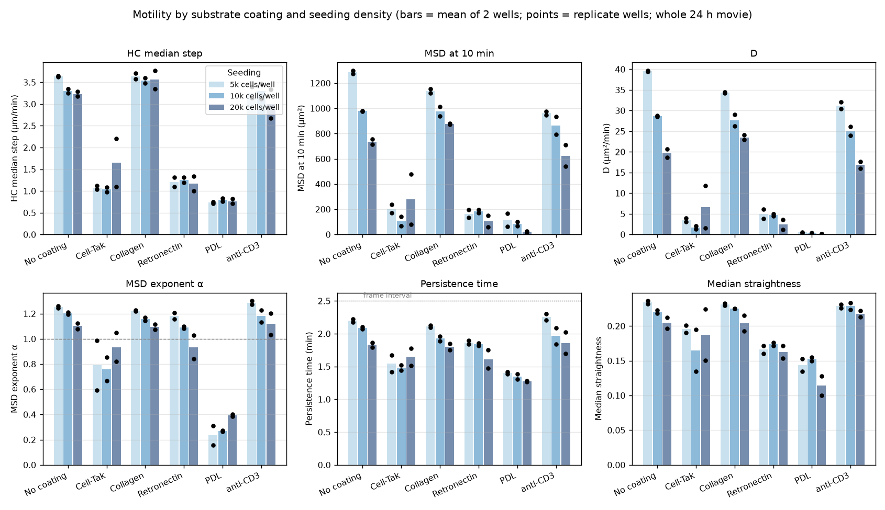
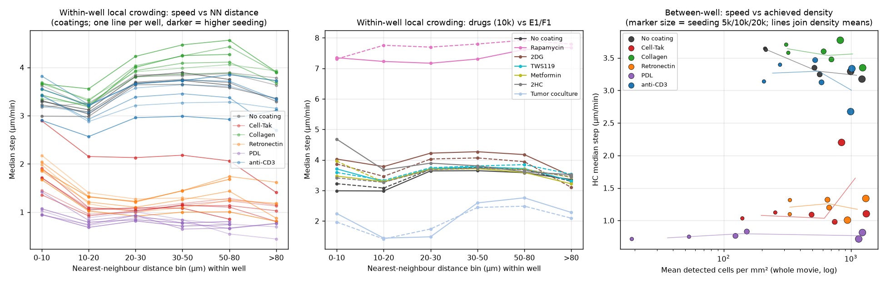
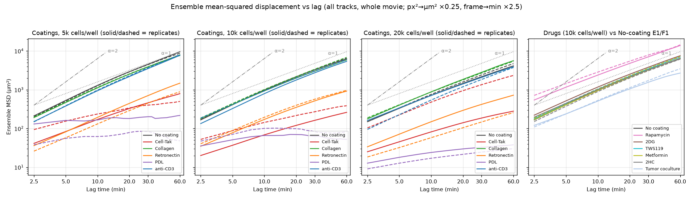
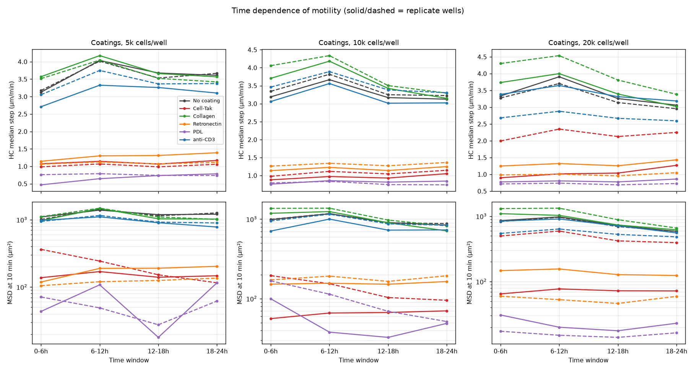
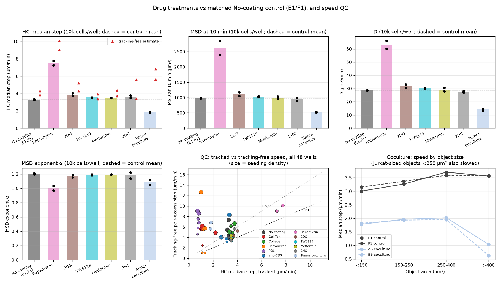

# Jurkat motility across coatings, seeding density, time and drug treatments

Source tables: `well_summary.csv` (window = `all` unless stated), `speed_vs_density.csv`, per-well `analysis/motility_hoct/msd_all.csv`, and `analysis/states_hoct.parquet` for the coculture size split. Replication unit = well (2 wells per condition x density). Numbers are well means with the two replicate values in parentheses; fold changes are vs the two No-coating wells at the same seeding density (drugs: vs E1/F1). No per-cell statistics are used. Speeds are per-frame step lengths at 2.5 min sampling and are lower bounds on path speed; MSD at a fixed lag (10 min) is used as the primary movement metric. Units: µm/min, µm², µm²/min.

## Key findings

1. **Cell-Tak and Retronectin reduce Jurkat motility ~3-fold in step speed and ~5-10-fold in MSD(10 min) at every seeding density.** HC median step 1.04-1.26 µm/min vs 3.23-3.63 for No coating (0.30-0.38×, except the Cell-Tak 20k replicate H2 at 2.20); MSD(10 min) 0.11-0.19× (Cell-Tak 5k/10k, Retronectin all) and D 0.06-0.17×. ~45-50% of cell-frames are in the plate-wide "stationary" class (<1.07 µm/min) vs 12-13% on No coating. *Confidence: high* for direction and approximate magnitude (both replicates at all three densities, bidirectional tracking agreement 0.86-0.93, confirmed by the tracking-free estimate at 5k Retronectin), *medium* for the exact speed values at ≥10k because the tracking-free estimate disagrees there (see finding 9).
2. **Collagen does not slow cells** (step 1.00×, 1.07×, 1.10×; MSD10 0.89×, 1.00×, 1.19×; D 0.87×, 0.97×, 1.20× at 5k/10k/20k; α within 0.05 of control). *Confidence: high* (replicates agree within 3-10%, effect smaller than the control replicate range at 20k).
3. **anti-CD3 (5 µg/ml) causes neither arrest nor measurable clustering, only a mild reduction in net displacement.** Step 0.90-1.00× of control, MSD10 0.75×, 0.88×, 0.85×, D 0.79-0.88×; frac_stationary 0.12-0.13 identical to control; cluster_fraction 0.049 vs 0.028 (5k), 0.134 vs 0.077 (10k), 0.225 vs 0.236 (20k). *Confidence: medium* — the 12-25% MSD reduction is consistent in sign across all 6 wells but the 20k replicates differ (G6 3.34 vs H6 2.67 µm/min), and the 10k clustering excess (+0.06) is of the same size as replicate spread at 20k.
4. **Slowing on Retronectin is a slow random walk, not confinement; slowing on Cell-Tak is partly confinement.** Retronectin α = 1.18, 1.09, 0.93 (local slope 10→30 min 0.85-1.18, control 1.01-1.14) with MSD rising 12-20× from 2.5 to 30 min, like control (14-22×). Cell-Tak α = 0.79, 0.76 (5k, 10k) with replicates 0.59-0.99 and local slope 0.48-0.90, i.e. subdiffusive at all lags, with ~50% stationary occupancy. *Confidence: medium* (replicate α spread on Cell-Tak is 0.2-0.4; the 2.5 min lag MSD of slow wells is partly a localisation-noise floor, see caveats).
5. **Seeding density reduces net displacement much more than step speed (No coating):** 5k→10k→20k gives step 3.63→3.30→3.23 (−9%, −11%), MSD10 1287→978→736 (−24%, −43%), D 39.5→28.7→19.7 (−28%, −50%), α 1.25→1.20→1.10, persistence time 2.20→2.09→1.83 min, while median NN distance falls 28.7→16.8→13.3 µm. Cell-Tak/Retronectin reduce step speed by 60-70% — 6× larger than the effect of the full 4-fold seeding range — so coating effects are not a crowding artefact. *Confidence: high* for the trend (monotonic in all metrics, replicate CV <3% for step and MSD10), *medium* for its interpretation because achieved density also triples within each well over 24 h (finding 7).
6. **Within wells, cells with a neighbour at 10-20 µm move ~20% slower than cells with a neighbour at 30-50 µm** (ratio 1.17-1.25 in all 6 No-coating wells, 1.25 Collagen, 1.16 anti-CD3, 1.09-1.15 for 2DG/TWS119/Metformin/2HC) and this crowding effect is absent on Cell-Tak (1.09), Retronectin (1.01), PDL (0.99) and under Rapamycin (1.01). The 0-10 µm (touching) bin is intermediate for motile conditions (3.0-3.6 µm/min) but is the *fastest* bin on Cell-Tak/Retronectin (1.4-2.9 µm/min), consistent with touching-cell segmentation/linking noise rather than biology. *Confidence: high* for the existence of the ~20% local-crowding effect in motile wells.
7. **Time: speed peaks at 6-12 h in every motile well and then declines; whether cells end slower than they started depends on density.** No-coating late/early (18-24 h vs 0-6 h) step ratio = 1.15, 1.16 (5k), 0.98, 0.96 (10k), 0.92, 0.90 (20k); MSD10 ratio = 1.10, 1.25 (5k), 0.85, 0.89 (10k), 0.68, 0.71 (20k). Detected density rises ~2.7-3.8× within every well over 24 h (e.g. E1 327→874 cells/mm², G1 580→1573). Collagen 20k shows the largest decline (MSD10 0.57, 0.50). *Confidence: high* for the 6-12 h peak (30 of 30 motile wells, +5 to +48%), *medium* for "slowing as wells fill" because density and time are confounded within a well.
8. **Rapamycin (0.01 µM) more than doubles motility; the other drugs have no detectable effect; tumour coculture halves Jurkat displacement.** Rapamycin step 7.51 (7.27, 7.76) vs 3.30 (3.25, 3.35) = 2.28×, tracking-free 2.35×, MSD10 2.68×, D 2.20×, frac_fast 0.75 vs 0.44, α 1.00 vs 1.20. 2DG 1.17× step (4.02, 3.70) and 1.14× MSD10; TWS119 1.08×/1.06×; Metformin 1.06×/1.01×; 2HC 1.10×/0.97× — all within ~15% and with replicates overlapping or near the control range. Coculture: step 0.55× (1.83, 1.78), MSD10 0.53×, D 0.49×; Jurkat-sized objects (<250 µm²) still move at 1.8-2.0 µm/min vs 3.0-3.4 in E1/F1, so the slowing is not only the tumour cells. *Confidence: high* for Rapamycin direction (both replicates, both tracked and tracking-free estimators agree; but bidirectional tracking agreement is 0.64 so the magnitude is uncertain at the ±20% level), *high* for null effects of TWS119/Metformin/2HC, *low-medium* for 2DG (+17%, one replicate within 10% of control), *medium* for coculture (detected density only 0.29× of control, tracking-free estimate disagrees 3.2-3.7×).
9. **Tracked and tracking-free speed disagree (>1.5×) in 24 of 48 wells; speed in those wells is uncertain.** All 6 PDL wells (6.4-12.7×), all 6 Cell-Tak wells (2.2-5.7×), Retronectin at 10k/20k (4.3-12.6×; the 5k wells agree: 0.79×, 0.97×), both coculture wells (3.2-3.7×), and six 20k/10k motile wells (G1 2.23×, H1 1.72×, G6 2.49×, H6 1.51×, E3 1.77×, H3 1.76×). The tracking-free estimate rises with density even in controls (1.08-1.20× at 5k, 1.15-1.32× at 10k, 1.7-2.2× at 20k), so it is itself density-biased; its value in slow wells (5.5-6.8 µm/min) is nearly constant and does not track seeding density, which points to estimator saturation at small NN spacing rather than to a true speed of 5-6 µm/min. *Confidence: high* that these wells' absolute speeds are uncertain; the direction of the Cell-Tak/Retronectin effect is still supported (finding 1).
10. **PDL wells are not interpretable as biology.** Detected density is 19-53 cells/mm² at 5k and 124-152 at 10k (9-28% of matched controls), but 1151-1232 at 20k (≈ control); median image intensity is 99-122 vs 133-171 elsewhere, and intensity drift over the movie is +0.27 to +0.75 (others mostly <0.2). MSD is nearly flat with lag (α 0.16-0.40; MSD 2.5→30 min only 1.5-2.7×, 9-200 µm²), i.e. at the localisation-noise floor. Steps (0.72-0.83 µm/min) sit at the noise floor. *Confidence: high* that PDL data are compromised by detection/focus; whether cells on PDL are truly arrested cannot be decided from this dataset.

## Q1. Coating effects at each density

HC median step (µm/min); fold vs No coating at same density:

| Condition | 5k (r1, r2) | fold | 10k (r1, r2) | fold | 20k (r1, r2) | fold |
|---|---|---|---|---|---|---|
| No coating | 3.63 (3.64, 3.62) | 1.00× | 3.30 (3.25, 3.35) | 1.00× | 3.23 (3.29, 3.17) | 1.00× |
| Cell-Tak | 1.08 (1.12, 1.03) | 0.30× | 1.04 (0.98, 1.09) | 0.31× | 1.65 (1.10, 2.20) | 0.51× |
| Collagen | 3.64 (3.70, 3.58) | 1.00× | 3.54 (3.48, 3.60) | 1.07× | 3.56 (3.35, 3.77) | 1.10× |
| Retronectin | 1.21 (1.31, 1.10) | 0.33× | 1.26 (1.20, 1.32) | 0.38× | 1.17 (1.34, 1.01) | 0.36× |
| PDL | 0.73 (0.72, 0.75) | 0.20× | 0.80 (0.83, 0.76) | 0.24× | 0.77 (0.82, 0.72) | 0.24× |
| anti-CD3 | 3.27 (3.14, 3.40) | 0.90× | 3.30 (3.12, 3.47) | 1.00× | 3.01 (3.34, 2.67) | 0.93× |

MSD at 10 min (µm²):

| Condition | 5k (r1, r2) | fold | 10k (r1, r2) | fold | 20k (r1, r2) | fold |
|---|---|---|---|---|---|---|
| No coating | 1287 (1300, 1273) | 1.00× | 978 (978, 978) | 1.00× | 736 (714, 757) | 1.00× |
| Cell-Tak | 204 (172, 237) | 0.16× | 106 (69, 144) | 0.11× | 280 (82, 479) | 0.38× |
| Collagen | 1139 (1123, 1155) | 0.89× | 976 (937, 1014) | 1.00× | 878 (881, 874) | 1.19× |
| Retronectin | 163 (194, 132) | 0.13× | 183 (172, 195) | 0.19× | 104 (149, 58) | 0.14× |
| PDL | 114 (166, 62) | 0.09× | 83 (66, 101) | 0.09× | 21 (24, 17) | 0.03× |
| anti-CD3 | 962 (947, 978) | 0.75× | 864 (794, 933) | 0.88× | 625 (709, 541) | 0.85× |

D (µm²/min, MSD slope/4 over 2.5-25 min) and α (log-log exponent):

| Condition | D 5k | fold | D 10k | fold | D 20k | fold | α 5k (r1, r2) | α 10k | α 20k |
|---|---|---|---|---|---|---|---|---|---|
| No coating | 39.5 (39.7, 39.4) | 1.00× | 28.6 (28.8, 28.5) | 1.00× | 19.7 (18.6, 20.7) | 1.00× | 1.25 (1.24, 1.26) | 1.20 (1.21, 1.20) | 1.10 (1.08, 1.12) |
| Cell-Tak | 3.5 (4.0, 3.0) | 0.09× | 1.7 (1.4, 2.1) | 0.06× | 6.7 (1.5, 11.8) | 0.34× | 0.79 (0.99, 0.59) | 0.76 (0.85, 0.67) | 0.93 (0.82, 1.05) |
| Collagen | 34.3 (34.2, 34.5) | 0.87× | 27.7 (26.2, 29.1) | 0.97× | 23.5 (24.1, 22.9) | 1.20× | 1.22 (1.23, 1.22) | 1.16 (1.14, 1.17) | 1.10 (1.12, 1.07) |
| Retronectin | 5.0 (6.1, 3.9) | 0.13× | 4.8 (4.5, 5.0) | 0.17× | 2.4 (3.6, 1.2) | 0.12× | 1.18 (1.21, 1.16) | 1.09 (1.10, 1.08) | 0.93 (1.03, 0.84) |
| PDL | 0.50 (0.56, 0.44) | 0.01× | 0.32 (0.28, 0.35) | 0.01× | 0.17 (0.19, 0.14) | 0.01× | 0.23 (0.16, 0.31) | 0.27 (0.27, 0.27) | 0.39 (0.38, 0.40) |
| anti-CD3 | 31.2 (30.4, 32.0) | 0.79× | 25.1 (24.0, 26.1) | 0.88× | 16.8 (17.7, 16.0) | 0.86× | 1.29 (1.27, 1.30) | 1.18 (1.23, 1.13) | 1.12 (1.03, 1.20) |

Persistence time (min) and median straightness:

| Condition | τp 5k | τp 10k | τp 20k | straightness 5k | 10k | 20k |
|---|---|---|---|---|---|---|
| No coating | 2.20 (2.17, 2.22) | 2.09 (2.10, 2.07) | 1.83 (1.79, 1.86) | 0.23 | 0.22 | 0.20 |
| Cell-Tak | 1.54 (1.67, 1.42) | 1.48 (1.52, 1.44) | 1.65 (1.51, 1.78) | 0.20 | 0.16 (0.13, 0.19) | 0.19 (0.15, 0.22) |
| Collagen | 2.11 (2.12, 2.09) | 1.93 (1.89, 1.96) | 1.80 (1.85, 1.75) | 0.23 | 0.22 | 0.20 |
| Retronectin | 1.87 (1.90, 1.84) | 1.84 (1.86, 1.82) | 1.61 (1.75, 1.47) | 0.17 | 0.17 | 0.16 |
| PDL | 1.40 (1.39, 1.42) | 1.35 (1.30, 1.39) | 1.27 (1.28, 1.26) | 0.14 | 0.15 | 0.11 |
| anti-CD3 | 2.26 (2.21, 2.30) | 1.97 (2.09, 1.84) | 1.86 (1.70, 2.02) | 0.23 | 0.23 | 0.22 |

Occupancy (plate-wide thresholds: stationary <1.07, fast >3.71 µm/min) and clustering:

| Condition | density | frac_stationary (r1, r2) | frac_fast (r1, r2) | cluster_fraction (r1, r2) | control cluster_fraction |
|---|---|---|---|---|---|
| No coating | 5k / 10k / 20k | 0.119 / 0.129 / 0.125 | 0.481 / 0.436 / 0.425 | 0.028 / 0.077 / 0.236 | — |
| Cell-Tak | 5k | 0.487 (0.471, 0.503) | 0.098 (0.099, 0.096) | 0.036 (0.051, 0.022) | 0.028 |
| Cell-Tak | 10k | 0.506 (0.533, 0.480) | 0.085 (0.070, 0.099) | 0.138 (0.167, 0.109) | 0.077 |
| Cell-Tak | 20k | 0.358 (0.479, 0.238) | 0.195 (0.097, 0.293) | 0.266 (0.298, 0.233) | 0.236 |
| Collagen | 5k / 10k / 20k | 0.112 / 0.114 / 0.108 | 0.481 / 0.466 / 0.468 | 0.068 / 0.153 / 0.245 | 0.028 / 0.077 / 0.236 |
| Retronectin | 5k | 0.443 (0.401, 0.484) | 0.091 (0.102, 0.080) | 0.027 (0.023, 0.031) | 0.028 |
| Retronectin | 10k | 0.424 (0.444, 0.403) | 0.123 (0.109, 0.136) | 0.085 (0.090, 0.080) | 0.077 |
| Retronectin | 20k | 0.460 (0.396, 0.524) | 0.098 (0.138, 0.058) | 0.180 (0.203, 0.157) | 0.236 |
| PDL | 5k / 10k / 20k | 0.639 / 0.618 / 0.643 | 0.039 / 0.047 / 0.038 | 0.039 / 0.107 / 0.343 | 0.028 / 0.077 / 0.236 |
| anti-CD3 | 5k | 0.121 (0.125, 0.117) | 0.425 (0.403, 0.447) | 0.049 (0.038, 0.060) | 0.028 |
| anti-CD3 | 10k | 0.117 (0.125, 0.108) | 0.429 (0.404, 0.454) | 0.134 (0.153, 0.116) | 0.077 |
| anti-CD3 | 20k | 0.127 (0.108, 0.145) | 0.376 (0.433, 0.319) | 0.225 (0.221, 0.228) | 0.236 |

Summary:
- **Slow cells:** Cell-Tak and Retronectin (step 0.30-0.38×, MSD10 0.11-0.19×, D 0.06-0.17×, stationary occupancy ~4× control). The Cell-Tak 20k pair disagrees (G2 1.10 vs H2 2.20 µm/min; H2 also has lower detected density, 844 vs 1321 cells/mm², and α 1.05) so the 20k Cell-Tak mean (0.51×) is not reliable; G2 alone matches the 5k/10k wells.
- **No slowing:** Collagen (within ±10% in step, 0.89-1.19× in MSD10). Collagen wells have 2-2.4× the cluster_fraction of controls at 5k/10k (0.068 vs 0.028; 0.153 vs 0.077) with no speed penalty.
- **anti-CD3:** no arrest (stationary fraction unchanged), 10-25% lower MSD10/D with α unchanged, i.e. slightly shorter effective steps rather than confinement. Clustering excess is small (+0.02 at 5k, +0.06 at 10k, none at 20k) and smaller than Collagen's. *Interpretation:* at 5 µg/ml plate-bound anti-CD3 with 2.5 min sampling, we see no evidence of the stop signal/arrest expected from TCR engagement; either the coating did not engage efficiently or the arrest is transient and below the resolution of this metric set.
- **PDL:** see Q6; not interpretable.

## Q2. Density dependence

Between wells (means of 2 wells), within condition:

| Condition | metric | 5k | 10k | 20k | 10k/5k | 20k/5k |
|---|---|---|---|---|---|---|
| No coating | cells/mm² | 213 | 543 | 1108 | 2.54 | 5.19 |
| No coating | NN distance (µm) | 28.7 | 16.8 | 13.3 | 0.59 | 0.46 |
| No coating | HC step | 3.63 | 3.30 | 3.23 | 0.91 | 0.89 |
| No coating | MSD10 | 1287 | 978 | 736 | 0.76 | 0.57 |
| No coating | D | 39.5 | 28.6 | 19.7 | 0.72 | 0.50 |
| No coating | α | 1.25 | 1.20 | 1.10 | | |
| No coating | τp (min) | 2.20 | 2.09 | 1.83 | 0.95 | 0.83 |
| Collagen | HC step | 3.64 | 3.54 | 3.56 | 0.97 | 0.98 |
| Collagen | MSD10 | 1139 | 976 | 878 | 0.86 | 0.77 |
| Collagen | D | 34.3 | 27.7 | 23.5 | 0.81 | 0.68 |
| anti-CD3 | HC step | 3.27 | 3.30 | 3.01 | 1.01 | 0.92 |
| anti-CD3 | MSD10 | 962 | 864 | 625 | 0.90 | 0.65 |
| anti-CD3 | D | 31.2 | 25.1 | 16.8 | 0.80 | 0.54 |
| Retronectin | HC step | 1.21 | 1.26 | 1.17 | 1.04 | 0.97 |
| Retronectin | MSD10 | 163 | 183 | 104 | 1.12 | 0.64 |
| Cell-Tak | HC step | 1.08 | 1.04 | 1.65* | 0.96 | 1.53* |
| Cell-Tak | MSD10 | 204 | 106 | 280* | 0.52 | 1.37* |

\* 20k Cell-Tak driven by the discordant H2 well.

- In motile conditions, step speed is nearly density-independent (−2 to −11% over a 5-fold range of achieved density) while MSD10 and D fall by 25-50%, accompanied by lower α (1.25→1.10) and shorter persistence time (2.2→1.8 min). *Interpretation:* crowding mainly randomises direction (more frequent reorientation/collisions) rather than slowing instantaneous movement.
- Within wells (`speed_vs_density.csv`, NN-distance bins pooled over wells, median step µm/min):

| Condition | 0-10 | 10-20 | 20-30 | 30-50 | 50-80 | >80 | (30-50)/(10-20) |
|---|---|---|---|---|---|---|---|
| No coating | 3.27 | 3.11 | 3.75 | 3.78 | 3.73 | 3.52 | 1.22 (per well 1.17-1.25) |
| Collagen | 3.55 | 3.31 | 3.98 | 4.15 | 4.22 | 3.82 | 1.25 |
| anti-CD3 | 3.39 | 2.98 | 3.41 | 3.47 | 3.46 | 3.23 | 1.16 |
| Cell-Tak | 1.84 | 1.21 | 1.22 | 1.31 | 1.28 | 1.10 | 1.09 |
| Retronectin | 1.93 | 1.24 | 1.12 | 1.26 | 1.39 | 1.13 | 1.01 |
| PDL | 1.08 | 0.78 | 0.90 | 0.77 | 0.70 | 0.67 | 0.99 |
| Rapamycin | 7.33 | 7.49 | 7.43 | 7.55 | 7.77 | 7.74 | 1.01 |
| 2DG / TWS119 / Metformin / 2HC | 3.65-4.04 | 3.28-3.62 | 3.69-4.13 | 3.71-4.17 | 3.64-4.06 | 3.29-3.49 | 1.09-1.15 |
| Tumor coculture | 2.10 | 1.42 | 1.61 | 2.52 | 2.62 | 2.19 | 1.77 |

- The frame-level `cells_per_mm2` binning in `speed_vs_density.csv` is confounded with time (density in every well rises ~3× over the movie, and speed has a 6-12 h peak), so it is non-monotonic (e.g. E1: 2.80 at 200-300, 3.50 at 400-600, 3.06 at 800-1200 cells/mm²) and is not used for inference here.
- **Separating crowding from coating:** (i) the within-well crowding effect in motile wells is ~20% and the between-well seeding effect on step is ~10%; the Cell-Tak/Retronectin effect is −62 to −70% at matched seeding and at matched achieved density (e.g. Retronectin 5k at 331 cells/mm², step 1.21, vs No coating 10k at 543 cells/mm², step 3.30). (ii) On adhesive coatings the local-crowding dependence disappears (ratio 1.01-1.09) — cells are slow regardless of neighbours. (iii) Collagen wells reach higher achieved density than controls at 5k/10k (316 vs 213; 657 vs 543 cells/mm²) yet are not slower, so the small positive Collagen fold at 20k (1.10-1.19×) is, if anything, understated by density.

## Q3. MSD regime

α (fit 2.5-25 min), local slope α(10→30 min) = log(MSD30/MSD10)/log 3, persistence time, and MSD at three lags:

| Condition | wells | α | α_local(10→30) | τp (min) | MSD 2.5 min | MSD 10 | MSD 30 | MSD30/MSD2.5 |
|---|---|---|---|---|---|---|---|---|
| No coating 5k | C1, D1 | 1.24, 1.26 | 1.14, 1.14 | 2.17, 2.22 | 212, 202 | 1300, 1273 | 4536, 4452 | 21-22 |
| No coating 10k | E1, F1 | 1.21, 1.20 | 1.10, 1.10 | 2.10, 2.07 | 167, 171 | 978, 978 | 3279, 3269 | 19-20 |
| No coating 20k | G1, H1 | 1.08, 1.12 | 1.01, 1.05 | 1.79, 1.86 | 151, 149 | 714, 757 | 2170, 2410 | 14-16 |
| Collagen (all) | C3-H3 | 1.07-1.23 | 1.03-1.14 | 1.75-2.12 | 177-196 | 874-1155 | 2702-3925 | 14-20 |
| anti-CD3 (all) | C6-H6 | 1.03-1.30 | 0.98-1.21 | 1.70-2.30 | 95-186 | 541-978 | 1841-3694 | 13-25 |
| Retronectin 5k | C4, D4 | 1.21, 1.16 | 1.18, 1.12 | 1.90, 1.84 | 36, 26 | 194, 132 | 708, 452 | 17-20 |
| Retronectin 10k | E4, F4 | 1.10, 1.08 | 1.00, 0.98 | 1.86, 1.82 | 35, 40 | 172, 195 | 517, 571 | 14-15 |
| Retronectin 20k | G4, H4 | 1.03, 0.84 | 0.94, 0.85 | 1.75, 1.47 | 34, 18 | 149, 58 | 420, 148 | 8-12 |
| Cell-Tak 5k | C2, D2 | 0.99, 0.59 | 0.90, 0.48 | 1.67, 1.42 | 41, 94 | 172, 237 | 460, 401 | 4-11 |
| Cell-Tak 10k | E2, F2 | 0.85, 0.67 | 0.79, 0.58 | 1.52, 1.44 | 20, 52 | 69, 144 | 163, 271 | 5-8 |
| Cell-Tak 20k | G2, H2 | 0.82, 1.05 | 0.75, 0.94 | 1.51, 1.78 | 25, 104 | 82, 479 | 186, 1350 | 7-13 |
| PDL (all) | C5-H5 | 0.16-0.40 | −0.17-0.33 | 1.26-1.42 | 9-131 | 17-166 | 25-202 | 1.5-2.7 |
| Rapamycin | A1, B1 | 1.03, 0.97 | 0.99, 0.92 | 1.72, 1.64 | 544, 716 | 2392, 2855 | 7068, 7864 | 11-13 |
| Coculture | A6, B6 | 1.05, 1.12 | 1.02, 1.08 | 1.69, 1.82 | 121, 110 | 511, 531 | 1559, 1732 | 13-16 |
| 2DG/TWS119/Metformin/2HC | A2-B5 | 1.14-1.22 | 1.07-1.12 | 1.88-2.12 | 151-221 | 898-1177 | 3088-3818 | 17-20 |

- **Controls and Collagen/anti-CD3 are mildly superdiffusive** (α 1.1-1.3 over 2.5-25 min, local slope ≈1.0-1.2 at 10-30 min), i.e. a persistent random walk whose persistence is barely resolved at 2.5 min sampling (τp 1.8-2.3 min < frame interval; these τp values are extrapolations of the velocity autocorrelation and should be read as "≤ one frame").
- **Retronectin: slow random walk.** α ≈ control at 5k (1.16-1.21), 1.08-1.10 at 10k, and MSD grows 14-20× from 2.5 to 30 min exactly as in controls; the entire effect is a ~6-8-fold lower MSD amplitude. Only H4 (20k) is subdiffusive (0.84), and H4 is the well with the extreme tracking-free disagreement (12.6×).
- **Cell-Tak: subdiffusive / partly confined.** α 0.59-0.99 (mean 0.76-0.79 at 5k/10k), local slope 0.48-0.90, MSD grows only 4-11× over 2.5→30 min; stationary occupancy ~50%. *Interpretation:* a mixture of arrested (adhered) cells and a motile minority, which produces a sub-linear ensemble MSD; the replicate spread in α (e.g. C2 0.99 vs D2 0.59) tracks the MSD(2.5 min) noise floor (41 vs 94 µm²), so part of the "confinement" signature is the localisation/mislink floor flattening the short-lag MSD.
- **Rapamycin** has α ≈ 1.0 (vs 1.2): more diffusive despite 2.3× faster steps; τp 1.6-1.7 min. *Interpretation:* with 18-19 µm steps at a NN spacing of 18-23 µm, linking ambiguity (bidir agreement 0.64) can randomise apparent direction, so the lower α may be partly a tracking artefact.
- **PDL** MSD is flat (1.5-2.7× over a 12× lag range): consistent with immobile objects plus localisation noise (floor ≈ 9-13 µm² at 20k → σ ≈ 1.5-1.8 µm per coordinate), not with a biological confinement regime.

## Q4. Time dependence (0-6 h vs 18-24 h)

HC step (µm/min) by window and MSD10 (µm²), per well; late/early = 18-24 h / 0-6 h:

| Well | Condition | 0-6h | 6-12h | 12-18h | 18-24h | step late/early | MSD10 0-6h → 18-24h | MSD late/early | cells/mm² 0-6h → 18-24h |
|---|---|---|---|---|---|---|---|---|---|
| C1 / D1 | No coating 5k | 3.13 / 3.17 | 4.04 / 4.02 | 3.68 / 3.53 | 3.61 / 3.67 | 1.15 / 1.16 | 1100→1210 / 1012→1265 | 1.10 / 1.25 | 96→362 / 111→346 |
| E1 / F1 | No coating 10k | 3.19 / 3.34 | 3.67 / 3.82 | 3.17 / 3.25 | 3.12 / 3.22 | 0.98 / 0.96 | 986→843 / 994→881 | 0.85 / 0.89 | 327→874 / 274→836 |
| G1 / H1 | No coating 20k | 3.33 / 3.28 | 3.91 / 3.70 | 3.26 / 3.14 | 3.06 / 2.95 | 0.92 / 0.90 | 857→587 / 830→586 | 0.68 / 0.71 | 580→1573 / 664→1951 |
| C3 / D3 | Collagen 5k | 3.57 / 3.52 | 4.18 / 4.05 | 3.66 / 3.52 | 3.57 / 3.42 | 1.00 / 0.97 | 972→1024 / 1112→1013 | 1.05 / 0.91 | 163→491 / 178→500 |
| E3 / F3 | Collagen 10k | 3.71 / 4.06 | 4.18 / 4.34 | 3.42 / 3.50 | 3.15 / 3.29 | 0.85 / 0.81 | 1185→712 / 1367→821 | 0.60 / 0.60 | 369→1119 / 271→1044 |
| G3 / H3 | Collagen 20k | 3.74 / 4.30 | 4.00 / 4.54 | 3.39 / 3.81 | 3.02 / 3.38 | 0.81 / 0.79 | 1096→620 / 1312→660 | 0.57 / 0.50 | 570→2144 / 357→1446 |
| C6 / D6 | anti-CD3 5k | 2.71 / 3.06 | 3.33 / 3.75 | 3.26 / 3.36 | 3.10 / 3.38 | 1.14 / 1.10 | 979→780 / 945→897 | 0.80 / 0.95 | 108→332 / 143→447 |
| E6 / F6 | anti-CD3 10k | 3.06 / 3.46 | 3.56 / 3.89 | 3.01 / 3.38 | 3.02 / 3.30 | 0.99 / 0.95 | 709→732 / 950→838 | 1.03 / 0.88 | 337→900 / 276→802 |
| G6 / H6 | anti-CD3 20k | 3.38 / 2.68 | 3.65 / 2.88 | 3.31 / 2.67 | 3.19 / 2.59 | 0.94 / 0.97 | 842→556 / 547→484 | 0.66 / 0.88 | 588→1549 / 504→1647 |
| C4 / D4 | Retronectin 5k | 1.15 / 1.06 | 1.30 / 1.13 | 1.31 / 1.07 | 1.39 / 1.12 | 1.21 / 1.05 | 119→203 / 105→136 | 1.71 / 1.29 | 185→519 / 185→519 |
| E4 / F4 | Retronectin 10k | 1.14 / 1.26 | 1.23 / 1.34 | 1.14 / 1.27 | 1.25 / 1.36 | 1.10 / 1.08 | 152→164 / 172→194 | 1.08 / 1.13 | 349→1103 / 344→1073 |
| G4 / H4 | Retronectin 20k | 1.25 / 0.98 | 1.32 / 1.01 | 1.26 / 0.96 | 1.43 / 1.05 | 1.15 / 1.07 | 147→124 / 60→59 | 0.84 / 1.00 | 634→2203 / 456→1583 |
| C2 / D2 | Cell-Tak 5k | 1.07 / 0.99 | 1.15 / 1.07 | 1.07 / 0.99 | 1.17 / 1.06 | 1.09 / 1.08 | 138→147 / 363→116 | 1.07 / 0.32 | 136→411 / 71→239 |
| E2 / F2 | Cell-Tak 10k | 0.88 / 0.98 | 0.97 / 1.12 | 0.93 / 1.04 | 1.05 / 1.15 | 1.19 / 1.17 | 56→70 / 195→95 | 1.25 / 0.49 | 381→1231 / 238→823 |
| G2 / H2 | Cell-Tak 20k | 0.90 / 1.99 | 1.01 / 2.35 | 1.04 / 2.13 | 1.27 / 2.25 | 1.41 / 1.13 | 65→72 / 499→394 | 1.11 / 0.79 | 636→2218 / 416→1408 |
| A1 / B1 | Rapamycin | 5.91 / 5.83 | 7.99 / 8.61 | 7.57 / 8.25 | 7.28 / 7.83 | 1.23 / 1.34 | 2012→2391 / 2246→2857 | 1.19 / 1.27 | 314→519 / 212→372 |
| A2 / B2 | 2DG | 3.67 / 3.45 | 4.37 / 4.13 | 3.99 / 3.60 | 4.00 / 3.66 | 1.09 / 1.06 | 1139→1088 / 1046→955 | 0.96 / 0.91 | 205→726 / 288→981 |
| A3 / B3 | TWS119 | 3.31 / 3.37 | 4.12 / 3.97 | 3.43 / 3.51 | 3.42 / 3.46 | 1.03 / 1.03 | 1092→914 / 1047→892 | 0.84 / 0.85 | 210→725 / 246→735 |
| A4 / B4 | Metformin | 3.10 / 3.13 | 3.83 / 4.00 | 3.37 / 3.39 | 3.52 / 3.47 | 1.14 / 1.11 | 813→920 / 975→910 | 1.13 / 0.93 | 206→827 / 211→786 |
| A5 / B5 | 2HC | 3.20 / 3.17 | 3.82 / 3.78 | 3.85 / 3.53 | 3.82 / 3.46 | 1.19 / 1.09 | 923→921 / 827→851 | 1.00 / 1.03 | 156→764 / 253→807 |
| A6 / B6 | Coculture | 1.39 / 1.49 | 1.75 / 1.83 | 1.87 / 1.70 | 2.03 / 1.94 | 1.46 / 1.30 | 264→553 / 421→474 | 2.09 / 1.13 | 105→250 / 100→233 |

- **Universal 6-12 h peak:** in all 30 motile wells (controls, Collagen, anti-CD3, drugs) step speed is higher in 6-12 h than in 0-6 h (+5 to +29%; Rapamycin +35 to +48%) (e.g. C1 3.13→4.04, E1 3.19→3.67, Rapamycin 5.9→8.0-8.6), then declines. *Interpretation:* recovery/settling after plating during the first 6 h, followed by a density- or medium-dependent decline.
- **Early vs late:** at 5k, cells end faster than they start (step 1.15×, MSD10 1.10-1.25× for controls); at 10k they end at the starting speed (0.96-0.98×) with 11-15% lower MSD10; at 20k they end 8-10% slower with 29-32% lower MSD10. Collagen 10k/20k shows the strongest late decline (step 0.79-0.85×, MSD10 0.50-0.60×), and these wells reach the highest end densities (1044-2144 cells/mm²).
- Detected density rises 2.7-3.8× in every well over 24 h (this is faster than a Jurkat doubling and likely includes cells settling into the focal plane / improving detection; it is not analysed here). Because density and time co-vary within a well, "slowing as wells fill" cannot be separated from a time effect within one well, but the ordering across seeding densities (5k speeds up, 20k slows) is consistent with a density-driven decline in net displacement.
- Slow coatings show no 6-12 h peak and a small monotonic increase in step (late/early 1.05-1.21 on Retronectin, 1.08-1.41 on Cell-Tak), with MSD10 trends that differ between replicates (Cell-Tak D2 0.32 vs C2 1.07) — these are at the noise floor and not interpreted.

## Q5. Drug effects vs E1/F1 (10k cells/well, No coating)

| Condition | wells | cells/mm² (r1, r2) | HC step (r1, r2) | fold | tracking-free step | fold | MSD10 (r1, r2) | fold | D (r1, r2) | fold | α (r1, r2) | frac_fast | frac_stationary |
|---|---|---|---|---|---|---|---|---|---|---|---|---|---|
| Control | E1, F1 | 543 (569, 517) | 3.30 (3.25, 3.35) | 1.00× | 4.07 (4.29, 3.85) | 1.00× | 978 (978, 978) | 1.00× | 28.6 (28.8, 28.5) | 1.00× | 1.20 (1.21, 1.20) | 0.436 | 0.129 |
| Rapamycin 0.01 µM | A1, B1 | 354 (415, 292) | 7.51 (7.27, 7.76) | **2.28×** | 9.56 (9.04, 10.09) | 2.35× | 2624 (2392, 2855) | **2.68×** | 63.1 (60.1, 66.1) | 2.20× | 1.00 (1.03, 0.97) | 0.754 | 0.039 |
| 2DG 100 µM | A2, B2 | 510 (427, 593) | 3.86 (4.02, 3.70) | 1.17× | 4.76 (5.22, 4.30) | 1.17× | 1115 (1177, 1053) | 1.14× | 31.8 (33.0, 30.5) | 1.11× | 1.17 (1.15, 1.19) | 0.507 | 0.104 |
| TWS119 1 µM | A3, B3 | 454 (436, 472) | 3.54 (3.53, 3.56) | 1.08× | 3.66 (3.36, 3.95) | 0.90× | 1032 (1020, 1044) | 1.06× | 30.3 (29.8, 30.7) | 1.06× | 1.19 (1.20, 1.18) | 0.469 | 0.116 |
| Metformin 150 µM | A4, B4 | 469 (480, 457) | 3.49 (3.48, 3.49) | 1.06× | 4.03 (3.72, 4.34) | 0.99× | 992 (954, 1030) | 1.01× | 29.2 (27.9, 30.6) | 1.02× | 1.19 (1.19, 1.19) | 0.461 | 0.115 |
| 2HC 5 mM | A5, B5 | 456 (416, 497) | 3.64 (3.77, 3.50) | 1.10× | 4.50 (5.59, 3.41) | 1.11× | 949 (1000, 898) | 0.97× | 27.6 (28.2, 27.0) | 0.96× | 1.18 (1.14, 1.22) | 0.480 | 0.111 |
| Tumor coculture | A6, B6 | 159 (164, 154) | 1.81 (1.83, 1.78) | **0.55×** | 6.22 (6.82, 5.61) | 1.53× | 521 (511, 531) | **0.53×** | 14.1 (13.4, 14.8) | 0.49× | 1.08 (1.05, 1.12) | 0.239 | 0.336 |

Coculture speed by object area (all cell-frames from `states_hoct.parquet`):

| Area bin (µm²) | A6 median step | B6 | E1 (control) | F1 (control) | A6 frac <1.07 | E1 frac <1.07 |
|---|---|---|---|---|---|---|
| <150 | 1.78 | 1.82 | 3.00 | 3.15 | 0.33 | 0.15 |
| 150-250 | 1.96 | 1.93 | 3.27 | 3.37 | 0.29 | 0.14 |
| 250-400 | 2.02 | 1.95 | 3.71 | 3.59 | 0.33 | 0.11 |
| >400 | 1.04 | 0.62 | 3.56 | 3.57 | 0.51-0.61 | 0.11 |

- **Rapamycin:** a large, replicate-consistent increase in every movement metric (step 2.28×, MSD10 2.68×, D 2.20×, frac_fast 0.75 vs 0.44, frac_stationary 0.04 vs 0.13) that is also seen by the tracking-free estimator (2.35×), and that is present in every time window (5.9 vs 3.2-3.3 µm/min already at 0-6 h). The replicate spread (7.27 vs 7.76) is 7%. Caveats: bidirectional tracking agreement drops to 0.64 (control 0.83) because 2.5 min steps (~19 µm) approach the NN spacing (18-23 µm), so individual tracks are less reliable and α (1.0) may be biased low; detected density is 0.65× control. *Interpretation:* an effect this large at 10 nM is unexpected for an mTORC1 inhibitor and should be verified (well identity, drug addition, imaging conditions) before biological interpretation.
- **2DG:** +17% step, +14% MSD10, +11% D; replicate B2 (3.70) is within 10% of control. Weak, direction consistent in both wells; low-medium confidence.
- **TWS119, Metformin, 2HC:** no effect beyond replicate spread (step +6 to +10%, MSD10 −3 to +6%, D −4 to +6%; α unchanged).
- **Tumour coculture:** step 0.55×, MSD10 0.53×, D 0.49×, frac_stationary 2.6× control. Only 159 cells/mm² were detected (0.29× of E1/F1 despite the same total seeding), and objects >400 µm² (presumptive tumour cells, 15% of cell-frames) are nearly immobile (0.6-1.0 µm/min), but Jurkat-sized objects (<250 µm²) are also slowed to 1.8-2.0 µm/min (0.57-0.60× of same-size control objects) with 29-33% stationary occupancy vs 14-15%. The tracking-free estimate (6.2 µm/min) disagrees by 3.2-3.7×, so the absolute value is uncertain. Coculture speed also rises monotonically over the movie (1.4→2.0 µm/min, MSD10 264→553 in A6). *Interpretation:* consistent with Jurkat cells engaging/adhering to tumour cells, but segmentation of Jurkat-tumour contacts (merged objects, mislinks) could contribute.

## Q6. Where tracked and tracking-free speeds disagree

Ratio = tracking-free pair-excess step / HC median step (whole movie). Flags: ratio outside 0.67-1.5; detected density <50% of matched control; intensity drift >0.3; bidirectional agreement <0.7.

| Group | Wells | ratio | bidir_full | comment |
|---|---|---|---|---|
| PDL | C5, D5, E5, F5, G5, H5 | 6.4, 7.7, 8.2, 9.9, 10.6, 12.7 | 0.90-0.92 | detected density 9-28% of control at 5k/10k; intensity drift +0.27 to +0.75; MSD flat → noise floor |
| Cell-Tak | C2, D2, E2, F2, G2, H2 | 2.2, 5.4, 5.7, 5.1, 5.6, 2.2 | 0.78-0.91 | tracking-free value 2.4-6.2 µm/min nearly constant; H2 (2.2 µm/min tracked) discordant with G2 (1.1) |
| Retronectin ≥10k | E4, F4, G4, H4 | 4.6, 4.3, 4.3, 12.6 | 0.86-0.91 | 5k wells agree (C4 0.79, D4 0.97) |
| Coculture | A6, B6 | 3.7, 3.2 | 0.88-0.89 | mixed population; low detection |
| Dense motile wells | G1, H1, G6, H6, E3, H3 | 2.2, 1.7, 2.5, 1.5, 1.8, 1.8 | 0.65-0.81 | tracking-free rises with density even in controls (5k 1.08-1.20, 10k 1.15-1.32, 20k 1.7-2.2) |
| Rapamycin | A1, B1 | 1.24, 1.30 | 0.64 | agree within the control range, but low bidir agreement because step ≈ NN spacing |
| All other wells | 24 wells (incl. Rapamycin) | 0.79-1.48 | 0.64-0.93 | agree |

- In all disagreeing wells the tracking-free value is *higher*. Two patterns argue that the disagreement reflects limits of the tracking-free estimator rather than mis-tracked fast cells: (i) in slow wells the tracking-free value is ~5.5-6.8 µm/min irrespective of seeding density or coating, and (ii) it increases systematically with density in control wells where tracked speed does not. Nonetheless, following the pre-specified rule, absolute speeds in the 24 flagged wells are treated as uncertain. The *direction* of the Cell-Tak/Retronectin effect is still supported by: Retronectin 5k wells where both estimators agree (1.04-1.06 vs 1.10-1.31 µm/min); bidirectional agreement 0.86-0.93 (higher than in controls); frac_stationary 0.40-0.53 vs 0.12-0.13; MSD(10 min) 5-10× lower with α near 1 (Retronectin).
- **PDL:** combination of very low detection at 5k/10k, lower median intensity (99-122 vs 133-171), the largest intensity drift on the plate, a flat MSD at the noise floor and step ≈ noise floor means the PDL motility values should not be used. The normal detected density at 20k (1151-1232 cells/mm²) with the same near-zero movement is compatible with strong adhesion/arrest, but equally with out-of-focus or low-contrast objects being segmented and tracked as static blobs; the data cannot distinguish these.

## Caveats

- **Temporal resolution:** at 2.5 min sampling, step lengths underestimate path speed (cells reorient within a frame; τp 1.3-2.3 min is below the frame interval), so all speeds are lower bounds and ratios between fast and slow conditions are compressed. MSD at 10 min is less affected and is the primary metric; the α fit over 2.5-25 min is sensitive to the short-lag noise floor in slow wells.
- **Localisation-noise floor:** MSD at 2.5 min in immobile wells is 9-13 µm² (PDL 20k) → centroid jitter σ ≈ 1.5-1.8 µm; steps of 0.7-0.8 µm/min correspond to this floor. Cell-Tak/Retronectin steps (1.0-1.3 µm/min) are only ~1.4× above it; their MSD(2.5 min) values (18-104 µm²) are inflated by occasional mislinks (RMS step 1.7-4.1 µm/min vs median 1.0-1.3), which flattens the short-lag MSD and biases α downward.
- **Replication:** n = 2 wells per condition x density; no inferential statistics are given. Replicate agreement for controls is excellent (step within 1-4%, MSD10 within 2-6%), so effects <10-15% (2DG, TWS119, Metformin, 2HC, anti-CD3 speed) are not distinguishable from noise; effects ≥2× (Cell-Tak, Retronectin, Rapamycin, coculture) are far outside it.
- **Density confound within wells:** detected cell density rises 2.7-3.8× over 24 h in all wells (faster than cell division alone), so the frame-level density binning and the time-window comparison are confounded; the between-well seeding comparison and the NN-distance binning are the cleaner density contrasts.
- **Tracking reliability varies with condition:** bidirectional agreement ranges 0.64 (Rapamycin) to 0.93 (slow coatings); dense 20k wells 0.65-0.81. Fast or dense conditions may have inflated apparent randomness (lower α, lower straightness).
- **Discordant replicates:** Cell-Tak 20k (G2 vs H2: 1.10 vs 2.20 µm/min, MSD10 82 vs 479), anti-CD3 20k (G6 vs H6: 3.34 vs 2.67), Retronectin 20k (G4 vs H4 MSD10 149 vs 58). Conclusions for these pairs rely on the other densities.
- **Coculture segmentation:** label-free segmentation of Jurkat cells in contact with tumour cells may merge objects or mislink; the size-split analysis is indicative only.
- Biological interpretations above are labelled as such; the dataset supports statements about measured motility, not mechanism.

## Figures

- `fig_motility_coating_density.png` — speed, MSD(10 min), D, α, persistence time, straightness by coating x density with replicate points.
- `fig_motility_msd_curves.png` — ensemble MSD vs lag per well (coatings at each density; drugs vs E1/F1).
- `fig_motility_speed_vs_density.png` — within-well speed vs NN-distance bin (coatings; drugs) and between-well speed vs achieved density.
- `fig_motility_time_windows.png` — step speed and MSD(10 min) per 6 h window.
- `fig_motility_drugs_qc.png` — drug panel vs E1/F1 (with tracking-free estimates), tracked vs tracking-free scatter for all wells, coculture speed by object size.
