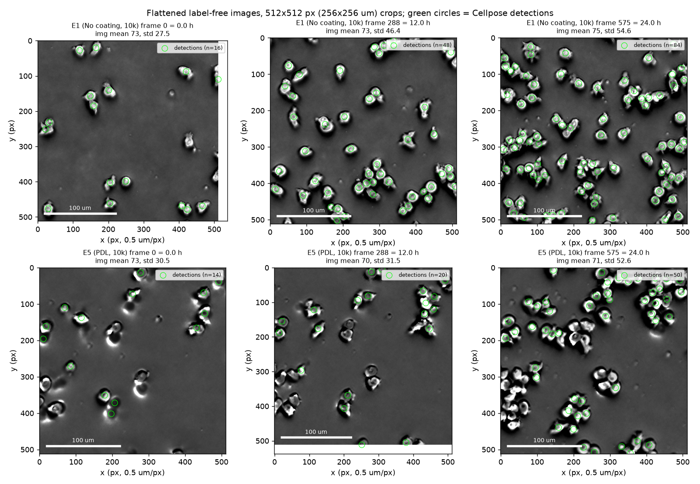
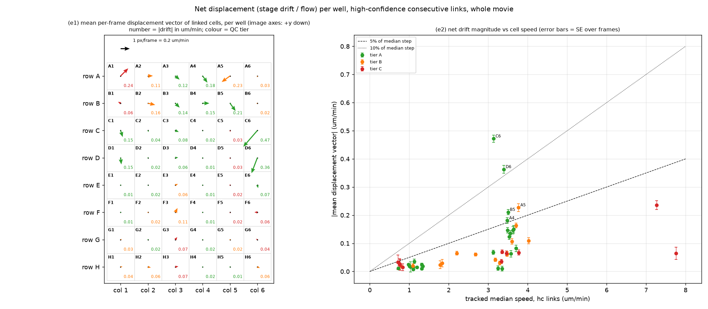

# Image-analysis QC of the 48-well Jurkat MCAM plate (2026-10-19 sample data)

Scope: per-well reliability of segmentation (Cellpose-SAM) and tracking (HOCT/ILP) for the 24 h, 576-frame, 0.5 um/px acquisition. Inputs: `well_summary.csv`, `frame_series.csv`, per-well `validation_hoct.json`, `bookkeeping_per_frame.csv`, `ingest_meta.json`, `states_hoct.parquet`, `debris.parquet`, `detections.parquet`, `bubble_mask.npy` and image crops from `flat.zarr`. Outputs of this QC: this report, `well_qc_tiers.csv`, and `fig_qc_*.png`. No pipeline code or configuration was changed.

Conventions: "bidir" = fraction of forward links reproduced by time-reversed tracking over the whole movie (`time_reversal_full.bidirectional_fraction`); "mini-GT F1" = mean edge-F1 of the production HOCT tracks (`full:hoct`) against the multi-linker consensus in the three 20-frame validation crops; "frame-skip" = agreement between 2-step and chained 1-step links; "hc speed" = `hc_median_step_um_min`; "track-free speed" = `trackfree_pair_excess_step_um_min`; "ambiguity index" = median step per frame divided by the mean cell spacing 1000/sqrt(cells/mm2) (dimensionless). "Count-jump frames" = frames whose count deviates from the 7-frame running median by more than max(10 %, 3 sqrt(N)), i.e. beyond Poisson noise.

## Key findings

1. **Linking reliability is set by step-length relative to cell spacing, not by density alone.** The ambiguity index (step per frame / mean spacing) explains the whole-movie bidirectional fraction with Pearson r = -0.93 (density alone r = -0.35, speed alone r = -0.77). Adherent wells (Cell-Tak, Retronectin, PDL; hc speed 0.7-1.3 um/min) link almost perfectly at any density (bidir 0.86-0.93, mini-GT F1 0.90-0.98, frame-skip 0.79-0.94), whereas motile wells (3.1-3.8 um/min) degrade from bidir 0.85-0.91 at 5k to 0.65-0.73 at 20k (G1 0.73, H1 0.71, H3 0.70, G6 0.68, G3 0.65; F1 0.76-0.84; frame-skip 0.48-0.59). The Rapamycin wells (A1, B1; 7.3-7.8 um/min, the fastest cells on the plate) are the least reliable of all at only ~300-400 cells/mm2 (bidir 0.64, F1 0.71-0.73, frame-skip 0.45-0.46). *Confidence: high* (three independent validators agree; the per-density breakdown inside each well shows the same gradient, e.g. G1 bidir 0.69 in dense vs 0.85 in sparse neighbourhoods).

2. **Tracking quality decays over the movie as density rises.** Mean bidir falls from 0.88 (0-6 h) to 0.86, 0.85 and 0.80 (18-24 h); for motile 20k wells from 0.77-0.81 to 0.57-0.69. The 18-24 h window of G1, G3, G6, H1, H3 (and A1/B1 at all times) should not be used for speed, straightness, persistence or state-transition metrics. Within tier-A wells the hc speed is stable across the four windows (median CV 8 %). *Confidence: high.*

3. **Speed is under-estimated by tracking in fast-dense wells; in adherent wells the track-free estimator, not the tracker, is wrong.** In motile wells with bidir < 0.8 the tracked speed is only 0.40-0.67x the track-free estimate (G6 0.40, G1 0.45, E3 0.57, H3 0.57, H1 0.58, H6 0.66, A5 0.67, G3 0.67), consistent with lost links of the fastest cells. In adherent/clustered wells the ratio is 0.08-0.46 (H4 0.08, H5 0.08, G5 0.10, E5 0.12, E2 0.18, ...) but there the track-free pair-excess value (5-13 um/min) is contradicted by optical flow (0.4-1.0 um/min), by frame-skip agreement 0.80-0.94 and by bidir 0.86-0.93; the pair-excess statistic is dominated by segmentation flicker in touching/aggregated cells and must not be used as the reference for adherent conditions. Note that C4/D4 (Retronectin 5k, few clusters) give ratio 1.03-1.26, i.e. the two estimators agree when clusters are rare. *Confidence: medium-high.*

4. **The 4-8x count increase (median 4.95x; apparent doubling time 10.4 h, range 8.0-29.5 h) is not proliferation and, outside PDL, mostly not a segmentation artefact: real objects accumulate in the field of view.** Evidence: (i) the fraction of image pixels deviating > 40 DN from background rises 2.4-7.3x in parallel (median coverage-fold/count-fold = 0.79 in non-PDL wells); (ii) the net track flux across the FOV border is negative in 48/48 wells (median -0.44 of the net count gain), so cells are not walking in from the sides; (iii) counts grow exponentially from frame 0 with no settling plateau (median 3.9 % of the 24 h increase occurs in the first 2 h, 8.7 % by 4 h; fold per 6 h window 1.55 / 1.34 / 1.55 / 1.51); (iv) the tracker balances the gain with "divisions" (median 5.3 divisions per net new cell; E1: 11,771 divisions for 1,890 net new cells), which are therefore de-novo appearances, not mitoses; (v) the central FOV (2.5 % of the well floor) holds ~5 % of the seeded cells at t = 0 and ~23-26 % at 24 h for all three seeding densities. The most plausible mechanism is continuous settling/centripetal transport of cells from suspension (convection or meniscus flow) into the imaged centre. Rapamycin (1.8-2.1x) and tumour coculture (2.7-2.9x) wells accumulate less. *Confidence: medium for the mechanism, high that fold-change and `division_rate_per_1000cells_h` (21-67, i.e. 2-7 %/h) must not be read as proliferation.*

5. **PDL at 5k/10k (C5, D5, E5, F5) is a detection failure, not low cell numbers.** Detected density is 0.08-0.31x the same-seeding median (19, 53, 152, 124 cells/mm2), while the "bubble" mask covers 9-21 % of the FOV in exactly these wells (0-1 % elsewhere) and, on inspection of `flat.zarr`, the masked patches are dense cell aggregates, not bubbles. Detections per unit of high-contrast image area are 3-10x lower than in other wells at frame 0 (456-2089 vs ~5000-9000); the frame-0 median detection footprint in E5 is 1144 px (286 um2) vs 485 px in E1, i.e. clumps are segmented as single objects; median cell intensity starts 88-93 DN (vs 120-170 DN elsewhere) and climbs +0.27 to +0.75 over 24 h as focus/contrast improves. PDL at 20k (G5, H5) has no mask, normal density (1150-1230 cells/mm2) and normal F1 (0.94-0.97) - the aggregation/contrast problem is density dependent. The low 5k/10k PDL densities, their speeds and cluster fractions are not interpretable. *Confidence: high.* Figure `fig_qc_crops_E5_vs_E1.png`.

6. **Focal-plane toggling is detectable in specific wells.** G6: 77 count-jump frames between 2 h and 20 h in which the count drops >= 10 % while median intensity rises +9 % (r(dn, dI) = -0.83), i.e. the "best plane" alternates between two z positions; G5 17 frames (same signature, r = -0.84); F5 45 frames in which median area jumps +28 % (defocused plane); B1 21, H2 14, F6 12 (including a 55 % jump at 23 h). F6 also shows the strongest slow drift of a non-PDL well (intensity +52 %, area -87 % relative trend; 0-6 h median area 445 um2 vs 231 um2 at 18-24 h). Plate-wide slow drift exists in almost all wells: median intensity trend +11 %, median area trend -32 % (first-6 h median 249 um2 -> last-6 h 197 um2). *Confidence: high for the toggling wells, medium that the slow area decline is optical (sharpening) rather than cells compacting - the two cannot be separated with a single focal plane.*

7. **Segmented footprints are 1.5-3x larger than a Jurkat cross-section and depend on density and time.** Whole-movie median areas are 156-341 um2 (plate median 211 um2; expected 80-120 um2 for 11-12 um cells) - the masks include the bright-body-plus-halo footprint at 0.3 NA. Median area falls with seeding density (254 / 220 / 178 um2 at 5k / 10k / 20k; r = -0.33 with log density) and with time (above). Cluster fraction rises 0.04 -> 0.10 -> 0.25 across 5k -> 10k -> 20k and 3-5x within each well over 24 h. Debris (rejected small/dim objects) is negligible (<= 0.55 % of cell-frames). Area-based metrics must be compared only within a window and within a density group. *Confidence: high.*

8. **No common stage drift; small well-specific flows in rows A-D.** Mean displacement vectors differ in direction between wells (a stage drift would be identical for all cameras). The largest are C6 (0.47 um/min = 15 % of the median step; direction -x,+y), D6 (0.36 um/min, 11 %), A5/B5/A4 (0.18-0.23 um/min, 5-6 %); rows E-H are all <= 0.07 um/min (median 0.02). Radial convergence toward the FOV centre is negligible (|v_rad| <= 4 % of step). Border region (40 px margin) holds 5.4 % of cell-frames; it carries 20 % of track starts and 14 % of track ends, i.e. ~3-4x elevated per cell-frame, as expected from cells crossing the edge. Drift is irrelevant for step/speed metrics but would add ~200 um2 to a 30 min MSD in C6/D6 (a few percent) and should be subtracted before computing straightness/persistence there. *Confidence: high.*

9. **The HOCT edge confidence is saturated and carries no information.** `hc_step_fraction` >= 0.998 and `mean_edge_conf` >= 0.996 in every well, so "high-confidence" speed equals all-link speed. The `bidir` flag per link is the only usable per-link quality filter. *Confidence: high.*

10. **A persistent concentric interference-like intensity pattern is visible in the flattened images (e.g. E1 at 24 h).** Detection density is not modulated by it (radial profile flat within +-25 %), so it is cosmetic for counting, but it may affect intensity-based features locally. *Confidence: low (not pursued).*

## Task 1 - Tracking reliability per well

Figure: 

Summary by seeding density (coating rows C-H only):

| seeding | mean cells/mm2 | mean bidir | mean mini-GT F1 | mean frame-skip | mean median area (um2) | mean cluster fraction |
|---|---|---|---|---|---|---|
| 5k | 223 | 0.90 | 0.95 | 0.85 | 251 | 0.041 |
| 10k | 529 | 0.85 | 0.92 | 0.78 | 208 | 0.116 |
| 20k | 1091 | 0.79 | 0.88 | 0.71 | 177 | 0.249 |

Summary by motility class (all 48 wells):

| class | n | bidir mean (min-max) | F1 mean (min-max) | frame-skip mean (min-max) | speed ratio mean (min-max) | hc speed mean | track-free mean |
|---|---|---|---|---|---|---|---|
| adherent (hc < 1.5 um/min) | 17 | 0.90 (0.86-0.93) | 0.95 (0.90-0.98) | 0.88 (0.79-0.94) | 0.29 (0.08-1.26) | 1.01 | 5.85 |
| intermediate | 3 | 0.85 (0.78-0.89) | 0.92 (0.90-0.95) | 0.78 (0.69-0.83) | 0.35 (0.27-0.45) | 1.94 | 5.78 |
| motile (hc >= 2.5 um/min) | 28 | 0.79 (0.64-0.90) | 0.88 (0.71-0.96) | 0.68 (0.45-0.87) | 0.78 (0.40-1.05) | 3.75 | 5.01 |

Correlations with whole-movie bidir: ambiguity index r = -0.93; hc speed r = -0.77; density r = -0.35. The dense + fast expectation holds, but speed matters more than density: 20k adherent wells (G2, G4, H4, H5) are tier A while 10k Rapamycin wells are tier C.

Wells where **speed estimates are unreliable**:
- Tracked speed biased low by lost links (motile, bidir < 0.80, ratio < 0.7): A1, B1 (ratio ~0.8 but bidir 0.64 and frame-skip 0.45 - the 2.5 min interval is too long for 7-8 um/min cells), G1, G3, G6, H1, H3, E3, H6, A5. For these, prefer the track-free estimate or report speed from the 0-6 h window only (bidir 0.77-0.81 there).
- Track-free estimate invalid (adherent/clustered; ratio 0.08-0.46 while tracking validators are all > 0.8): C2, D2, E2, F2, G2, H2 (Cell-Tak), E4, F4, G4, H4 (Retronectin), all PDL, A6/B6 (coculture). Use the tracked speed and treat values ~0.7-1.3 um/min as being near the localisation-noise floor (1 px/frame = 0.2 um/min).

Per-well table (sorted by seeding density then speed):

| well | condition | seeded | cells/mm2 | hc speed (um/min) | track-free speed (um/min) | ratio tracked/track-free | ambiguity (step/spacing) | bidir full | bidir 0-6h | bidir 18-24h | mini-GT F1 | frame-skip agr. | tier |
|---|---|---|---|---|---|---|---|---|---|---|---|---|---|
| C5 | PDL | 5000 | 19 | 0.72 | 4.60 | 0.16 | 0.01 | 0.92 | 0.94 | 0.91 | 0.97 | 0.90 | C |
| D5 | PDL | 5000 | 53 | 0.75 | 5.82 | 0.13 | 0.01 | 0.92 | 0.92 | 0.92 | 0.94 | 0.89 | C |
| D2 | Cell-Tak | 5000 | 140 | 1.03 | 5.54 | 0.19 | 0.03 | 0.90 | 0.90 | 0.90 | 0.92 | 0.83 | A |
| D4 | Retronectin | 5000 | 331 | 1.10 | 1.06 | 1.03 | 0.05 | 0.93 | 0.94 | 0.92 | 0.97 | 0.92 | A |
| C2 | Cell-Tak | 5000 | 255 | 1.12 | 2.44 | 0.46 | 0.04 | 0.90 | 0.92 | 0.89 | 0.97 | 0.86 | A |
| C4 | Retronectin | 5000 | 332 | 1.31 | 1.04 | 1.26 | 0.06 | 0.93 | 0.94 | 0.92 | 0.98 | 0.94 | A |
| C6 | anti-CD3 | 5000 | 207 | 3.14 | 3.16 | 0.99 | 0.11 | 0.90 | 0.92 | 0.89 | 0.95 | 0.87 | A |
| D6 | anti-CD3 | 5000 | 277 | 3.40 | 3.56 | 0.95 | 0.14 | 0.89 | 0.91 | 0.87 | 0.96 | 0.83 | A |
| D3 | Collagen | 5000 | 322 | 3.58 | 4.03 | 0.89 | 0.16 | 0.85 | 0.88 | 0.82 | 0.93 | 0.75 | A |
| D1 | No coating | 5000 | 215 | 3.62 | 4.33 | 0.84 | 0.13 | 0.88 | 0.91 | 0.85 | 0.95 | 0.82 | A |
| C1 | No coating | 5000 | 212 | 3.64 | 3.93 | 0.93 | 0.13 | 0.87 | 0.91 | 0.85 | 0.93 | 0.82 | A |
| C3 | Collagen | 5000 | 310 | 3.70 | 4.10 | 0.90 | 0.16 | 0.85 | 0.88 | 0.82 | 0.92 | 0.78 | A |
| F5 | PDL | 10000 | 124 | 0.76 | 7.55 | 0.10 | 0.02 | 0.91 | 0.89 | 0.91 | 0.95 | 0.86 | C |
| E5 | PDL | 10000 | 152 | 0.83 | 6.79 | 0.12 | 0.03 | 0.91 | 0.92 | 0.90 | 0.97 | 0.89 | C |
| E2 | Cell-Tak | 10000 | 746 | 0.98 | 5.60 | 0.18 | 0.07 | 0.91 | 0.93 | 0.89 | 0.97 | 0.92 | A |
| F2 | Cell-Tak | 10000 | 491 | 1.09 | 5.53 | 0.20 | 0.06 | 0.88 | 0.90 | 0.86 | 0.90 | 0.79 | B |
| E4 | Retronectin | 10000 | 674 | 1.20 | 5.52 | 0.22 | 0.08 | 0.91 | 0.93 | 0.89 | 0.97 | 0.91 | A |
| F4 | Retronectin | 10000 | 654 | 1.32 | 5.66 | 0.23 | 0.08 | 0.90 | 0.92 | 0.88 | 0.97 | 0.88 | A |
| B6 | Tumor coculture | 10000 | 154 | 1.78 | 5.61 | 0.32 | 0.06 | 0.89 | 0.90 | 0.88 | 0.95 | 0.83 | B |
| A6 | Tumor coculture | 10000 | 164 | 1.83 | 6.82 | 0.27 | 0.06 | 0.88 | 0.90 | 0.87 | 0.90 | 0.81 | B |
| E6 | anti-CD3 | 10000 | 588 | 3.12 | 3.74 | 0.84 | 0.19 | 0.83 | 0.88 | 0.79 | 0.90 | 0.73 | A |
| E1 | No coating | 10000 | 569 | 3.25 | 4.29 | 0.76 | 0.19 | 0.83 | 0.89 | 0.78 | 0.91 | 0.73 | A |
| F1 | No coating | 10000 | 517 | 3.35 | 3.85 | 0.87 | 0.19 | 0.83 | 0.89 | 0.78 | 0.90 | 0.73 | A |
| F6 | anti-CD3 | 10000 | 524 | 3.47 | 4.45 | 0.78 | 0.20 | 0.79 | 0.87 | 0.73 | 0.88 | 0.65 | C |
| E3 | Collagen | 10000 | 703 | 3.48 | 6.16 | 0.56 | 0.23 | 0.76 | 0.82 | 0.72 | 0.84 | 0.61 | B |
| A4 | Metformin | 10000 | 480 | 3.48 | 3.72 | 0.94 | 0.19 | 0.83 | 0.89 | 0.79 | 0.93 | 0.77 | A |
| B4 | Metformin | 10000 | 457 | 3.49 | 4.34 | 0.80 | 0.19 | 0.82 | 0.89 | 0.78 | 0.91 | 0.73 | A |
| B5 | 2HC | 10000 | 497 | 3.50 | 3.41 | 1.03 | 0.20 | 0.86 | 0.91 | 0.82 | 0.94 | 0.76 | A |
| A3 | TWS119 | 10000 | 436 | 3.53 | 3.36 | 1.05 | 0.18 | 0.84 | 0.89 | 0.81 | 0.95 | 0.76 | A |
| B3 | TWS119 | 10000 | 472 | 3.56 | 3.95 | 0.90 | 0.19 | 0.82 | 0.87 | 0.78 | 0.93 | 0.72 | A |
| F3 | Collagen | 10000 | 610 | 3.60 | 4.91 | 0.73 | 0.22 | 0.77 | 0.83 | 0.74 | 0.87 | 0.64 | B |
| B2 | 2DG | 10000 | 593 | 3.70 | 4.30 | 0.86 | 0.23 | 0.79 | 0.87 | 0.74 | 0.89 | 0.66 | B |
| A5 | 2HC | 10000 | 416 | 3.77 | 5.59 | 0.67 | 0.19 | 0.82 | 0.90 | 0.78 | 0.87 | 0.68 | B |
| A2 | 2DG | 10000 | 427 | 4.02 | 5.22 | 0.77 | 0.21 | 0.79 | 0.89 | 0.73 | 0.85 | 0.70 | B |
| A1 | Rapamycin | 10000 | 415 | 7.27 | 9.04 | 0.80 | 0.37 | 0.64 | 0.77 | 0.56 | 0.71 | 0.45 | C |
| B1 | Rapamycin | 10000 | 292 | 7.76 | 10.09 | 0.77 | 0.33 | 0.64 | 0.81 | 0.54 | 0.73 | 0.46 | C |
| H5 | PDL | 20000 | 1151 | 0.72 | 9.07 | 0.08 | 0.06 | 0.92 | 0.94 | 0.90 | 0.97 | 0.93 | A |
| G5 | PDL | 20000 | 1232 | 0.82 | 8.61 | 0.09 | 0.07 | 0.90 | 0.91 | 0.89 | 0.94 | 0.87 | B |
| H4 | Retronectin | 20000 | 939 | 1.01 | 12.66 | 0.08 | 0.08 | 0.91 | 0.93 | 0.88 | 0.95 | 0.91 | A |
| G2 | Cell-Tak | 20000 | 1321 | 1.10 | 6.18 | 0.18 | 0.10 | 0.87 | 0.92 | 0.82 | 0.93 | 0.84 | A |
| G4 | Retronectin | 20000 | 1309 | 1.34 | 5.73 | 0.23 | 0.12 | 0.86 | 0.92 | 0.81 | 0.92 | 0.80 | A |
| H2 | Cell-Tak | 20000 | 844 | 2.20 | 4.89 | 0.45 | 0.16 | 0.78 | 0.84 | 0.74 | 0.92 | 0.69 | B |
| H6 | anti-CD3 | 20000 | 996 | 2.67 | 4.03 | 0.66 | 0.21 | 0.81 | 0.88 | 0.77 | 0.90 | 0.74 | B |
| H1 | No coating | 20000 | 1221 | 3.17 | 5.45 | 0.58 | 0.28 | 0.71 | 0.81 | 0.64 | 0.82 | 0.57 | B |
| G1 | No coating | 20000 | 995 | 3.29 | 7.35 | 0.45 | 0.26 | 0.73 | 0.81 | 0.69 | 0.84 | 0.59 | B |
| G6 | anti-CD3 | 20000 | 1018 | 3.34 | 8.30 | 0.40 | 0.27 | 0.68 | 0.77 | 0.63 | 0.78 | 0.48 | C |
| G3 | Collagen | 20000 | 1236 | 3.35 | 5.00 | 0.67 | 0.29 | 0.65 | 0.78 | 0.57 | 0.77 | 0.52 | C |
| H3 | Collagen | 20000 | 825 | 3.77 | 6.66 | 0.57 | 0.27 | 0.70 | 0.78 | 0.66 | 0.76 | 0.53 | C |

## Task 2 - Focus / detection drift

Figure: 

Figure: 

Detection-drift signatures used: slow drift = relative linear trend of median intensity and median area over the movie; abrupt change = count-jump frames beyond Poisson noise, and frame-to-frame changes > 10 % in median intensity or median area (these two are noisy in wells with < 150 cells, e.g. C5, D2, D5).

Interpretation of the PDL 5k/10k wells (detection failure, see Key finding 5):

| well | seeded | cells/mm2 | density / same-seeding median | bubble-mask fraction of FOV | median I 0-6h | median I 18-24h | I trend | detections per unit high-contrast area, f0 | same, f575 | median area 0-6h (um2) | hc speed (um/min) | bidir full | mini-GT F1 |
|---|---|---|---|---|---|---|---|---|---|---|---|---|---|
| C5 | 5000 | 19 | 0.08 | 0.17 | 91 | 142 | +0.63 | 456 | 871 | 242 | 0.72 | 0.92 | 0.97 |
| D5 | 5000 | 53 | 0.23 | 0.15 | 93 | 112 | +0.27 | 934 | 1751 | 237 | 0.75 | 0.92 | 0.94 |
| E5 | 10000 | 152 | 0.31 | 0.21 | 92 | 125 | +0.44 | 1696 | 2887 | 309 | 0.83 | 0.91 | 0.97 |
| F5 | 10000 | 124 | 0.26 | 0.09 | 88 | 150 | +0.75 | 2089 | 6589 | 326 | 0.76 | 0.91 | 0.95 |
| G5 | 20000 | 1232 | 1.14 | 0.00 | 100 | 142 | +0.47 | 4665 | 10131 | 231 | 0.82 | 0.90 | 0.94 |
| H5 | 20000 | 1151 | 1.06 | 0.00 | 106 | 133 | +0.32 | 6542 | 14106 | 197 | 0.72 | 0.92 | 0.97 |

What the crops show (`fig_qc_crops_E5_vs_E1.png`, 512x512 px = 256x256 um, green circles = accepted detections): E1 cells are isolated round bodies with a dark halo, detected nearly completely at all three times, and the number of visible cells in the same crop grows from ~20 to ~90 over 24 h (the accumulation of Key finding 4 is visible by eye). E5 cells at 0 h have a smeared, comet-like appearance (asymmetric halo = out-of-plane), aggregate into tight clumps by 12 h, and at 12 h and 24 h many well-contrasted cells, especially inside clumps, carry no detection. A full-frame view (not saved) shows the E5 FOV at 24 h to be at least as densely populated as E1, while only 790 vs 2534 objects are detected.

G1 / G3 / H1 check (lowest bidir among coating wells): no focus signature (0 count-jump frames; intensity trends -0.02, +0.17, +0.15), densities 995-1236 cells/mm2, hc speed 3.2-3.4 um/min, ambiguity index 0.26-0.29, bidir in dense neighbourhoods 0.61-0.69 vs 0.85-0.88 in sparse ones, bidir falling from 0.78-0.81 (0-6 h) to 0.57-0.69 (18-24 h). Their low bidir is a linking limitation from density x speed, not an imaging problem. G6 is different: it combines the same linking limitation with the strongest z-toggling on the plate (77 count-jump frames).

Per-well drift table (sorted by intensity trend):

| well | condition | median I 0-6h (DN) | median I 18-24h (DN) | I trend (rel) | median area 0-6h (um2) | median area 18-24h (um2) | area trend (rel) | count-jump frames | I-jump frames (>10%) | area-jump frames (>10%) | count fold |
|---|---|---|---|---|---|---|---|---|---|---|---|
| F5 | PDL | 88 | 150 | +0.75 | 326 | 151 | -1.03 | 45 | 32 | 129 | 5.49 |
| C5 | PDL | 91 | 142 | +0.63 | 242 | 189 | -0.34 | 0 | 71 | 107 | 4.72 |
| F6 | anti-CD3 | 100 | 146 | +0.52 | 445 | 231 | -0.87 | 12 | 0 | 16 | 4.29 |
| G5 | PDL | 100 | 142 | +0.47 | 231 | 148 | -0.62 | 17 | 25 | 1 | 4.65 |
| E5 | PDL | 92 | 125 | +0.44 | 309 | 197 | -0.60 | 0 | 28 | 0 | 4.51 |
| F2 | Cell-Tak | 127 | 163 | +0.37 | 294 | 203 | -0.52 | 0 | 0 | 2 | 5.30 |
| H5 | PDL | 106 | 133 | +0.32 | 197 | 142 | -0.45 | 0 | 1 | 0 | 5.48 |
| A2 | 2DG | 117 | 147 | +0.30 | 331 | 230 | -0.47 | 1 | 2 | 36 | 5.78 |
| H3 | Collagen | 124 | 152 | +0.28 | 303 | 185 | -0.67 | 0 | 0 | 3 | 8.02 |
| F4 | Retronectin | 134 | 162 | +0.27 | 277 | 198 | -0.46 | 0 | 12 | 81 | 5.08 |
| D5 | PDL | 93 | 112 | +0.27 | 237 | 182 | -0.33 | 0 | 1 | 15 | 5.24 |
| E3 | Collagen | 130 | 156 | +0.25 | 265 | 180 | -0.52 | 0 | 0 | 3 | 5.65 |
| A5 | 2HC | 109 | 125 | +0.20 | 397 | 295 | -0.36 | 0 | 0 | 9 | 7.30 |
| G3 | Collagen | 141 | 159 | +0.17 | 205 | 146 | -0.46 | 0 | 5 | 0 | 6.14 |
| G4 | Retronectin | 124 | 140 | +0.17 | 239 | 155 | -0.58 | 0 | 0 | 0 | 5.23 |
| D3 | Collagen | 125 | 140 | +0.16 | 305 | 228 | -0.38 | 2 | 91 | 152 | 4.39 |
| F3 | Collagen | 141 | 158 | +0.16 | 228 | 175 | -0.35 | 0 | 1 | 73 | 7.39 |
| H1 | No coating | 139 | 155 | +0.15 | 232 | 159 | -0.52 | 0 | 0 | 5 | 4.46 |
| H2 | Cell-Tak | 139 | 154 | +0.15 | 211 | 164 | -0.35 | 14 | 0 | 75 | 5.34 |
| B3 | TWS119 | 121 | 135 | +0.15 | 301 | 240 | -0.30 | 0 | 0 | 61 | 4.46 |
| E6 | anti-CD3 | 113 | 126 | +0.14 | 276 | 220 | -0.32 | 0 | 0 | 30 | 4.14 |
| B5 | 2HC | 134 | 147 | +0.12 | 253 | 218 | -0.16 | 0 | 41 | 55 | 4.61 |
| C1 | No coating | 136 | 146 | +0.12 | 278 | 248 | -0.20 | 0 | 52 | 125 | 6.33 |
| H4 | Retronectin | 148 | 160 | +0.12 | 253 | 189 | -0.40 | 0 | 7 | 4 | 5.33 |
| E2 | Cell-Tak | 138 | 149 | +0.11 | 173 | 157 | -0.15 | 0 | 0 | 2 | 4.99 |
| D2 | Cell-Tak | 134 | 144 | +0.11 | 239 | 230 | -0.08 | 0 | 14 | 187 | 4.94 |
| B6 | Tumor coculture | 131 | 141 | +0.10 | 232 | 204 | -0.15 | 0 | 0 | 9 | 2.69 |
| B1 | Rapamycin | 125 | 133 | +0.10 | 252 | 190 | -0.38 | 21 | 37 | 96 | 1.76 |
| A3 | TWS119 | 138 | 148 | +0.09 | 267 | 224 | -0.22 | 0 | 141 | 160 | 5.02 |
| H6 | anti-CD3 | 134 | 144 | +0.09 | 226 | 164 | -0.44 | 0 | 0 | 5 | 5.72 |
| B4 | Metformin | 124 | 132 | +0.09 | 274 | 237 | -0.21 | 0 | 0 | 28 | 5.62 |
| A6 | Tumor coculture | 128 | 136 | +0.08 | 267 | 224 | -0.21 | 0 | 0 | 8 | 2.90 |
| E1 | No coating | 136 | 144 | +0.08 | 192 | 159 | -0.26 | 0 | 0 | 0 | 3.93 |
| B2 | 2DG | 140 | 147 | +0.07 | 236 | 195 | -0.28 | 0 | 5 | 46 | 5.28 |
| G2 | Cell-Tak | 140 | 147 | +0.07 | 188 | 150 | -0.31 | 0 | 0 | 0 | 5.35 |
| A4 | Metformin | 145 | 149 | +0.05 | 233 | 208 | -0.16 | 0 | 40 | 40 | 5.59 |
| C4 | Retronectin | 121 | 125 | +0.05 | 298 | 281 | -0.10 | 0 | 2 | 19 | 4.20 |
| E4 | Retronectin | 139 | 144 | +0.04 | 232 | 197 | -0.22 | 0 | 0 | 41 | 4.89 |
| C3 | Collagen | 122 | 125 | +0.04 | 282 | 267 | -0.08 | 0 | 2 | 46 | 4.86 |
| G6 | anti-CD3 | 161 | 166 | +0.04 | 214 | 167 | -0.35 | 77 | 20 | 1 | 4.39 |
| C6 | anti-CD3 | 118 | 122 | +0.03 | 338 | 289 | -0.16 | 0 | 1 | 13 | 4.25 |
| A1 | Rapamycin | 157 | 157 | +0.02 | 191 | 151 | -0.32 | 2 | 7 | 7 | 2.07 |
| D6 | anti-CD3 | 132 | 130 | +0.01 | 255 | 258 | -0.04 | 0 | 2 | 11 | 4.96 |
| D1 | No coating | 133 | 133 | -0.00 | 245 | 235 | -0.06 | 0 | 3 | 20 | 5.05 |
| C2 | Cell-Tak | 162 | 161 | -0.01 | 204 | 208 | +0.00 | 1 | 24 | 147 | 4.61 |
| F1 | No coating | 153 | 151 | -0.02 | 196 | 169 | -0.21 | 0 | 0 | 5 | 4.73 |
| G1 | No coating | 170 | 167 | -0.02 | 170 | 151 | -0.16 | 0 | 0 | 56 | 4.32 |
| D4 | Retronectin | 123 | 120 | -0.04 | 284 | 290 | +0.01 | 0 | 3 | 52 | 4.38 |

## Task 3 - Border effects and drift / flow

Figure: 

Method: for every consecutive same-track link in `states_hoct.parquet` (all 48 wells, 23k-1.65M links per well), the per-frame mean of (dx, dy) was averaged over frames; SE is over frames. Radial velocity is the component along the vector from the FOV centre, restricted to cells > 300 px from the border to avoid edge truncation bias.

Results: border cell-frame fraction 5.4 % (range 1.4-10 %); border appearances are 20 % of all track starts and border ends 14 % of all track ends (median), ~3-4x the per-cell-frame rate of the interior, as expected for cells crossing the edge. Net border flux (appearances minus ends) is negative in every well, so lateral inflow does not explain the count increase. Mean displacement is < 0.1 um/min (< 3 % of the median step) in 43/48 wells; the five exceptions are in rows A-D with well-specific directions (table). No evidence of plate-wide stage drift; evidence of weak well-specific medium flow in C6/D6 (anti-CD3 5k, replicates agree in direction) and A4/A5/B5.

| well | condition | mean dx (px/frame) | mean dy (px/frame) | abs drift (um/min) | SE (um/min) | drift / median step | radial v (px/frame, +out) | SE | border cell-frame fraction | border appearances | border ends | net border flux | net count change |
|---|---|---|---|---|---|---|---|---|---|---|---|---|---|
| C6 | anti-CD3 | -1.54 | +1.78 | 0.47 | 0.012 | 0.153 | +0.04 | 0.04 | 0.048 | 729 | 1074 | -345 | +676 |
| D6 | anti-CD3 | -0.64 | +1.70 | 0.36 | 0.014 | 0.109 | -0.23 | 0.04 | 0.055 | 919 | 1405 | -486 | +1002 |
| A1 | Rapamycin | +0.83 | -0.84 | 0.24 | 0.016 | 0.034 | +0.10 | 0.06 | 0.054 | 1626 | 2921 | -1295 | +628 |
| A5 | 2HC | -0.92 | +0.67 | 0.23 | 0.014 | 0.062 | -0.78 | 0.04 | 0.046 | 1248 | 1465 | -217 | +1845 |
| B5 | 2HC | +0.62 | +0.86 | 0.21 | 0.009 | 0.062 | -0.21 | 0.03 | 0.061 | 1542 | 2600 | -1058 | +1764 |
| A4 | Metformin | +0.52 | +0.74 | 0.18 | 0.010 | 0.053 | -0.29 | 0.03 | 0.058 | 1415 | 2407 | -992 | +1916 |
| B2 | 2DG | +0.80 | +0.18 | 0.16 | 0.009 | 0.046 | -0.14 | 0.03 | 0.047 | 1268 | 2450 | -1182 | +2370 |
| C1 | No coating | +0.23 | +0.72 | 0.15 | 0.013 | 0.042 | -0.30 | 0.05 | 0.026 | 543 | 700 | -157 | +874 |
| B4 | Metformin | +0.73 | +0.00 | 0.15 | 0.010 | 0.044 | -0.32 | 0.03 | 0.055 | 1404 | 2206 | -802 | +1893 |
| D1 | No coating | +0.08 | +0.73 | 0.15 | 0.013 | 0.041 | -0.21 | 0.05 | 0.064 | 956 | 1412 | -456 | +806 |
| B3 | TWS119 | +0.48 | +0.48 | 0.14 | 0.009 | 0.040 | -0.00 | 0.03 | 0.057 | 1342 | 2407 | -1065 | +1652 |
| A3 | TWS119 | +0.47 | +0.40 | 0.12 | 0.010 | 0.036 | -0.09 | 0.03 | 0.041 | 1009 | 1693 | -684 | +1576 |

## Task 4 - Count inflation

Shape of n_cells(t): exponential-like increase from frame 0 in 46/48 wells (log-linear in the time-course figure), no initial settling phase and no plateau except in A1/B1 (Rapamycin; plateau after ~12-18 h at 1.8-2.1x) and partially A6/B6. Median fraction of the total 24 h increase reached by 2 h: 3.9 % (range -2 % to 15 %), by 4 h: 8.7 %, by 6 h: 14.7 %; fold per 6 h window (median) 1.55 / 1.34 / 1.55 / 1.51. The increase therefore does **not** happen in the first 2-4 h; it is continuous.

Relation to focus: across wells, count fold is only weakly correlated with intensity trend (r = 0.20) and E1/F1/G1 show 3.9-4.7x with essentially flat intensity (+-0.08) and modest area decline (-16 to -26 %), so focus drift is not the main driver outside PDL/F6. Image coverage (model-free) rises in parallel with counts (median coverage-fold / count-fold = 0.79 in non-PDL wells; coverage saturates at high density, so this ratio is a lower bound). The tracker attributes the gain to "divisions" (5.3 per net new cell), which are appearances of settling cells.

Guidance for cross-well comparison of density: compare wells only within the same time window; prefer 6-12 h (accumulation already 2x the design density spread, tracking still good) and report 0-6 h alongside; do not use `count_fold_change`, `apparent_doubling_time_h` or `division_rate_per_1000cells_h` as proliferation readouts; treat `cells_per_mm2` as "cells that have reached the focal plane in the well centre", which is also affected by coating (adherent cells stop being resuspended).

| well | condition | n first | n last | fold 24h | apparent doubling (h) | frac. of increase by 2h | by 4h | fold 0-6h | fold 6-12h | fold 12-18h | fold 18-24h | image-coverage fold | tracker divisions / net gain | net border flux |
|---|---|---|---|---|---|---|---|---|---|---|---|---|---|---|
| H3 | Collagen | 573 | 4593 | 8.02 | 8.0 | 0.06 | 0.09 | 1.99 | 1.48 | 1.52 | 1.79 | 4.04 | 6.0 | -1942 |
| F3 | Collagen | 440 | 3250 | 7.39 | 8.3 | 0.05 | 0.10 | 2.02 | 1.39 | 1.57 | 1.67 | 3.98 | 5.4 | -1354 |
| A5 | 2HC | 293 | 2138 | 7.30 | 8.4 | 0.02 | 0.06 | 1.71 | 1.67 | 1.70 | 1.50 | 7.34 | 4.3 | -217 |
| C1 | No coating | 164 | 1038 | 6.33 | 9.0 | 0.04 | 0.09 | 1.84 | 1.47 | 1.63 | 1.43 | 5.56 | 4.2 | -157 |
| G3 | Collagen | 1033 | 6343 | 6.14 | 9.2 | 0.04 | 0.09 | 1.66 | 1.50 | 1.51 | 1.63 | 3.97 | 5.9 | -3293 |
| A2 | 2DG | 367 | 2123 | 5.78 | 9.5 | 0.05 | 0.08 | 1.72 | 1.34 | 1.66 | 1.51 | 4.67 | 5.4 | -781 |
| H6 | anti-CD3 | 853 | 4876 | 5.72 | 9.5 | 0.05 | 0.11 | 1.77 | 1.36 | 1.51 | 1.57 | 3.10 | 6.1 | -2363 |
| E3 | Collagen | 592 | 3343 | 5.65 | 9.6 | 0.06 | 0.13 | 2.01 | 1.22 | 1.48 | 1.55 | 3.26 | 6.5 | -1943 |
| B4 | Metformin | 410 | 2303 | 5.62 | 9.6 | 0.02 | 0.05 | 1.50 | 1.50 | 1.63 | 1.53 | 4.83 | 5.1 | -802 |
| A4 | Metformin | 417 | 2333 | 5.59 | 9.7 | 0.01 | 0.05 | 1.54 | 1.56 | 1.68 | 1.40 | 5.75 | 5.2 | -992 |
| F5 | PDL | 129 | 708 | 5.49 | 9.8 | 0.04 | 0.01 | 1.26 | 1.53 | 1.68 | 1.69 | 1.74 | 3.6 | -46 |
| H5 | PDL | 1047 | 5734 | 5.48 | 9.8 | 0.03 | 0.08 | 1.52 | 1.47 | 1.58 | 1.56 | 2.54 | 3.6 | -860 |
| G2 | Cell-Tak | 1252 | 6704 | 5.35 | 9.9 | 0.02 | 0.06 | 1.51 | 1.45 | 1.55 | 1.59 | 3.07 | 5.0 | -2137 |
| H2 | Cell-Tak | 823 | 4394 | 5.34 | 9.9 | 0.04 | 0.08 | 1.55 | 1.32 | 1.56 | 1.68 | 3.19 | 6.7 | -2046 |
| H4 | Retronectin | 848 | 4517 | 5.33 | 9.9 | 0.04 | 0.08 | 1.54 | 1.43 | 1.60 | 1.52 | 3.63 | 5.3 | -1472 |
| F2 | Cell-Tak | 482 | 2554 | 5.30 | 10.0 | 0.01 | 0.06 | 1.56 | 1.33 | 1.61 | 1.58 | 3.57 | 5.2 | -672 |
| B2 | 2DG | 554 | 2924 | 5.28 | 10.0 | 0.02 | 0.07 | 1.65 | 1.25 | 1.65 | 1.54 | 4.17 | 6.0 | -1182 |
| D5 | PDL | 54 | 283 | 5.24 | 10.0 | 0.01 | 0.08 | 1.50 | 1.37 | 1.57 | 1.63 | 2.80 | 3.4 | -94 |
| G4 | Retronectin | 1212 | 6344 | 5.23 | 10.1 | 0.03 | 0.08 | 1.56 | 1.43 | 1.54 | 1.53 | 3.59 | 5.5 | -2267 |
| F4 | Retronectin | 634 | 3220 | 5.08 | 10.2 | 0.03 | 0.09 | 1.59 | 1.34 | 1.52 | 1.57 | 2.63 | 4.9 | -1045 |
| D1 | No coating | 199 | 1005 | 5.05 | 10.3 | 0.06 | 0.11 | 1.74 | 1.28 | 1.62 | 1.39 | 5.59 | 4.7 | -456 |
| A3 | TWS119 | 392 | 1968 | 5.02 | 10.3 | 0.05 | 0.09 | 1.70 | 1.33 | 1.56 | 1.42 | 4.78 | 5.6 | -684 |
| E2 | Cell-Tak | 735 | 3671 | 4.99 | 10.3 | 0.03 | 0.08 | 1.52 | 1.35 | 1.59 | 1.53 | 3.38 | 4.8 | -1108 |
| D6 | anti-CD3 | 253 | 1255 | 4.96 | 10.4 | 0.04 | 0.12 | 1.81 | 1.20 | 1.62 | 1.41 | 4.95 | 4.7 | -486 |
| D2 | Cell-Tak | 138 | 682 | 4.94 | 10.4 | 0.01 | 0.07 | 1.35 | 1.48 | 1.65 | 1.50 | 3.69 | 4.2 | -169 |
| E4 | Retronectin | 664 | 3245 | 4.89 | 10.5 | 0.02 | 0.09 | 1.55 | 1.33 | 1.54 | 1.53 | 4.51 | 4.9 | -1059 |
| C3 | Collagen | 289 | 1405 | 4.86 | 10.5 | 0.05 | 0.10 | 1.75 | 1.26 | 1.48 | 1.49 | 4.36 | 5.3 | -418 |
| F1 | No coating | 529 | 2501 | 4.73 | 10.7 | 0.04 | 0.09 | 1.55 | 1.27 | 1.53 | 1.56 | 3.70 | 5.8 | -1250 |
| C5 | PDL | 25 | 118 | 4.72 | 10.7 | -0.02 | -0.02 | 1.08 | 1.15 | 1.65 | 2.31 | 2.47 | 2.8 | -38 |
| G5 | PDL | 1174 | 5464 | 4.65 | 10.8 | 0.03 | 0.07 | 1.46 | 1.48 | 1.62 | 1.33 | 2.14 | 4.5 | -1163 |
| C2 | Cell-Tak | 262 | 1208 | 4.61 | 10.9 | 0.03 | 0.12 | 1.59 | 1.29 | 1.52 | 1.48 | 4.36 | 5.4 | -294 |
| B5 | 2HC | 489 | 2253 | 4.61 | 10.9 | 0.04 | 0.08 | 1.54 | 1.37 | 1.55 | 1.40 | 4.33 | 5.0 | -1058 |
| E5 | PDL | 175 | 790 | 4.51 | 11.0 | -0.02 | -0.03 | 1.18 | 1.42 | 1.68 | 1.61 | 2.65 | 3.9 | -156 |
| H1 | No coating | 1292 | 5763 | 4.46 | 11.1 | 0.04 | 0.10 | 1.50 | 1.29 | 1.53 | 1.51 | 2.84 | 6.8 | -3378 |
| B3 | TWS119 | 478 | 2130 | 4.46 | 11.1 | 0.02 | 0.07 | 1.55 | 1.37 | 1.39 | 1.51 | 4.16 | 6.2 | -1065 |
| D3 | Collagen | 318 | 1395 | 4.39 | 11.3 | 0.05 | 0.12 | 1.72 | 1.19 | 1.58 | 1.35 | 2.28 | 6.0 | -590 |
| G6 | anti-CD3 | 995 | 4364 | 4.39 | 11.3 | 0.04 | 0.16 | 1.89 | 1.24 | 1.06 | 1.77 | 2.51 | 9.2 | -3054 |
| D4 | Retronectin | 353 | 1547 | 4.38 | 11.3 | 0.05 | 0.10 | 1.51 | 1.26 | 1.55 | 1.49 | 4.56 | 3.9 | -324 |
| G1 | No coating | 1104 | 4773 | 4.32 | 11.4 | 0.05 | 0.09 | 1.49 | 1.29 | 1.43 | 1.58 | 2.93 | 7.0 | -3239 |
| F6 | anti-CD3 | 512 | 2196 | 4.29 | 11.4 | 0.05 | 0.10 | 1.69 | 1.37 | 1.36 | 1.37 | 3.68 | 7.9 | -1018 |
| C6 | anti-CD3 | 208 | 884 | 4.25 | 11.5 | 0.04 | 0.09 | 1.59 | 1.36 | 1.45 | 1.36 | 3.61 | 4.9 | -345 |
| C4 | Retronectin | 345 | 1448 | 4.20 | 11.6 | 0.05 | 0.11 | 1.53 | 1.34 | 1.45 | 1.41 | 3.20 | 4.1 | -224 |
| E6 | anti-CD3 | 628 | 2601 | 4.14 | 11.7 | 0.05 | 0.12 | 1.61 | 1.20 | 1.55 | 1.37 | 3.68 | 6.8 | -1578 |
| E1 | No coating | 644 | 2534 | 3.93 | 12.1 | 0.03 | 0.09 | 1.52 | 1.26 | 1.42 | 1.44 | 3.05 | 6.2 | -1590 |
| A6 | Tumor coculture | 227 | 659 | 2.90 | 15.6 | 0.06 | 0.03 | 1.15 | 1.43 | 1.31 | 1.34 | 1.84 | 8.4 | -89 |
| B6 | Tumor coculture | 235 | 633 | 2.69 | 16.8 | 0.05 | -0.03 | 1.03 | 1.26 | 1.42 | 1.46 | 1.60 | 8.3 | -75 |
| A1 | Rapamycin | 589 | 1217 | 2.07 | 22.9 | 0.15 | 0.34 | 1.49 | 1.05 | 1.30 | 1.02 | 2.37 | 15.9 | -1295 |
| B1 | Rapamycin | 427 | 750 | 1.76 | 29.5 | 0.08 | 0.32 | 1.44 | 1.08 | 1.22 | 0.93 | 2.98 | 20.1 | -760 |

## Task 5 - Segmentation sanity

Median areas (um2) and cluster fractions by coating x seeding density:

| coating | area 5k (um2) | area 10k (um2) | area 20k (um2) | cluster frac 5k | 10k | 20k |
|---|---|---|---|---|---|---|
| Cell-Tak | 210 | 195 | 170 | 0.036 | 0.138 | 0.266 |
| Collagen | 262 | 198 | 187 | 0.068 | 0.153 | 0.245 |
| No coating | 245 | 178 | 168 | 0.028 | 0.077 | 0.236 |
| PDL | 202 | 198 | 160 | 0.039 | 0.107 | 0.343 |
| Retronectin | 298 | 214 | 194 | 0.027 | 0.085 | 0.180 |
| anti-CD3 | 289 | 261 | 182 | 0.049 | 0.134 | 0.225 |

Drug wells (10k):

| drug well | condition | median area (um2) | area 0-6h | area 18-24h | cluster frac | debris frac |
|---|---|---|---|---|---|---|
| A1 | Rapamycin | 173 | 191 | 151 | 0.061 | 0.0035 |
| A2 | 2DG | 262 | 331 | 230 | 0.073 | 0.0009 |
| A3 | TWS119 | 244 | 267 | 224 | 0.067 | 0.0007 |
| A4 | Metformin | 211 | 233 | 208 | 0.087 | 0.0024 |
| A5 | 2HC | 341 | 397 | 295 | 0.083 | 0.0005 |
| A6 | Tumor coculture | 240 | 267 | 224 | 0.127 | 0.0014 |
| B1 | Rapamycin | 218 | 252 | 190 | 0.044 | 0.0020 |
| B2 | 2DG | 203 | 236 | 195 | 0.112 | 0.0027 |
| B3 | TWS119 | 266 | 301 | 240 | 0.092 | 0.0006 |
| B4 | Metformin | 258 | 274 | 237 | 0.092 | 0.0012 |
| B5 | 2HC | 229 | 253 | 218 | 0.055 | 0.0017 |
| B6 | Tumor coculture | 214 | 232 | 204 | 0.094 | 0.0011 |

Plate median area 211 um2 (156-341); only G1/G2/G3/G5/H5 (20k, 156-165 um2) approach the physical cross-section of a Jurkat cell (~100 um2). Larger medians go with sparser wells (254 um2 at 5k) and with the 0-6 h window (249 um2 plate median) and are largest in wells with low starting contrast (A5 341, C6 306, C4 299, F6 283). The decrease of area with density is partly geometric (touching cells are watershed-split into smaller pieces; cluster fraction 0.25 at 20k) and partly optical (the halo is included when cells are isolated/defocused). Debris fraction is 0.00-0.55 % and not a concern. Areas should be compared only within a window and density group, and never used as a proxy for cell volume.

## Task 6 - Tiering rule and tier table

Figure: 

Rule (evaluated in this order on whole-movie values; all thresholds are in `well_qc_tiers.csv` reasons):

- **Tier C (flag/exclude)** if any of
  - detection failure: `bubble_fraction` > 0.05 **or** detected `cells_per_mm2` < 0.33x the median of wells with the same seeding density (Tumor coculture is exempt from this test because its surface is occupied by tumour cells by design);
  - severe focus/contrast instability: |`intensity_trend_rel`| > 0.5 **or** >= 40 count-jump frames (beyond Poisson noise);
  - tracking unreliable: `bidir_fraction_full` < 0.70 **or** mini-GT F1 < 0.80. For this sub-group density/count metrics remain usable; speed, MSD, straightness, persistence and transitions do not.
- **Tier B (density/MSD usable; speed/transitions less reliable)** if not C and any of
  - moderate linking errors: `bidir_fraction_full` < 0.80 **or** mini-GT F1 < 0.88 **or** frame-skip agreement < 0.70;
  - speed under-estimation: hc speed >= 2.5 um/min **and** tracked/track-free ratio < 0.7;
  - focus/contrast drift: |`intensity_trend_rel`| > 0.35 **or** >= 10 count-jump frames;
  - Tumor coculture (mixed population; tumour aggregates are partly bubble-masked).
- **Tier A** otherwise. Adherent wells (hc speed < 1.5 um/min) carry an informational note: speed is near the localisation-noise floor and the track-free estimator is not applicable to them.

Result: **25 tier A, 13 tier B, 10 tier C.**

Tier C wells:
- **A1** (Rapamycin, 10k): tracking unreliable: bidir 0.64, mini-GT F1 0.71, frame-skip 0.45 (density/count metrics still usable)
- **B1** (Rapamycin, 10k): tracking unreliable: bidir 0.64, mini-GT F1 0.73, frame-skip 0.46 (density/count metrics still usable)
- **C5** (PDL, 5k): detection failure: bubble-mask covers 17% of FOV, detected density 0.08x of same-seeding median; severe focus/contrast instability: intensity trend +0.63, 0 count-jump frames
- **D5** (PDL, 5k): detection failure: bubble-mask covers 15% of FOV, detected density 0.23x of same-seeding median
- **E5** (PDL, 10k): detection failure: bubble-mask covers 21% of FOV, detected density 0.31x of same-seeding median
- **F5** (PDL, 10k): detection failure: bubble-mask covers 9% of FOV, detected density 0.26x of same-seeding median; severe focus/contrast instability: intensity trend +0.75, 45 count-jump frames
- **F6** (anti-CD3, 10k): severe focus/contrast instability: intensity trend +0.52, 12 count-jump frames
- **G3** (Collagen, 20k): tracking unreliable: bidir 0.65, mini-GT F1 0.77, frame-skip 0.52 (density/count metrics still usable)
- **G6** (anti-CD3, 20k): severe focus/contrast instability: intensity trend +0.04, 77 count-jump frames; tracking unreliable: bidir 0.68, mini-GT F1 0.78, frame-skip 0.48 (density/count metrics still usable)
- **H3** (Collagen, 20k): tracking unreliable: bidir 0.70, mini-GT F1 0.76, frame-skip 0.53 (density/count metrics still usable)

Tier B wells:
- **A2** (2DG, 10k): moderate linking errors: bidir 0.79, F1 0.85, frame-skip 0.70
- **A5** (2HC, 10k): moderate linking errors: bidir 0.82, F1 0.87, frame-skip 0.68; tracked speed only 0.67x of track-free estimate (fast cells under-linked)
- **A6** (Tumor coculture, 10k): mixed population (tumour cells; 7% of FOV bubble-masked, likely tumour aggregates): density/speed/area describe the mixture, not Jurkat alone
- **B2** (2DG, 10k): moderate linking errors: bidir 0.79, F1 0.89, frame-skip 0.66
- **B6** (Tumor coculture, 10k): mixed population (tumour cells; 7% of FOV bubble-masked, likely tumour aggregates): density/speed/area describe the mixture, not Jurkat alone
- **E3** (Collagen, 10k): moderate linking errors: bidir 0.76, F1 0.84, frame-skip 0.61; tracked speed only 0.56x of track-free estimate (fast cells under-linked)
- **F2** (Cell-Tak, 10k): focus/contrast drift: intensity trend +0.37, 0 count-jump frames; adherent/near-stationary cells (hc step 1.09 um/min): speed near localisation-noise floor; track-free estimate not applicable
- **F3** (Collagen, 10k): moderate linking errors: bidir 0.77, F1 0.87, frame-skip 0.64
- **G1** (No coating, 20k): moderate linking errors: bidir 0.73, F1 0.84, frame-skip 0.59; tracked speed only 0.45x of track-free estimate (fast cells under-linked)
- **G5** (PDL, 20k): focus/contrast drift: intensity trend +0.47, 17 count-jump frames; adherent/near-stationary cells (hc step 0.82 um/min): speed near localisation-noise floor; track-free estimate not applicable
- **H1** (No coating, 20k): moderate linking errors: bidir 0.71, F1 0.82, frame-skip 0.57; tracked speed only 0.58x of track-free estimate (fast cells under-linked)
- **H2** (Cell-Tak, 20k): moderate linking errors: bidir 0.78, F1 0.92, frame-skip 0.69; focus/contrast drift: intensity trend +0.15, 14 count-jump frames
- **H6** (anti-CD3, 20k): tracked speed only 0.66x of track-free estimate (fast cells under-linked)

Full tier table (also in `well_qc_tiers.csv`):

| well | tier | bidir full | mini-GT F1 | speed ratio tracked/track-free | I trend | count fold | median area (um2) | cells/mm2 | reason |
|---|---|---|---|---|---|---|---|---|---|
| A1 | **C** | 0.638 | 0.712 | 0.80 | +0.02 | 2.07 | 173 | 415 | tracking unreliable: bidir 0.64, mini-GT F1 0.71, frame-skip 0.45 (density/count metrics still usable) |
| A2 | **B** | 0.791 | 0.849 | 0.77 | +0.30 | 5.78 | 262 | 427 | moderate linking errors: bidir 0.79, F1 0.85, frame-skip 0.70 |
| A3 | **A** | 0.840 | 0.951 | 1.05 | +0.09 | 5.02 | 244 | 436 | all reliability and detection checks passed |
| A4 | **A** | 0.833 | 0.930 | 0.94 | +0.05 | 5.59 | 211 | 480 | all reliability and detection checks passed |
| A5 | **B** | 0.824 | 0.868 | 0.67 | +0.20 | 7.30 | 341 | 416 | moderate linking errors: bidir 0.82, F1 0.87, frame-skip 0.68; tracked speed only 0.67x of track-free estimate (fast cells under-linked) |
| A6 | **B** | 0.881 | 0.900 | 0.27 | +0.08 | 2.90 | 240 | 164 | mixed population (tumour cells; 7% of FOV bubble-masked, likely tumour aggregates): density/speed/area describe the mixture, not Jurkat alone |
| B1 | **C** | 0.642 | 0.732 | 0.77 | +0.10 | 1.76 | 218 | 292 | tracking unreliable: bidir 0.64, mini-GT F1 0.73, frame-skip 0.46 (density/count metrics still usable) |
| B2 | **B** | 0.791 | 0.887 | 0.86 | +0.07 | 5.28 | 203 | 593 | moderate linking errors: bidir 0.79, F1 0.89, frame-skip 0.66 |
| B3 | **A** | 0.818 | 0.932 | 0.90 | +0.15 | 4.46 | 266 | 472 | all reliability and detection checks passed |
| B4 | **A** | 0.819 | 0.905 | 0.81 | +0.09 | 5.62 | 258 | 457 | all reliability and detection checks passed |
| B5 | **A** | 0.857 | 0.942 | 1.03 | +0.12 | 4.61 | 229 | 497 | all reliability and detection checks passed |
| B6 | **B** | 0.888 | 0.950 | 0.32 | +0.10 | 2.69 | 214 | 154 | mixed population (tumour cells; 7% of FOV bubble-masked, likely tumour aggregates): density/speed/area describe the mixture, not Jurkat alone |
| C1 | **A** | 0.875 | 0.927 | 0.93 | +0.12 | 6.33 | 252 | 212 | all reliability and detection checks passed |
| C2 | **A** | 0.905 | 0.966 | 0.46 | -0.01 | 4.61 | 197 | 255 | adherent/near-stationary cells (hc step 1.12 um/min): speed near localisation-noise floor; track-free estimate not applicable |
| C3 | **A** | 0.846 | 0.917 | 0.90 | +0.04 | 4.86 | 270 | 310 | all reliability and detection checks passed |
| C4 | **A** | 0.930 | 0.980 | 1.26 | +0.05 | 4.20 | 299 | 332 | adherent/near-stationary cells (hc step 1.31 um/min): speed near localisation-noise floor; track-free estimate not applicable |
| C5 | **C** | 0.923 | 0.973 | 0.16 | +0.63 | 4.72 | 204 | 19 | detection failure: bubble-mask covers 17% of FOV, detected density 0.08x of same-seeding median; severe focus/contrast instability: intensity trend +0.63, 0 count-jump frames |
| C6 | **A** | 0.905 | 0.954 | 0.99 | +0.03 | 4.25 | 306 | 208 | all reliability and detection checks passed |
| D1 | **A** | 0.879 | 0.950 | 0.84 | -0.00 | 5.05 | 238 | 215 | all reliability and detection checks passed |
| D2 | **A** | 0.903 | 0.920 | 0.19 | +0.11 | 4.94 | 224 | 140 | adherent/near-stationary cells (hc step 1.03 um/min): speed near localisation-noise floor; track-free estimate not applicable |
| D3 | **A** | 0.851 | 0.926 | 0.89 | +0.16 | 4.39 | 255 | 322 | all reliability and detection checks passed |
| D4 | **A** | 0.931 | 0.967 | 1.03 | -0.04 | 4.38 | 297 | 331 | adherent/near-stationary cells (hc step 1.10 um/min): speed near localisation-noise floor; track-free estimate not applicable |
| D5 | **C** | 0.922 | 0.945 | 0.13 | +0.27 | 5.24 | 201 | 54 | detection failure: bubble-mask covers 15% of FOV, detected density 0.23x of same-seeding median |
| D6 | **A** | 0.890 | 0.957 | 0.95 | +0.01 | 4.96 | 272 | 277 | all reliability and detection checks passed |
| E1 | **A** | 0.828 | 0.915 | 0.76 | +0.08 | 3.93 | 174 | 569 | all reliability and detection checks passed |
| E2 | **A** | 0.910 | 0.968 | 0.17 | +0.11 | 4.99 | 164 | 746 | adherent/near-stationary cells (hc step 0.98 um/min): speed near localisation-noise floor; track-free estimate not applicable |
| E3 | **B** | 0.756 | 0.840 | 0.56 | +0.25 | 5.65 | 207 | 703 | moderate linking errors: bidir 0.76, F1 0.84, frame-skip 0.61; tracked speed only 0.56x of track-free estimate (fast cells under-linked) |
| E4 | **A** | 0.911 | 0.969 | 0.22 | +0.04 | 4.89 | 206 | 674 | adherent/near-stationary cells (hc step 1.20 um/min): speed near localisation-noise floor; track-free estimate not applicable |
| E5 | **C** | 0.912 | 0.974 | 0.12 | +0.45 | 4.51 | 224 | 152 | detection failure: bubble-mask covers 21% of FOV, detected density 0.31x of same-seeding median |
| E6 | **A** | 0.829 | 0.904 | 0.83 | +0.14 | 4.14 | 239 | 588 | all reliability and detection checks passed |
| F1 | **A** | 0.826 | 0.897 | 0.87 | -0.01 | 4.73 | 183 | 517 | all reliability and detection checks passed |
| F2 | **B** | 0.879 | 0.898 | 0.20 | +0.37 | 5.30 | 225 | 491 | focus/contrast drift: intensity trend +0.37, 0 count-jump frames; adherent/near-stationary cells (hc step 1.09 um/min): speed near localisation-noise floor; track-free estimate not applicable |
| F3 | **B** | 0.775 | 0.865 | 0.73 | +0.16 | 7.39 | 190 | 610 | moderate linking errors: bidir 0.77, F1 0.87, frame-skip 0.64 |
| F4 | **A** | 0.898 | 0.968 | 0.23 | +0.27 | 5.08 | 223 | 654 | adherent/near-stationary cells (hc step 1.32 um/min): speed near localisation-noise floor; track-free estimate not applicable |
| F5 | **C** | 0.906 | 0.949 | 0.10 | +0.74 | 5.49 | 172 | 124 | detection failure: bubble-mask covers 9% of FOV, detected density 0.26x of same-seeding median; severe focus/contrast instability: intensity trend +0.75, 45 count-jump frames |
| F6 | **C** | 0.789 | 0.883 | 0.78 | +0.52 | 4.29 | 283 | 524 | severe focus/contrast instability: intensity trend +0.52, 12 count-jump frames |
| G1 | **B** | 0.726 | 0.844 | 0.45 | -0.02 | 4.32 | 157 | 995 | moderate linking errors: bidir 0.73, F1 0.84, frame-skip 0.59; tracked speed only 0.45x of track-free estimate (fast cells under-linked) |
| G2 | **A** | 0.867 | 0.934 | 0.18 | +0.07 | 5.35 | 162 | 1320 | adherent/near-stationary cells (hc step 1.10 um/min): speed near localisation-noise floor; track-free estimate not applicable |
| G3 | **C** | 0.654 | 0.773 | 0.67 | +0.17 | 6.14 | 162 | 1236 | tracking unreliable: bidir 0.65, mini-GT F1 0.77, frame-skip 0.52 (density/count metrics still usable) |
| G4 | **A** | 0.858 | 0.922 | 0.23 | +0.17 | 5.23 | 178 | 1309 | adherent/near-stationary cells (hc step 1.34 um/min): speed near localisation-noise floor; track-free estimate not applicable |
| G5 | **B** | 0.902 | 0.937 | 0.10 | +0.47 | 4.65 | 165 | 1232 | focus/contrast drift: intensity trend +0.47, 17 count-jump frames; adherent/near-stationary cells (hc step 0.82 um/min): speed near localisation-noise floor; track-free estimate not applicable |
| G6 | **C** | 0.683 | 0.782 | 0.40 | +0.04 | 4.39 | 180 | 1018 | severe focus/contrast instability: intensity trend +0.04, 77 count-jump frames; tracking unreliable: bidir 0.68, mini-GT F1 0.78, frame-skip 0.48 (density/count metrics still usable) |
| H1 | **B** | 0.710 | 0.820 | 0.58 | +0.15 | 4.46 | 179 | 1221 | moderate linking errors: bidir 0.71, F1 0.82, frame-skip 0.57; tracked speed only 0.58x of track-free estimate (fast cells under-linked) |
| H2 | **B** | 0.777 | 0.915 | 0.45 | +0.15 | 5.34 | 178 | 844 | moderate linking errors: bidir 0.78, F1 0.92, frame-skip 0.69; focus/contrast drift: intensity trend +0.15, 14 count-jump frames |
| H3 | **C** | 0.699 | 0.759 | 0.57 | +0.28 | 8.02 | 211 | 825 | tracking unreliable: bidir 0.70, mini-GT F1 0.76, frame-skip 0.53 (density/count metrics still usable) |
| H4 | **A** | 0.905 | 0.947 | 0.08 | +0.12 | 5.33 | 210 | 939 | adherent/near-stationary cells (hc step 1.01 um/min): speed near localisation-noise floor; track-free estimate not applicable |
| H5 | **A** | 0.920 | 0.974 | 0.08 | +0.32 | 5.48 | 156 | 1151 | adherent/near-stationary cells (hc step 0.72 um/min): speed near localisation-noise floor; track-free estimate not applicable |
| H6 | **B** | 0.813 | 0.902 | 0.66 | +0.09 | 5.72 | 184 | 996 | tracked speed only 0.66x of track-free estimate (fast cells under-linked) |

## Recommendations for the biological analyses

1. **Wells.** Use tier A wells for all metrics. Use tier B wells for density, cluster fraction and MSD-type metrics, and report their speed/transition metrics only from the 0-6 h window (or with the track-free estimate for motile wells). Exclude C5, D5, E5, F5 (PDL 5k/10k) from every metric and from the coating comparison at those densities; PDL can be assessed only at 20k (G5 tier B, H5 tier A). Exclude A1/B1 (Rapamycin) from speed, straightness, persistence, MSD and transition analyses - the cells are too fast for the 2.5 min interval - but keep their density/count curves, which are the only wells with a clear plateau. Exclude G3, G6, H3 from tracking-based metrics (18-24 h first), keep their density. Exclude F6 from the 0-12 h windows (defocused start; area 445 um2) and compare it only at 12-24 h.
2. **Windows.** For motility (speed, frac_fast, straightness, persistence, transitions): 0-6 h is the most reliable linking window (bidir 0.88 plate mean) but contains the focus/contrast settling of the PDL, F6, F2, A2 and A5 wells; 6-12 h is the recommended compromise (bidir 0.86, intensity stabilised in all non-PDL wells, density still below the 1000 cells/mm2 level where motile wells break down). Avoid 18-24 h for motile 20k wells and for any state-transition analysis. For density: compare within one window (6-12 h or 12-18 h), never across windows, never as fold change.
3. **Metrics.** Do not use `division_rate_per_1000cells_h`, `count_fold_change`, `apparent_doubling_time_h` as biology. Do not use `trackfree_pair_excess_step_um_min` as a reference for adherent or coculture wells; do use it as the better speed estimate for motile wells with bidir < 0.8. Do not use `hc_*` as a quality filter (saturated); filter links by the per-link `bidir` flag instead. Treat median area as an optical footprint: compare only within window and density group. Correct MSD/straightness for the mean drift vector in C6 and D6.
4. **Controls.** E1/F1 (10k no coating) are tier A with bidir 0.83 and F1 0.90-0.92 and are adequate controls for rows A-B; note that drug wells A2, A5, B2 are tier B for linking and A6/B6 are a mixed population.
5. **Re-processing suggestions (not done here).** (i) Recompute the bubble mask with an aggregate-aware criterion or disable it for PDL/coculture wells, then re-segment C5, D5, E5, F5, A6, B6; (ii) re-segment PDL wells with a cluster-splitting setting tuned on E5 frame 288; (iii) for the fast wells consider a 2-frame-gap-tolerant linking or down-weighting of 18-24 h; (iv) if z-stacks still exist, re-derive the per-frame best plane with a cell-count-stable criterion for G6, G5, F5, F6, B1, H2.

## Files produced

- `findings_qc.md` (this report)
- `well_qc_tiers.csv`
- `fig_qc_reliability_vs_density.png` (a)
- `fig_qc_timecourses.png` (b)
- `fig_qc_crops_E5_vs_E1.png` (c)
- `fig_qc_tier_platemap.png` (d)
- `fig_qc_drift_vectors.png` (e)
