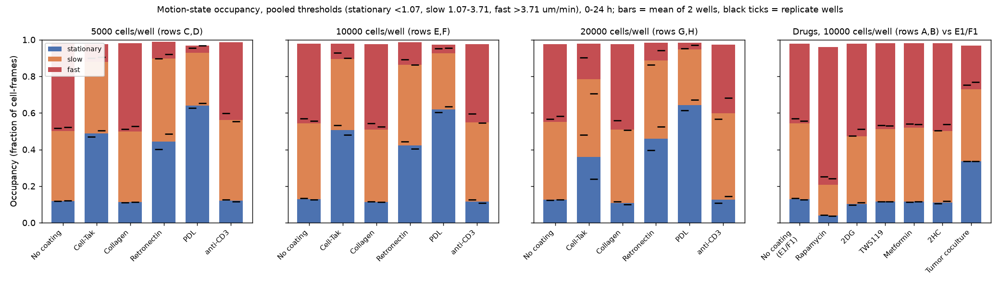
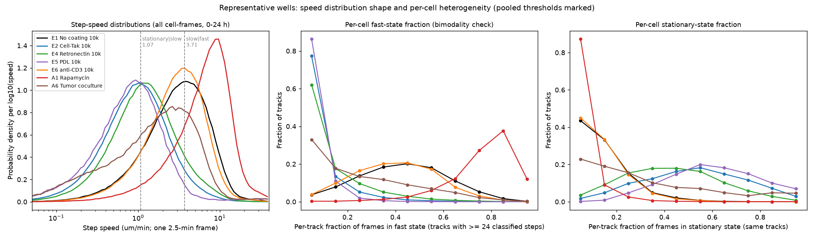
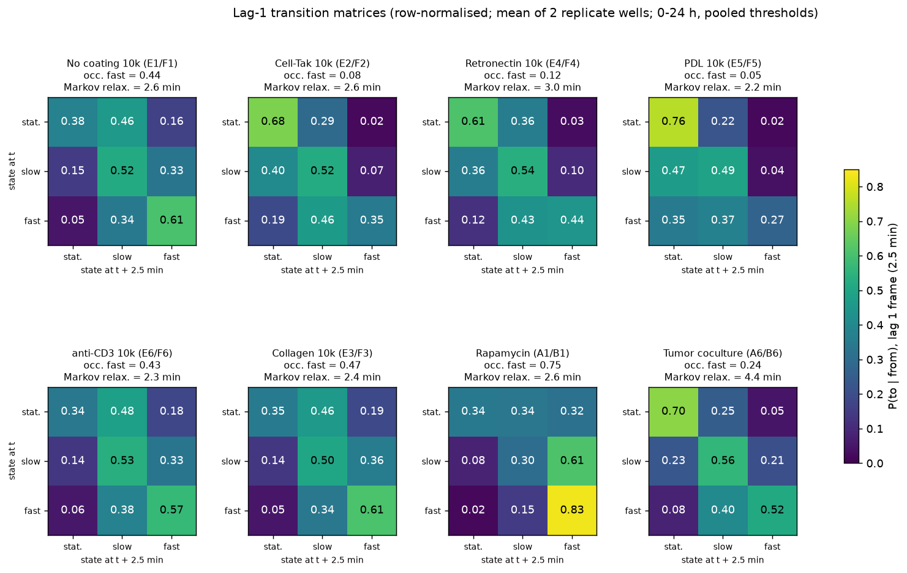
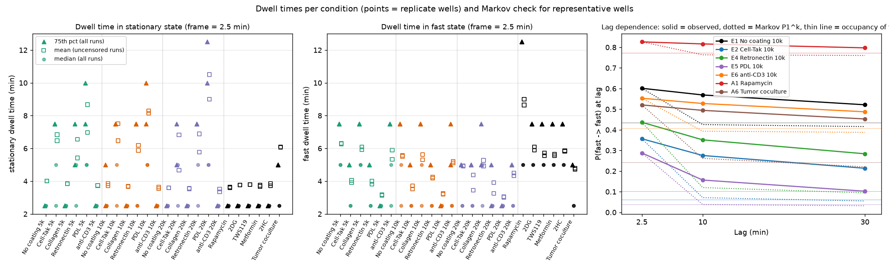
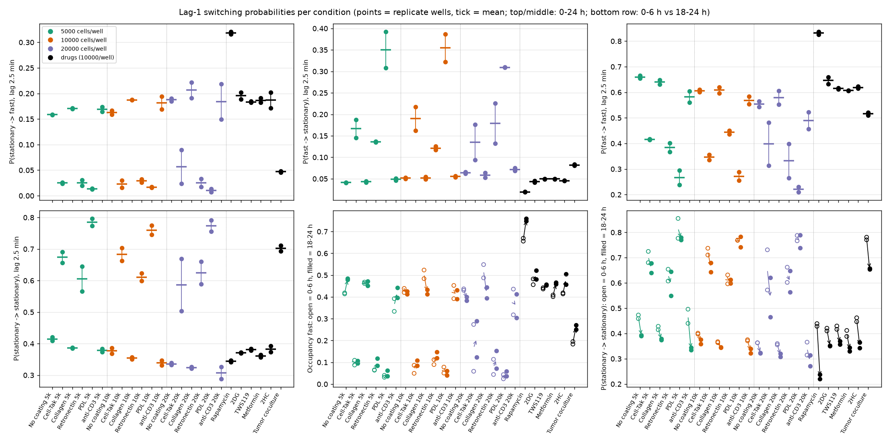

# Motion-state transitions across the 48-well plate (pooled thresholds)

Data: `transition_global_long.csv`, `well_summary.csv` (pooled thresholds: stationary < 1.07 um/min, slow 1.07-3.71 um/min, fast > 3.71 um/min, i.e. 5.37 / 18.57 px per 2.5-min frame), plus per-well recomputation from `outputs/wells/<well>/analysis/states_hoct.parquet` (step-speed distributions, per-track state fractions, dwell times, bidirectional-link-restricted estimates). Replication unit = well (2 wells per condition x density). All numbers are condition means with replicate-well values in parentheses unless stated. Effect sizes are differences of condition means vs matched No-coating wells at the same density (drugs vs E1/F1). No per-cell p-values are reported.

## Key findings

1. **Cell-Tak, Retronectin and PDL arrest cells; PDL is strongest.** Stationary occupancy rises from 0.12-0.13 (No coating, all densities) to 0.42-0.51 (Cell-Tak; +0.37 at 5k and 10k), 0.42-0.46 (Retronectin; +0.30 to +0.34) and 0.62-0.64 (PDL; +0.49 to +0.52); fast occupancy drops from 0.43-0.48 to 0.04-0.12 (-0.31 to -0.44). Median step speed falls to 0.30-0.38x of control (Cell-Tak, Retronectin at 5k/10k; 0.51x for the discordant Cell-Tak 20k pair) and 0.20-0.24x (PDL). Confidence: **high** for 5k/10k (replicates agree within 0.04 for stationary occupancy; effect 10x larger than replicate spread). **Medium** at 20k for Cell-Tak (G2 0.48 vs H2 0.24 stationary) and Retronectin (G4 0.40 vs H4 0.52). PDL at 5k/10k has very low detected cell density (19-152 cells/mm2 vs 212-569 in controls), so the PDL numbers describe the few cells that were detected (medium).
2. **The coating arrest is a wholesale slowdown, not a bimodal split.** On Cell-Tak 10k, the per-track stationary fraction is unimodal and broad (centre ~0.5; 0.51 of tracks > 0.5 stationary, only 0.01 < 0.1 stationary, 0.01 of tracks > 0.5 fast), versus controls where 0.45 of tracks are < 0.1 stationary. The whole step-speed distribution shifts left by about 0.5 log10 units (p25/p50/p75/p90 = 0.54/1.00/1.77/3.04 um/min vs 1.70/3.19/5.48/8.20 for E1/F1) without a secondary fast mode. PDL is the same but shifted further (p90 = 2.2 um/min). Confidence: **high** (both replicates, three independent readouts agree).
3. **Tumor coculture is the one condition that splits the population.** Stationary occupancy 0.34 (0.335, 0.337; +0.21 vs E1/F1), fast 0.24 (-0.20), but the per-track stationary fraction is spread across 0-0.9 with 0.24 of tracks > 0.5 stationary and 0.22 of tracks < 0.1 stationary (controls: 0.01 and 0.45). The lag-1 matrix shows a very sticky stationary state (P(stat->stat) = 0.70 vs 0.38) while the fast state stays nearly as persistent as control (P(fast->fast) 0.52 vs 0.61), and the Markov relaxation time is the longest on the plate (4.4 min vs 2.6 min; empirical stationary-state memory ~210 min vs ~26 min). Confidence: **medium** - robust across replicates and QC filters, but label-free segmentation cannot separate Jurkat from tumor cells, so the arrested subpopulation may partly be tumor cells (interpretation).
4. **Rapamycin makes cells faster and more persistent; this is the only drug with a large effect.** Fast occupancy 0.75 (0.749, 0.759) vs 0.44 (+0.32), stationary 0.04 (-0.09); median speed 2.3x control; P(fast->fast) 0.83 vs 0.61 (+0.23), P(stat->fast) 0.32 vs 0.16 (+0.16), P(fast->stat) 0.019 vs 0.051; 0.95 of tracks are > 0.5 fast (control 0.36). The effect grows over time (fast occupancy 0.66 at 0-6 h -> 0.75 at 18-24 h; P(stat->fast) 0.21 -> 0.44). 2DG (+0.07 fast, +0.04 P(fast->fast)), 2HC (+0.04), TWS119 (+0.03) and Metformin (+0.03) are at or just above replicate spread. Confidence: **medium-high**: both Rapamycin wells have the lowest link quality on the plate (bidir 0.64), which inflates fast steps, but restricting to bidirectionally-confirmed links still gives fast occupancy 0.72 vs 0.40 (+0.33) and P(fast->fast) 0.80 vs 0.59.
5. **Coatings change switching rates in both directions, not just mean speed.** Relative to controls (P(stat->fast) = 0.16-0.19, P(fast->stat) = 0.04-0.06, P(fast->fast) = 0.55-0.66), Cell-Tak / Retronectin / PDL reduce P(stat->fast) to 0.01-0.03 (-0.13 to -0.18), raise P(fast->stat) to 0.12-0.19 (Cell-Tak, Retronectin) and 0.31-0.35 (PDL; +0.25 to +0.31), and reduce fast persistence P(fast->fast) to 0.33-0.44 (Cell-Tak, Retronectin) and 0.22-0.27 (PDL). anti-CD3 leaves occupancy and mean speed essentially unchanged (fast -0.01 to -0.06; median speed 0.90-1.00x) but slightly reduces fast persistence (P(fast->fast) -0.04 to -0.08) and the fast dwell p90 (7.5-11.25 min vs 10-12.5 min at matched density), i.e. a small switching-rate effect without an occupancy effect. Collagen is indistinguishable from No coating (fast +0.00 to +0.04, P(fast->fast) -0.02 to +0.03). Confidence: **high** for Cell-Tak/Retronectin/PDL, **low** for anti-CD3 (effect size comparable to replicate spread at 20k: G6 0.52 vs H6 0.46).
6. **The 3-state chain is not Markov at lag 1: cells carry memory for tens of minutes.** The stationary distribution of the lag-1 matrix reproduces observed occupancy to within 0.04 in every well (bias: pi_fast is 0.01-0.03 below occupancy), so the matrix is internally consistent. But P_lag4 is far from P_lag1^4 (max element difference 0.10-0.29, mean 0.20 across the 48 wells): e.g. No coating 10k observed P4(fast->fast) = 0.57 vs Markov prediction 0.43 (= occupancy, i.e. the Markov chain has fully mixed), and the observed excess persistence decays only from 0.13 (lag 10 min) to 0.085 (lag 30 min). The eigenvalue relaxation time is 1.9-3.0 min everywhere (4.4 min coculture) and does not discriminate conditions; the empirical memory time from the lag-4 -> lag-12 decay is 33-69 min for the fast state in controls and 20-33 min for the stationary state, rising to 92-125 min (stationary) on Cell-Tak/Retronectin and ~210 min in coculture. Confidence: **high** for non-Markovianity (every well), **medium** for the memory-time values (two-point estimate; depends on track-length censoring).
7. **Dwell times are short relative to the 2.5-min frame; coatings lengthen stationary and shorten fast runs.** Median dwell is 2.5 min (1 frame) in almost all states and conditions; 75th percentiles are more informative: stationary p75 = 2.5-3.75 min in controls vs 7.5 min on Cell-Tak/Retronectin and 8.75-11.25 min on PDL; fast p75 = 7.5 min in controls vs 5.0 (Cell-Tak/Retronectin), 2.5 (PDL) and 12.5 min (Rapamycin). Censoring is substantial (fast runs 26-45% censored by track start/end or gaps; 69% in Rapamycin), so fast dwell times, especially for Rapamycin, are lower bounds. Confidence: **medium**.
8. **Time dependence is modest except for Rapamycin and coculture.** Control occupancy changes by < 0.05 between 0-6 h and 18-24 h at 10k/20k (fast 0.43 -> 0.42 and 0.43 -> 0.39); at 5k controls speed up (fast 0.42 -> 0.48). Adhesive-coating arrest weakens slightly (Cell-Tak 10k stationary 0.55 -> 0.48; Retronectin 10k fast 0.10 -> 0.13), Rapamycin's stationary occupancy halves (0.072 -> 0.030) and coculture's stationary occupancy falls (0.41 -> 0.30). Detected cell density rises ~3x over the 24 h in every well (e.g. E1/F1 300 -> 855 cells/mm2), so late-window estimates come from more cells and more crowded fields. Confidence: **medium**.
9. **QC: low-link-quality wells inflate fast-state estimates by ~0.03-0.07, but no conclusion changes.** Seven wells have bidir_fraction < 0.75 (A1, B1 Rapamycin; G1, H1 No coating 20k; G3, H3 Collagen 20k; G6 anti-CD3 20k). Restricting to bidirectionally-confirmed links lowers fast occupancy by 0.065 in G1/H1 (0.41 -> 0.345) and 0.047 in Rapamycin (0.77 -> 0.72) vs 0.015-0.035 in high-quality wells, and lowers P(stat->fast) by 0.05-0.08 in low-quality wells. Effect sizes computed on confirmed links only (Rapamycin +0.33 fast; Cell-Tak 10k -0.35; PDL 10k -0.38; coculture -0.19) match the unrestricted ones within 0.02. The apparent density dependence of control motility (fast 0.48 -> 0.43 from 5k to 20k) becomes larger (0.46 -> 0.35) under the restriction, so the 20k vs 5k comparison is the one most sensitive to link quality. Confidence: **high**.

## Q1. Occupancy and distribution shape

Occupancy (fraction of cell-frames; 0-24 h; `well_summary.csv`, pooled thresholds). hc_median = median step speed in um/min.

| condition | wells | stationary | slow | fast | median speed (um/min) |
|---|---|---|---|---|---|
| No coating 5k | C1/D1 | 0.119 (0.118, 0.120) | 0.382 (0.381, 0.382) | 0.481 (0.482, 0.479) | 3.63 (3.64, 3.62) |
| Cell-Tak 5k | C2/D2 | 0.487 (0.471, 0.503) | 0.392 (0.411, 0.374) | 0.098 (0.099, 0.096) | 1.08 (1.12, 1.03) |
| Collagen 5k | C3/D3 | 0.112 (0.111, 0.114) | 0.387 (0.381, 0.394) | 0.481 (0.489, 0.473) | 3.64 (3.70, 3.58) |
| Retronectin 5k | C4/D4 | 0.443 (0.401, 0.484) | 0.456 (0.486, 0.425) | 0.091 (0.102, 0.080) | 1.21 (1.31, 1.10) |
| PDL 5k | C5/D5 | 0.639 (0.626, 0.652) | 0.290 (0.289, 0.292) | 0.039 (0.046, 0.033) | 0.73 (0.72, 0.75) |
| anti-CD3 5k | C6/D6 | 0.121 (0.125, 0.117) | 0.440 (0.457, 0.422) | 0.425 (0.403, 0.447) | 3.27 (3.14, 3.40) |
| No coating 10k | E1/F1 | 0.129 (0.133, 0.125) | 0.414 (0.417, 0.411) | 0.436 (0.430, 0.443) | 3.30 (3.25, 3.35) |
| Cell-Tak 10k | E2/F2 | 0.506 (0.533, 0.480) | 0.389 (0.381, 0.396) | 0.085 (0.070, 0.099) | 1.04 (0.98, 1.09) |
| Collagen 10k | E3/F3 | 0.114 (0.116, 0.112) | 0.396 (0.402, 0.391) | 0.466 (0.458, 0.474) | 3.54 (3.48, 3.60) |
| Retronectin 10k | E4/F4 | 0.424 (0.444, 0.403) | 0.439 (0.433, 0.445) | 0.123 (0.109, 0.136) | 1.26 (1.20, 1.32) |
| PDL 10k | E5/F5 | 0.618 (0.602, 0.634) | 0.309 (0.326, 0.292) | 0.047 (0.048, 0.046) | 0.80 (0.83, 0.76) |
| anti-CD3 10k | E6/F6 | 0.117 (0.125, 0.108) | 0.431 (0.450, 0.412) | 0.429 (0.404, 0.454) | 3.30 (3.13, 3.47) |
| No coating 20k | G1/H1 | 0.125 (0.123, 0.126) | 0.427 (0.419, 0.436) | 0.425 (0.433, 0.417) | 3.23 (3.29, 3.17) |
| Cell-Tak 20k | G2/H2 | 0.358 (0.479, 0.238) | 0.425 (0.407, 0.443) | 0.195 (0.097, 0.293) | 1.65 (1.10, 2.20) |
| Collagen 20k | G3/H3 | 0.108 (0.116, 0.100) | 0.400 (0.420, 0.379) | 0.468 (0.441, 0.494) | 3.56 (3.35, 3.77) |
| Retronectin 20k | G4/H4 | 0.460 (0.396, 0.524) | 0.427 (0.450, 0.403) | 0.098 (0.138, 0.058) | 1.17 (1.34, 1.01) |
| PDL 20k | G5/H5 | 0.643 (0.614, 0.673) | 0.302 (0.320, 0.284) | 0.038 (0.047, 0.029) | 0.77 (0.82, 0.72) |
| anti-CD3 20k | G6/H6 | 0.127 (0.108, 0.145) | 0.471 (0.425, 0.516) | 0.376 (0.433, 0.319) | 3.01 (3.34, 2.68) |
| Rapamycin | A1/B1 | 0.039 (0.041, 0.038) | 0.168 (0.175, 0.161) | 0.754 (0.749, 0.759) | 7.51 (7.27, 7.76) |
| 2DG | A2/B2 | 0.104 (0.097, 0.110) | 0.368 (0.355, 0.381) | 0.507 (0.526, 0.487) | 3.86 (4.02, 3.70) |
| TWS119 | A3/B3 | 0.116 (0.117, 0.116) | 0.395 (0.398, 0.393) | 0.469 (0.468, 0.470) | 3.55 (3.53, 3.56) |
| Metformin | A4/B4 | 0.115 (0.114, 0.116) | 0.405 (0.408, 0.402) | 0.461 (0.460, 0.461) | 3.49 (3.48, 3.49) |
| 2HC | A5/B5 | 0.111 (0.105, 0.117) | 0.391 (0.378, 0.404) | 0.480 (0.497, 0.462) | 3.64 (3.77, 3.50) |
| Tumor coculture | A6/B6 | 0.336 (0.335, 0.337) | 0.392 (0.386, 0.399) | 0.239 (0.246, 0.232) | 1.81 (1.83, 1.78) |

Effect sizes vs matched control (difference of condition means; speed as ratio):

| condition | control | d stationary | d fast | median speed ratio |
|---|---|---|---|---|
| Cell-Tak 5k | No coating 5k | +0.368 | -0.383 | 0.30 |
| Collagen 5k | No coating 5k | -0.007 | -0.000 | 1.00 |
| Retronectin 5k | No coating 5k | +0.324 | -0.390 | 0.33 |
| PDL 5k | No coating 5k | +0.520 | -0.441 | 0.20 |
| anti-CD3 5k | No coating 5k | +0.002 | -0.056 | 0.90 |
| Cell-Tak 10k | No coating 10k | +0.377 | -0.351 | 0.31 |
| Collagen 10k | No coating 10k | -0.015 | +0.030 | 1.07 |
| Retronectin 10k | No coating 10k | +0.295 | -0.313 | 0.38 |
| PDL 10k | No coating 10k | +0.489 | -0.389 | 0.24 |
| anti-CD3 10k | No coating 10k | -0.012 | -0.007 | 1.00 |
| Cell-Tak 20k | No coating 20k | +0.234 | -0.230 | 0.51 |
| Collagen 20k | No coating 20k | -0.017 | +0.042 | 1.10 |
| Retronectin 20k | No coating 20k | +0.335 | -0.327 | 0.36 |
| PDL 20k | No coating 20k | +0.519 | -0.387 | 0.24 |
| anti-CD3 20k | No coating 20k | +0.002 | -0.049 | 0.93 |
| Rapamycin | No coating 10k | -0.090 | +0.318 | 2.28 |
| 2DG | No coating 10k | -0.026 | +0.071 | 1.17 |
| TWS119 | No coating 10k | -0.013 | +0.033 | 1.08 |
| Metformin | No coating 10k | -0.014 | +0.025 | 1.06 |
| 2HC | No coating 10k | -0.018 | +0.044 | 1.10 |
| Tumor coculture | No coating 10k | +0.207 | -0.197 | 0.55 |

Density: among No-coating wells, fast occupancy falls slightly with seeding density (0.48 -> 0.44 -> 0.43 for 5k -> 10k -> 20k) and median speed from 3.63 to 3.23 um/min; stationary occupancy is flat (0.12-0.13). Coating effects are similar at all three densities except the discordant Cell-Tak 20k pair.

**Wholesale shift vs bimodal split.** Recomputed from `states_hoct.parquet` for all wells (pooled thresholds; steps over exactly one frame interval). Speed percentiles (um/min) and per-track state fractions (tracks with >= 24 classified steps, i.e. >= 1 h):

| condition | wells | p25 | p50 | p75 | p90 | tracks > 0.5 stationary | tracks < 0.1 stationary | tracks > 0.5 fast | tracks < 0.1 fast |
|---|---|---|---|---|---|---|---|---|---|
| No coating 10k | E1/F1 | 1.70 | 3.19 | 5.48 | 8.20 | 0.01 (0.01, 0.01) | 0.45 (0.43, 0.47) | 0.36 (0.34, 0.38) | 0.03 (0.04, 0.03) |
| Cell-Tak 10k | E2/F2 | 0.54 | 1.00 | 1.77 | 3.04 | 0.51 (0.53, 0.48) | 0.01 (0.02, 0.01) | 0.01 (0.01, 0.00) | 0.73 (0.77, 0.69) |
| Retronectin 10k | E4/F4 | 0.67 | 1.23 | 2.22 | 3.95 | 0.32 (0.35, 0.30) | 0.05 (0.04, 0.06) | 0.03 (0.02, 0.04) | 0.59 (0.62, 0.56) |
| PDL 10k | E5/F5 | 0.41 | 0.77 | 1.36 | 2.21 | 0.74 (0.69, 0.78) | 0.00 (0.00, 0.00) | 0.00 (0.00, 0.00) | 0.88 (0.86, 0.89) |
| anti-CD3 10k | E6/F6 | 1.76 | 3.16 | 5.17 | 7.64 | 0.01 (0.01, 0.01) | 0.48 (0.45, 0.52) | 0.31 (0.27, 0.36) | 0.03 (0.04, 0.02) |
| Collagen 10k | E3/F3 | 1.82 | 3.39 | 5.75 | 8.56 | 0.01 (0.01, 0.01) | 0.49 (0.47, 0.51) | 0.39 (0.36, 0.42) | 0.02 (0.02, 0.02) |
| Rapamycin | A1/B1 | 3.99 | 7.14 | 10.83 | 15.14 | 0.00 (0.00, 0.00) | 0.87 (0.87, 0.88) | 0.95 (0.95, 0.95) | 0.00 (0.00, 0.00) |
| 2DG | A2/B2 | 2.00 | 3.72 | 6.17 | 8.96 | 0.01 (0.00, 0.01) | 0.56 (0.60, 0.53) | 0.52 (0.56, 0.47) | 0.02 (0.01, 0.02) |
| Tumor coculture | A6/B6 | 0.65 | 1.71 | 3.45 | 5.52 | 0.24 (0.24, 0.24) | 0.22 (0.23, 0.21) | 0.14 (0.14, 0.13) | 0.34 (0.33, 0.36) |

- Cell-Tak, Retronectin, PDL: every speed percentile drops by a similar factor (p25, p50, p75, p90 all 0.30-0.37x control on Cell-Tak), the log-speed distribution keeps a single mode that moves left (figure below), and almost no track spends > 50% of its time fast (0.00-0.03). The per-track stationary fraction is unimodal and broad (centred near 0.5 on Cell-Tak, 0.65-0.75 on PDL). This is a wholesale slowdown of essentially all detected cells, with cell-to-cell variation in degree.
- Tumor coculture: the speed distribution is broad and flat-topped between 0.5 and 5 um/min (a shoulder rather than a shifted peak), the per-track stationary fraction is spread over 0-0.9 with mass at both ends (0.22 of tracks < 0.1, 0.24 > 0.5), and the per-track fast fraction has a mode near 0 (0.34 of tracks < 0.1) and a tail to 0.8. This is a mixture of arrested and still-motile cells (bimodal split). Interpretation: the arrested fraction may include tumor cells themselves, since label-free segmentation does not distinguish cell types; the coculture wells also have the lowest detected density (154-164 cells/mm2 vs 517-569 for E1/F1), consistent with a different object population.
- Rapamycin: the whole distribution shifts right (p50 2.2x, p90 1.8x control) with a single sharper mode and 0.95 of tracks > 0.5 fast: wholesale acceleration.
- anti-CD3 narrows the fast tail slightly (p90 7.6 vs 8.2 um/min) without moving the median.

## Q2. Lag-1 (2.5 min) switching

Row-normalised lag-1 probabilities, 0-24 h (`transition_global_long.csv`):

| condition | wells | P(stat->stat) | P(stat->fast) | P(fast->stat) | P(fast->fast) | P(slow->slow) |
|---|---|---|---|---|---|---|
| No coating 5k | C1/D1 | 0.415 (0.410, 0.420) | 0.158 (0.158, 0.159) | 0.041 (0.040, 0.042) | 0.660 (0.665, 0.654) | 0.510 (0.513, 0.507) |
| Cell-Tak 5k | C2/D2 | 0.674 (0.657, 0.691) | 0.025 (0.024, 0.026) | 0.167 (0.146, 0.188) | 0.416 (0.415, 0.417) | 0.525 (0.531, 0.520) |
| Collagen 5k | C3/D3 | 0.387 (0.388, 0.386) | 0.171 (0.172, 0.170) | 0.043 (0.042, 0.044) | 0.640 (0.648, 0.632) | 0.506 (0.501, 0.511) |
| Retronectin 5k | C4/D4 | 0.605 (0.565, 0.645) | 0.025 (0.031, 0.019) | 0.136 (0.135, 0.136) | 0.385 (0.367, 0.402) | 0.548 (0.566, 0.531) |
| PDL 5k | C5/D5 | 0.785 (0.797, 0.774) | 0.013 (0.014, 0.013) | 0.350 (0.308, 0.392) | 0.267 (0.295, 0.239) | 0.496 (0.519, 0.473) |
| anti-CD3 5k | C6/D6 | 0.378 (0.384, 0.373) | 0.169 (0.164, 0.174) | 0.049 (0.051, 0.046) | 0.582 (0.560, 0.603) | 0.534 (0.549, 0.519) |
| No coating 10k | E1/F1 | 0.377 (0.386, 0.368) | 0.163 (0.159, 0.167) | 0.051 (0.053, 0.050) | 0.606 (0.601, 0.611) | 0.521 (0.522, 0.519) |
| Cell-Tak 10k | E2/F2 | 0.683 (0.704, 0.663) | 0.023 (0.016, 0.030) | 0.190 (0.162, 0.218) | 0.346 (0.357, 0.336) | 0.522 (0.523, 0.522) |
| Collagen 10k | E3/F3 | 0.354 (0.351, 0.357) | 0.187 (0.188, 0.187) | 0.052 (0.054, 0.049) | 0.608 (0.596, 0.620) | 0.504 (0.508, 0.501) |
| Retronectin 10k | E4/F4 | 0.611 (0.623, 0.599) | 0.029 (0.026, 0.033) | 0.121 (0.126, 0.117) | 0.444 (0.437, 0.451) | 0.537 (0.533, 0.540) |
| PDL 10k | E5/F5 | 0.760 (0.745, 0.774) | 0.017 (0.016, 0.018) | 0.354 (0.322, 0.387) | 0.271 (0.288, 0.255) | 0.491 (0.501, 0.481) |
| anti-CD3 10k | E6/F6 | 0.339 (0.346, 0.331) | 0.181 (0.169, 0.194) | 0.055 (0.057, 0.054) | 0.568 (0.553, 0.583) | 0.532 (0.543, 0.521) |
| No coating 20k | G1/H1 | 0.336 (0.339, 0.333) | 0.188 (0.190, 0.185) | 0.064 (0.062, 0.066) | 0.554 (0.565, 0.543) | 0.520 (0.514, 0.525) |
| Cell-Tak 20k | G2/H2 | 0.587 (0.670, 0.504) | 0.056 (0.023, 0.090) | 0.135 (0.177, 0.094) | 0.398 (0.314, 0.482) | 0.532 (0.531, 0.534) |
| Collagen 20k | G3/H3 | 0.324 (0.326, 0.321) | 0.207 (0.191, 0.222) | 0.058 (0.064, 0.053) | 0.579 (0.552, 0.606) | 0.503 (0.521, 0.486) |
| Retronectin 20k | G4/H4 | 0.624 (0.588, 0.660) | 0.025 (0.033, 0.017) | 0.179 (0.132, 0.226) | 0.332 (0.399, 0.265) | 0.524 (0.539, 0.508) |
| PDL 20k | G5/H5 | 0.773 (0.755, 0.791) | 0.010 (0.013, 0.007) | 0.309 (0.309, 0.310) | 0.220 (0.231, 0.210) | 0.478 (0.486, 0.469) |
| anti-CD3 20k | G6/H6 | 0.307 (0.288, 0.326) | 0.184 (0.219, 0.149) | 0.072 (0.068, 0.075) | 0.490 (0.522, 0.457) | 0.556 (0.522, 0.590) |
| Rapamycin | A1/B1 | 0.344 (0.341, 0.347) | 0.318 (0.316, 0.321) | 0.019 (0.020, 0.019) | 0.832 (0.826, 0.837) | 0.304 (0.306, 0.303) |
| 2DG | A2/B2 | 0.371 (0.370, 0.372) | 0.195 (0.202, 0.188) | 0.043 (0.041, 0.046) | 0.646 (0.659, 0.633) | 0.481 (0.473, 0.490) |
| TWS119 | A3/B3 | 0.381 (0.379, 0.383) | 0.183 (0.185, 0.182) | 0.049 (0.049, 0.050) | 0.615 (0.616, 0.613) | 0.501 (0.502, 0.500) |
| Metformin | A4/B4 | 0.361 (0.357, 0.365) | 0.187 (0.191, 0.182) | 0.050 (0.049, 0.050) | 0.607 (0.605, 0.608) | 0.506 (0.506, 0.507) |
| 2HC | A5/B5 | 0.383 (0.374, 0.392) | 0.187 (0.202, 0.172) | 0.046 (0.046, 0.045) | 0.618 (0.622, 0.614) | 0.491 (0.476, 0.505) |
| Tumor coculture | A6/B6 | 0.703 (0.712, 0.694) | 0.047 (0.048, 0.046) | 0.082 (0.080, 0.084) | 0.515 (0.521, 0.510) | 0.563 (0.559, 0.566) |

Switching effect sizes vs matched control (difference of means):

| condition | d P(stat->stat) | d P(stat->fast) | d P(fast->stat) | d P(fast->fast) |
|---|---|---|---|---|
| Cell-Tak 5k / 10k / 20k | +0.26 / +0.31 / +0.25 | -0.13 / -0.14 / -0.13 | +0.13 / +0.14 / +0.07 | -0.24 / -0.26 / -0.16 |
| Retronectin 5k / 10k / 20k | +0.19 / +0.23 / +0.29 | -0.13 / -0.13 / -0.16 | +0.10 / +0.07 / +0.12 | -0.28 / -0.16 / -0.22 |
| PDL 5k / 10k / 20k | +0.37 / +0.38 / +0.44 | -0.15 / -0.15 / -0.18 | +0.31 / +0.30 / +0.25 | -0.39 / -0.33 / -0.33 |
| Collagen 5k / 10k / 20k | -0.03 / -0.02 / -0.01 | +0.01 / +0.03 / +0.02 | +0.00 / +0.00 / -0.01 | -0.02 / +0.00 / +0.03 |
| anti-CD3 5k / 10k / 20k | -0.04 / -0.04 / -0.03 | +0.01 / +0.02 / -0.00 | +0.01 / +0.00 / +0.01 | -0.08 / -0.04 / -0.06 |
| Rapamycin | -0.03 | +0.16 | -0.03 | +0.23 |
| 2DG | -0.01 | +0.03 | -0.01 | +0.04 |
| TWS119 / Metformin / 2HC | +0.00 / -0.02 / +0.01 | +0.02 / +0.02 / +0.02 | -0.00 / -0.00 / -0.01 | +0.01 / +0.00 / +0.01 |
| Tumor coculture | +0.33 | -0.12 | +0.03 | -0.09 |

Which conditions change switching rather than (or in addition to) mean speed:
- Cell-Tak, Retronectin, PDL: both the entry rate into fast (P(stat->fast) 6-15x lower) and the exit rate from fast (P(fast->stat) 2.5-7x higher) change, and fast persistence falls. Because the whole speed distribution shifts, part of this is a threshold effect (cells near the thresholds hop more); the stationary self-transition (0.61-0.79 vs 0.34-0.42) is the most direct switching readout and shows stationary runs are genuinely stickier (also seen in dwell p75 and stationary memory time, Q3/Q4).
- Tumor coculture changes switching asymmetrically: stationary becomes very sticky (+0.33 self-transition, the largest on the plate) while fast persistence drops only -0.09 and P(fast->stat) rises only +0.03. Mean speed halves mostly because more cells are parked, not because moving cells move slower (p90 speed 5.5 vs 8.2 um/min, but p75-of-fast-tracks persists). This is a switching/population effect rather than a uniform slowdown.
- Rapamycin raises P(fast->fast) by +0.23 and doubles P(stat->fast); slow becomes a transient state (P(slow->slow) 0.30 vs 0.52). Both speed and switching change.
- anti-CD3: switching only (P(fast->fast) -0.04 to -0.08, P(stat->stat) -0.03 to -0.04) with occupancy and median speed unchanged; low confidence (within 2x replicate spread).
- Collagen, TWS119, Metformin, 2HC: no switching change beyond replicate spread (|d| <= 0.03). 2DG: small, consistent increase in fast entry/persistence (+0.03/+0.04) in both wells.

**Stationary distribution vs occupancy (Markov consistency).** The left eigenvector (eigenvalue 1) of each well's lag-1 matrix reproduces the occupancy of the from-states in the same lag-1 pairs to within 0.042 (max over 48 wells x 3 states). pi_stationary exceeds occupancy by 0.005-0.02 and pi_fast is 0.01-0.03 below occupancy in all wells, e.g. No coating 10k pi = (0.141, 0.436, 0.423) vs occupancy (0.134, 0.426, 0.440); Rapamycin pi_fast 0.767 vs 0.782. Interpretation: fast cell-frames are more often the last frame of a track (link loss is speed-dependent), so they contribute to occupancy but not to the from-state of a lag-1 pair, which slightly biases the matrix toward the slower states. The one-step matrix is therefore internally consistent with occupancy, but see Q3: it is not a sufficient description of the dynamics.

## Q3. Lag dependence and Markov check

Observed P(fast->fast) and P(stat->stat) at lag 1, 4 and 12 frames vs the Markov prediction P_lag1^k (condition means):

| condition | P1(f->f) | P4(f->f) obs | P1^4(f->f) | P12(f->f) obs | P1^12(f->f) | P1(s->s) | P4(s->s) obs | P1^4(s->s) | P12(s->s) obs | P1^12(s->s) | max |P4 - P1^4| |
|---|---|---|---|---|---|---|---|---|---|---|---|
| No coating 5k | 0.660 | 0.636 | 0.485 | 0.598 | 0.472 | 0.415 | 0.346 | 0.147 | 0.244 | 0.128 | 0.23 |
| No coating 10k | 0.606 | 0.573 | 0.432 | 0.526 | 0.423 | 0.377 | 0.304 | 0.152 | 0.213 | 0.141 | 0.18 |
| No coating 20k | 0.554 | 0.520 | 0.406 | 0.478 | 0.402 | 0.336 | 0.259 | 0.145 | 0.176 | 0.140 | 0.12 |
| Cell-Tak 10k | 0.346 | 0.258 | 0.076 | 0.196 | 0.063 | 0.683 | 0.639 | 0.549 | 0.622 | 0.542 | 0.24 |
| Retronectin 10k | 0.444 | 0.365 | 0.132 | 0.302 | 0.106 | 0.611 | 0.571 | 0.458 | 0.547 | 0.447 | 0.24 |
| PDL 10k | 0.271 | 0.143 | 0.036 | 0.096 | 0.031 | 0.760 | 0.724 | 0.660 | 0.719 | 0.657 | 0.19 |
| anti-CD3 10k | 0.568 | 0.543 | 0.414 | 0.504 | 0.409 | 0.339 | 0.270 | 0.136 | 0.183 | 0.130 | 0.15 |
| Collagen 10k | 0.608 | 0.576 | 0.454 | 0.531 | 0.448 | 0.354 | 0.272 | 0.136 | 0.178 | 0.127 | 0.16 |
| Rapamycin | 0.832 | 0.823 | 0.770 | 0.804 | 0.767 | 0.344 | 0.242 | 0.061 | 0.112 | 0.046 | 0.29 |
| 2DG | 0.646 | 0.619 | 0.501 | 0.577 | 0.494 | 0.371 | 0.293 | 0.126 | 0.182 | 0.114 | 0.20 |
| Tumor coculture | 0.515 | 0.487 | 0.253 | 0.442 | 0.213 | 0.703 | 0.665 | 0.432 | 0.637 | 0.376 | 0.24 |

- In every well P1^4 has already converged to the stationary distribution (|P1^4(f->f) - pi_fast| < 0.05, median 0.01), whereas the observed lag-4 (10 min) and lag-12 (30 min) matrices retain most of the lag-1 excess persistence. The chain is **not Markov** at the single-frame level; the state sequence has memory of tens of minutes. The max element difference |P4 - P1^4| is 0.10-0.29 (mean 0.20) across wells, and |P12 - P1^12| is 0.07-0.28 (mean 0.15), with the largest violations in Rapamycin (0.29; stationary cells stay stationary far longer than the chain predicts) and the adhesive coatings (0.24).
- **Relaxation times.** The eigenvalue-based time, tau = -2.5 min / ln|lambda2|, is 1.9-3.0 min in all coating/drug conditions (No coating 5k/10k/20k: 2.97/2.60/2.17 min; Cell-Tak 10k 2.59; PDL 10k 2.19; Rapamycin 2.57) and 4.39 min (4.54, 4.24) in coculture. Because the lag-1 chain mixes in about one frame, this quantity mostly measures frame-to-frame speed noise and does not discriminate conditions (except coculture, 1.7x control). The same quantity from the lag-4 matrix gives 6-10 min (coculture 14.9 min), confirming the lag dependence.
- **Empirical memory time** (two-point fit of the excess P_k(x->x) - occupancy_x between lag 10 and 30 min; condition mean, replicate range):

| condition | fast-state memory (min) | stationary-state memory (min) |
|---|---|---|
| No coating 5k / 10k / 20k | 69 (66-72) / 45 (44-46) / 33 (33-33) | 33 (30-36) / 26 (26-26) / 20 (19-20) |
| Cell-Tak 5k / 10k / 20k | 55 (51-60) / 48 (38-58) / 48 (46-49) | 107 (99-114) / 125 (102-147) / 92 (74-110) |
| Retronectin 5k / 10k / 20k | 93 (92-93) / 69 (63-74) / 60 (50-70) | 115 (95-136) / 106 (98-114) / 108 (93-123) |
| PDL 5k / 10k / 20k | 30 (26-33) / 34 (33-35) / 31 (31-31) | 571 (189-953) / 314 (311-317) / 279 (241-317) |
| anti-CD3 5k / 10k / 20k | 89 (83-96) / 45 (41-49) / 37 (31-44) | 38 (33-42) / 23 (22-24) / 21 (16-26) |
| Collagen 5k / 10k / 20k | 52 (51-53) / 35 (34-36) / 31 (30-32) | 25 (24-26) / 21 (21-21) / 17 (16-17) |
| Rapamycin | 34 (34-34) | 19 (18-19) |
| 2DG / TWS119 / Metformin / 2HC | 40 / 47 / 48 / 57 | 22 / 24 / 24 / 30 |
| Tumor coculture | 102 (93-111) | 212 (176-248) |

Interpretation: the memory most likely reflects between-cell heterogeneity (persistently fast vs persistently slow cells, see per-track fractions in Q1) rather than a slow intrinsic switching process; adhesive coatings and coculture create long-lived arrested cells (stationary memory 100-300 min vs 20-33 min), Rapamycin does not create long-lived fast cells beyond control (34 min) because nearly all cells are fast. Memory time shortens with seeding density in controls (33 -> 20 min stationary), consistent with contact-driven state changes (interpretation). The PDL stationary-memory values are poorly determined (excess probabilities < 0.06 and the 5k replicate range is 189-953 min).

## Q4. Dwell times (pooled thresholds, minutes)

Runs of consecutive frames in one state within a track; a run is censored if it touches the track start/end or a frame gap. Median and p75 use all runs (censored runs included as lower bounds); the mean is for uncensored runs only. Resolution is one frame = 2.5 min.

| condition | stationary median / p75 / mean(unc.) | censored | fast median / p75 / mean(unc.) | censored | slow median / p75 | runs >= 30 min (stat / fast) |
|---|---|---|---|---|---|---|
| No coating 5k | 2.5 / 2.5 / 4.0 | 0.14 | 5.0 / 7.5 / 6.3 | 0.26 | 2.5 / 5.0 | 0.01 / 0.02 |
| No coating 10k | 2.5 / 3.75 (5.0, 2.5) / 3.8 | 0.15 | 3.75 (2.5, 5.0) / 7.5 / 5.6 | 0.28 | 2.5 / 5.0 | 0.00 / 0.01 |
| No coating 20k | 2.5 / 2.5 / 3.6 | 0.19 | 2.5 / 5.0 / 4.9 | 0.35 | 2.5 / 5.0 | 0.00 / 0.00 |
| Cell-Tak 5k / 10k / 20k | 3.75 / 7.5 / 6.7; 3.75 / 7.5 / 7.0; 3.75 / 6.25 / 5.8 | 0.25 / 0.21 / 0.21 | 2.5 / 5.0 / 4.0; 2.5 / 5.0 / 3.6; 2.5 / 5.0 / 3.9 | 0.34 / 0.35 / 0.36 | 2.5 / 5.0 | 0.03 / 0.00 |
| Retronectin 5k / 10k / 20k | 3.75 / 6.25 / 6.0; 2.5 / 7.5 / 6.0; 3.75 / 7.5 / 6.3 | 0.09 / 0.12 / 0.14 | 2.5 / 5.0 / 3.9; 2.5 / 5.0 / 4.2; 2.5 / 3.75 / 3.6 | 0.17 / 0.25 / 0.33 | 3.75 / 7.5 (5k); 2.5 / 7.5 (10k); 2.5 / 5.0 (20k) | 0.02 / 0.00 |
| PDL 5k / 10k / 20k | 5.0 / 8.75 / 7.8; 5.0 / 8.75 / 8.2; 5.0 / 11.25 / 9.8 | 0.32 / 0.33 / 0.21 | 2.5 / 2.5 / 3.2; 2.5 / 2.5 / 3.2; 2.5 / 2.5 / 3.0 | 0.45 / 0.44 / 0.42 | 2.5 / 5.0 | 0.05-0.06 / 0.00 |
| anti-CD3 5k / 10k / 20k | 2.5 / 2.5 / 3.7; 2.5 / 2.5 / 3.6; 2.5 / 2.5 / 3.4 | 0.11 / 0.19 / 0.21 | 3.75 / 7.5 / 5.6; 2.5 / 6.25 / 5.2; 2.5 / 5.0 / 4.4 | 0.17 / 0.32 / 0.34 | 2.5 / 5.0-6.25 | 0.00-0.01 / 0.00-0.01 |
| Collagen 5k / 10k / 20k | 2.5 / 2.5 / 3.8; 2.5 / 2.5 / 3.7; 2.5 / 2.5 / 3.6 | 0.16 / 0.19 / 0.24 | 5.0 / 7.5 / 6.0; 3.75 / 7.5 / 5.5; 3.75 / 6.25 / 5.1 | 0.30 / 0.35 / 0.42 | 2.5 / 5.0 | 0.00 / 0.01 |
| Rapamycin | 2.5 / 2.5 / 3.6 | 0.25 | 5.0 / 12.5 / 8.8 | **0.69** | 2.5 / 2.5 | 0.00 / 0.04 |
| 2DG | 2.5 / 2.5 / 3.8 | 0.17 | 5.0 / 7.5 / 6.0 | 0.34 | 2.5 / 5.0 | 0.00 / 0.01 |
| TWS119 / Metformin / 2HC | 2.5 / 2.5 / 3.7-3.8 | 0.15-0.17 | 5.0 / 7.5 / 5.6-5.9 | 0.26-0.30 | 2.5 / 5.0 | 0.00-0.01 / 0.01 |
| Tumor coculture | 2.5 / 5.0 / 6.1 | 0.29 | 2.5 / 5.0 / 4.8 | 0.33 | 2.5 / 6.25 | 0.03 / 0.01 |

- Dwell times are short everywhere: the median run is one frame in nearly every state and condition, which means the frame-level state label flickers (speed noise straddling the thresholds) and the 2.5-min sampling does not resolve the intrinsic dwell. Differences show up in the upper tail: stationary p75 2.5-3.75 min (controls) -> 6.25-7.5 (Cell-Tak, Retronectin) -> 8.75-11.25 min (PDL); uncensored stationary mean 3.6-4.0 -> 5.8-7.0 -> 7.8-9.8 min; stationary runs >= 30 min are 0-1% of runs in controls, 2-3% on Cell-Tak/Retronectin and 5-6% on PDL. Fast p75 goes the other way: 7.5 min (controls) -> 5.0 (Cell-Tak, Retronectin) -> 2.5 min (PDL), and up to 12.5 min under Rapamycin (uncensored mean 8.8 vs 5.6 min; 4% of fast runs >= 30 min vs 1%).
- Censoring: 14-33% of stationary runs and 26-45% of fast runs are censored (gaps or track ends), rising to 69% of fast runs in Rapamycin where fast cells frequently lose their link (bidir 0.64). Censored runs are lower bounds, so the Rapamycin fast dwell time and, to a lesser degree, all fast dwell times are underestimates; the stationary-vs-fast ordering is robust because censoring would, if anything, shorten the fast runs that are already the longest.
- Cross-check with the pipeline's per-well-threshold dwell summary (E1: medians 2.5 min in all states, p75 5.0/5.0/7.5 min for stationary/slow/fast) matches the pooled-threshold recomputation (2.5 / 5.0 / 7.5).

## Q5. Time dependence (0-6 h vs 18-24 h)

| condition | stationary 0-6 h -> 18-24 h | fast 0-6 h -> 18-24 h | P(stat->stat) 0-6 h -> 18-24 h | P(fast->fast) 0-6 h -> 18-24 h | P(stat->fast) 0-6 h -> 18-24 h | cells/mm2 0-6 h -> 18-24 h |
|---|---|---|---|---|---|---|
| No coating 5k | 0.151 -> 0.114 | 0.416 -> 0.482 | 0.466 -> 0.392 | 0.639 -> 0.652 | 0.118 -> 0.172 | 104 -> 354 |
| No coating 10k | 0.132 -> 0.134 | 0.430 -> 0.419 | 0.399 -> 0.368 | 0.618 -> 0.579 | 0.149 -> 0.164 | 301 -> 855 |
| No coating 20k | 0.123 -> 0.134 | 0.434 -> 0.392 | 0.363 -> 0.322 | 0.592 -> 0.498 | 0.174 -> 0.184 | 622 -> 1762 |
| Cell-Tak 10k | 0.549 -> 0.480 | 0.068 -> 0.097 | 0.724 -> 0.662 | 0.339 -> 0.333 | 0.020 -> 0.026 | 310 -> 1027 |
| Retronectin 10k | 0.442 -> 0.409 | 0.101 -> 0.134 | 0.614 -> 0.606 | 0.422 -> 0.430 | 0.027 -> 0.032 | 347 -> 1088 |
| PDL 10k | 0.604 -> 0.622 | 0.064 -> 0.051 | 0.769 -> 0.763 | 0.288 -> 0.292 | 0.028 -> 0.016 | 66 -> 245 |
| anti-CD3 10k | 0.122 -> 0.123 | 0.422 -> 0.410 | 0.373 -> 0.330 | 0.588 -> 0.535 | 0.163 -> 0.183 | 306 -> 851 |
| Collagen 10k | 0.100 -> 0.127 | 0.504 -> 0.423 | 0.366 -> 0.345 | 0.650 -> 0.557 | 0.192 -> 0.183 | 320 -> 1082 |
| Rapamycin | 0.072 -> 0.030 | 0.663 -> 0.754 | 0.434 -> 0.229 | 0.789 -> 0.819 | 0.209 -> 0.436 | 263 -> 445 |
| 2DG | 0.121 -> 0.102 | 0.469 -> 0.502 | 0.415 -> 0.351 | 0.652 -> 0.625 | 0.157 -> 0.208 | 247 -> 854 |
| Metformin | 0.138 -> 0.111 | 0.405 -> 0.462 | 0.400 -> 0.337 | 0.593 -> 0.593 | 0.147 -> 0.201 | 208 -> 807 |
| Tumor coculture | 0.406 -> 0.302 | 0.189 -> 0.261 | 0.776 -> 0.655 | 0.448 -> 0.538 | 0.034 -> 0.054 | 102 -> 241 |

- Controls at 10k and 20k are stable in occupancy (|change| <= 0.04) but fast persistence drops as the field fills (P(fast->fast) 0.59 -> 0.50 at 20k, 0.62 -> 0.58 at 10k); at 5k, cells speed up over the day (fast +0.07, stationary -0.04, P(stat->fast) 0.12 -> 0.17). Both Collagen replicates at 10k/20k show the same crowding-type decline as controls (P(fast->fast) 0.65 -> 0.56).
- Adhesive-coating arrest is slightly weaker late: Cell-Tak 10k stationary 0.55 -> 0.48, Retronectin 10k fast 0.10 -> 0.13 (both replicates), while PDL is flat. The coating effect sizes vs control remain > 0.3 in both windows.
- Rapamycin's effect strengthens: stationary 0.072 -> 0.030, P(stat->fast) 0.21 -> 0.44, P(stat->stat) 0.43 -> 0.23 (both wells). Coculture's arrested fraction shrinks (stationary 0.41 -> 0.30; P(stat->stat) 0.78 -> 0.66) and its fast persistence rises (0.45 -> 0.54).
- Detected cell density rises ~3x in all wells between the first and last 6 h (e.g. E1/F1 301 -> 855 cells/mm2). This is faster than Jurkat proliferation can explain, so cells are presumably settling into the imaging plane or becoming segmentable over time; late-window estimates are from a larger and more crowded population. The small late decline in P(fast->fast) in controls at 10k/20k is consistent with crowding (interpretation).
- Markov relaxation times shorten slightly over time in all conditions (e.g. No coating 10k 2.8 -> 2.5 min; Rapamycin 3.3 -> 1.9 min; coculture 4.9 -> 4.1 min).

## Q6. Drug effects vs E1/F1

| drug | wells | d stationary | d fast | median speed ratio | d P(stat->fast) | d P(fast->stat) | d P(fast->fast) | tracks > 0.5 fast (ctrl 0.36) | fast dwell p75 (ctrl 7.5 min) |
|---|---|---|---|---|---|---|---|---|---|
| Rapamycin | A1/B1 | -0.090 | +0.318 | 2.28 | +0.156 | -0.032 | +0.226 | 0.95 | 12.5 |
| 2DG | A2/B2 | -0.026 | +0.071 | 1.17 | +0.033 | -0.008 | +0.040 | 0.52 | 7.5 |
| TWS119 | A3/B3 | -0.013 | +0.033 | 1.08 | +0.021 | -0.002 | +0.009 | 0.42 | 7.5 |
| Metformin | A4/B4 | -0.014 | +0.025 | 1.06 | +0.024 | -0.002 | +0.001 | 0.42 | 7.5 |
| 2HC | A5/B5 | -0.018 | +0.044 | 1.10 | +0.024 | -0.006 | +0.013 | 0.48 | 7.5 |
| Tumor coculture | A6/B6 | +0.207 | -0.197 | 0.55 | -0.116 | +0.031 | -0.090 | 0.14 | 5.0 |

- Rapamycin (both wells, replicates within 0.01): the strongest single effect on the plate in the fast direction, with a wholesale right shift (p25 of step speed 3.99 vs 1.70 um/min) and more persistent fast runs. The effect size is reduced but not removed when only bidirectionally-confirmed links are used (fast occupancy 0.72 vs 0.40; P(fast->fast) 0.80 vs 0.59; P(stat->fast) 0.23 vs 0.13). Interpretation: increased Jurkat motility under mTOR inhibition is plausible, but Rapamycin wells also have the lowest link quality and a smaller late-window cell density (445 vs 855 cells/mm2), so some of the increase may reflect fewer tracked cells and more link errors.
- 2DG: a small, replicate-consistent increase in fast occupancy (+0.07; 0.526 and 0.487 vs 0.430 and 0.443) and P(fast->fast) (+0.04); ~2x the replicate spread. Interpretation: no evidence that glycolysis inhibition slows the cells within 24 h; if anything they move slightly more.
- TWS119, Metformin, 2HC: changes of +0.02 to +0.04 in fast occupancy and <= 0.02 in switching, equal to the spread between E1 and F1 (0.013); no detectable effect on either occupancy or switching. Note that all four small-molecule wells (rows A/B) sit at +0.03 to +0.07 fast relative to E/F controls, so a row effect of ~+0.03 cannot be excluded.
- Tumor coculture: arrests a subpopulation (Q1, Q2): stationary +0.21, P(stat->stat) +0.33, bimodal per-track distribution, longest memory time on the plate. Interpretation: Jurkat cells may be arrested by contact with tumor cells, but segmented tumor cells themselves would also appear as a stationary population; distinguishing these requires a label.

## Q7. QC caveat: link quality (bidir_fraction)

Wells with bidir_fraction < 0.75: A1 (0.638), B1 (0.642) Rapamycin; G1 (0.726), H1 (0.710) No coating 20k; G3 (0.654), H3 (0.699) Collagen 20k; G6 (0.683) anti-CD3 20k. Low bidir means the forward and reverse linkers disagree on many links; wrong links join different cells and create long spurious steps, which are classified as fast and generate spurious stat->fast and fast->stat transitions. This biases fast occupancy and P(stat->fast) upward and P(fast->fast) and P(stat->stat) downward in low-quality wells, i.e. it would exaggerate the Rapamycin effect and make the 20k controls look more motile than they are.

Two checks:

1. Restricting the recomputation to steps whose links are bidirectionally confirmed (both the from- and to-step for transitions):

| condition | wells | bidir | fast occ. all -> confirmed | stationary occ. all -> confirmed | P(fast->fast) all -> confirmed | P(stat->fast) all -> confirmed |
|---|---|---|---|---|---|---|
| No coating 5k | C1/D1 | 0.88 | 0.478 -> 0.461 | 0.125 -> 0.131 | 0.664 -> 0.655 | 0.158 -> 0.140 |
| No coating 10k | E1/F1 | 0.83 | 0.430 -> 0.396 | 0.137 -> 0.150 | 0.610 -> 0.590 | 0.162 -> 0.133 |
| No coating 20k | G1/H1 | 0.72 | 0.410 -> 0.345 | 0.135 -> 0.161 | 0.559 -> 0.519 | 0.186 -> 0.129 |
| Collagen 20k | G3/H3 | 0.68 | 0.448 -> 0.377 | 0.120 -> 0.146 | 0.588 -> 0.548 | 0.204 -> 0.136 |
| anti-CD3 20k | G6/H6 | 0.75 | 0.357 -> 0.299 | 0.138 -> 0.158 | 0.495 -> 0.460 | 0.182 -> 0.129 |
| Cell-Tak 10k | E2/F2 | 0.89 | 0.068 -> 0.050 | 0.534 -> 0.554 | 0.365 -> 0.352 | 0.022 -> 0.013 |
| PDL 10k | E5/F5 | 0.91 | 0.035 -> 0.020 | 0.651 -> 0.668 | 0.286 -> 0.243 | 0.016 -> 0.007 |
| Rapamycin | A1/B1 | 0.64 | 0.771 -> 0.724 | 0.044 -> 0.057 | 0.833 -> 0.802 | 0.314 -> 0.233 |
| Tumor coculture | A6/B6 | 0.88 | 0.224 -> 0.205 | 0.362 -> 0.376 | 0.535 -> 0.534 | 0.046 -> 0.034 |

   Unconfirmed links are indeed enriched in fast steps: removing them lowers fast occupancy by 0.015-0.035 in high-quality wells and by 0.05-0.07 in low-quality wells, and lowers P(stat->fast) by 0.02-0.03 vs 0.05-0.08. Effect sizes on confirmed links only: Rapamycin +0.33 fast (unrestricted +0.34 on the same recomputation), Cell-Tak 10k -0.35 (-0.36), PDL 10k -0.38 (-0.40), coculture -0.19 (-0.21), 2DG +0.07 (+0.07), anti-CD3 20k -0.05 (-0.05). Note that the restriction itself is biased the other way (confirmed links preferentially retain slow, unambiguous cells), so the truth lies between the two columns.
2. Down-weighting low-bidir wells to zero in the condition means (falling back to bidir-weighted means when both wells of a condition are low, which is the case for Rapamycin, No coating 20k and Collagen 20k) changes no coating effect size by more than 0.001 except anti-CD3 20k (d fast -0.05 -> -0.11, d P(fast->fast) -0.06 -> -0.10, i.e. the effect gets larger when G6 is dropped, but it then rests on a single well).

Conclusions that hold under down-weighting / restriction: coating arrest (Cell-Tak, Retronectin, PDL), the coculture split, Rapamycin's acceleration, the null results for Collagen, TWS119, Metformin and 2HC, and the non-Markov lag dependence (also present in the highest-quality wells, e.g. C4/D4 bidir 0.93, max |P4 - P1^4| = 0.20-0.27). Conclusions that are sensitive: the magnitude of the Rapamycin effect (+0.32 to +0.34 fast unrestricted vs +0.33 restricted, but with fast dwell times 69% censored), the small density dependence of control motility (becomes larger, 0.46 -> 0.35 fast from 5k to 20k, under restriction), and anything about anti-CD3 at 20k.

## Caveats

- Replication is two wells per condition; all "effects" are judged against the replicate spread (typically 0.01-0.04 in occupancy), with no formal test. Three condition pairs are discordant: Cell-Tak 20k (G2 stationary 0.48 vs H2 0.24), Retronectin 20k (0.40 vs 0.52) and anti-CD3 20k (fast 0.43 vs 0.32).
- PDL at 5k and 10k has 19-152 detected cells/mm2 (3-10x fewer than controls); the PDL occupancy and switching values describe a small, possibly non-representative subset of cells (e.g. cells that remained round enough to segment). PDL 20k has normal density (1150-1230 cells/mm2) and gives the same answer, which supports the PDL conclusion.
- Tumor coculture wells contain two cell types that the label-free segmentation does not separate; coculture wells also have low detected density (154-164 cells/mm2).
- Detected cell density triples between 0-6 h and 18-24 h in every well, so the 'all' window is weighted toward the late, crowded period and the time comparison mixes a changing population with a changing behaviour.
- The three-state description with a 2.5-min frame is coarse: median dwell is one frame in all states, so lag-1 transition probabilities contain a large component of frame-to-frame speed noise around the thresholds (the same noise makes the eigenvalue relaxation time ~1 frame everywhere). The adhesive-coating switching effects (P(stat->fast), P(fast->stat)) are partly a consequence of shifting the whole speed distribution across fixed thresholds; the self-transition probabilities, dwell upper quantiles and the lag-4/lag-12 memory times are the more threshold-robust indicators.
- The lag-1 stationary distribution under-predicts fast occupancy by 0.01-0.03 in every well because fast frames are over-represented at track ends (speed-dependent link loss); dwell-time censoring is also speed dependent (fast runs 26-45% censored, 69% in Rapamycin).
- The per-well recomputation excludes steps spanning frame gaps (about 5% of steps), whereas `well_summary.csv` / `transition_global_long.csv` include them; this makes the recomputed stationary occupancy ~0.01-0.03 higher and fast occupancy ~0.01-0.02 lower than the pipeline values. Conclusions are the same with either.
- Memory-time estimates use only two lags (10 and 30 min) and assume a single exponential; they are indicative (tens vs hundreds of minutes), not precise.

## Figures

- `fig_transitions_occupancy.png`: stacked occupancy per condition and density with replicate ticks.
- `fig_transitions_matrices.png`: lag-1 transition matrices for controls, Cell-Tak, Retronectin, PDL, anti-CD3, Collagen, Rapamycin, coculture (10k).
- `fig_transitions_switching.png`: switching-probability dot plots with replicate wells; 0-6 h vs 18-24 h occupancy and P(stat->stat).
- `fig_transitions_speed_dist.png`: step-speed distributions and per-track state fractions for E1, E2, E4, E5, E6, A1, A6 with pooled thresholds marked.
- `fig_transitions_dwell.png`: stationary and fast dwell-time statistics per condition; lag dependence of P(fast->fast) vs the Markov prediction.
