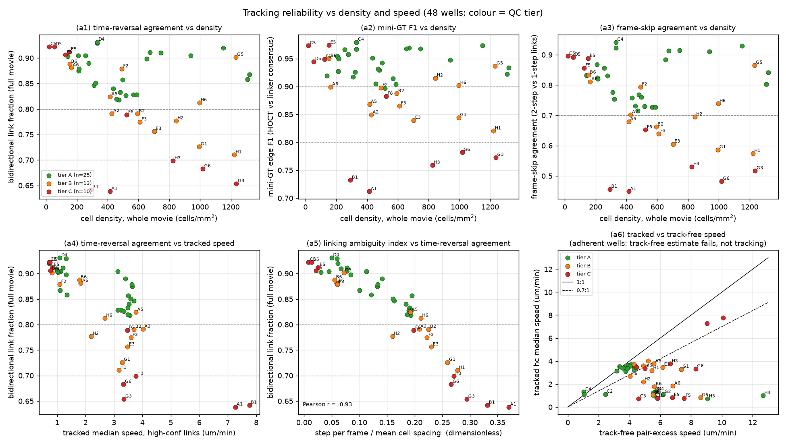
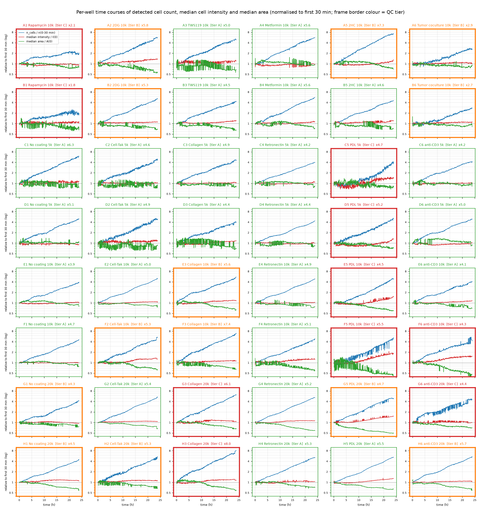
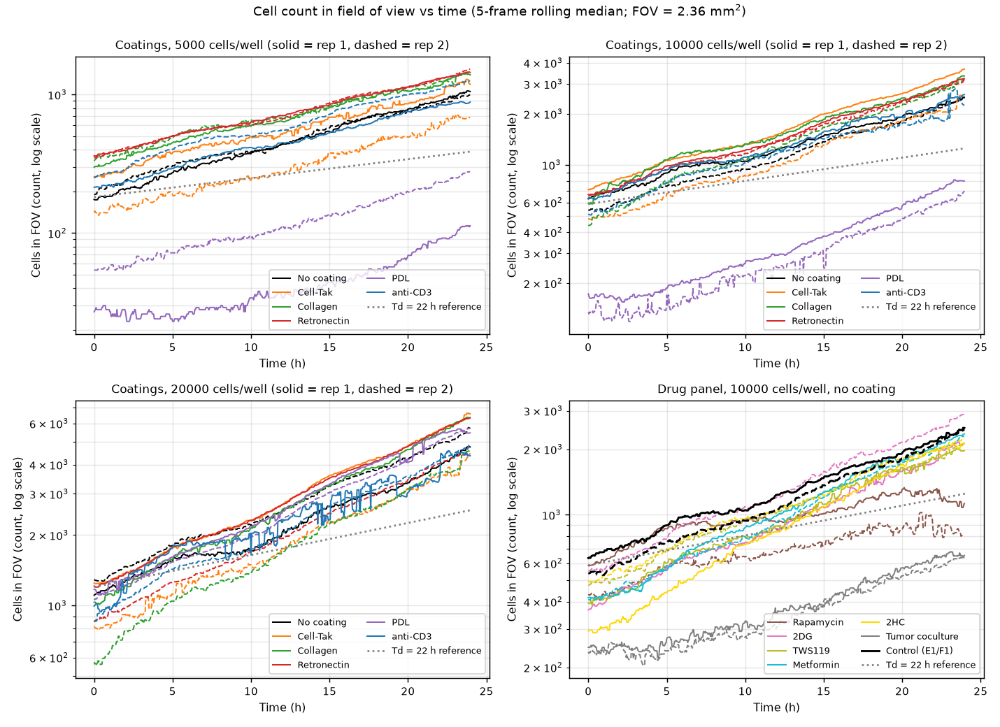
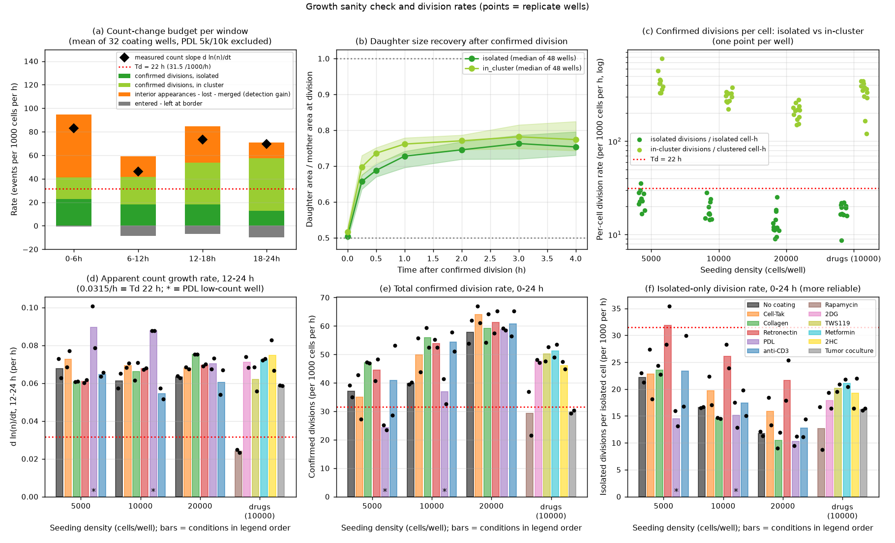
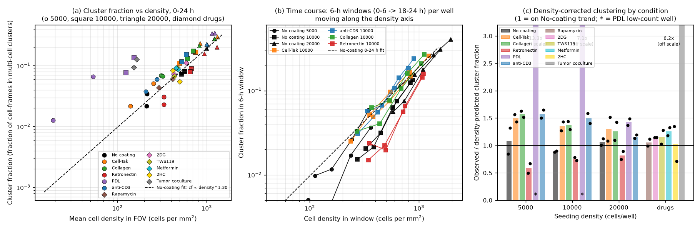
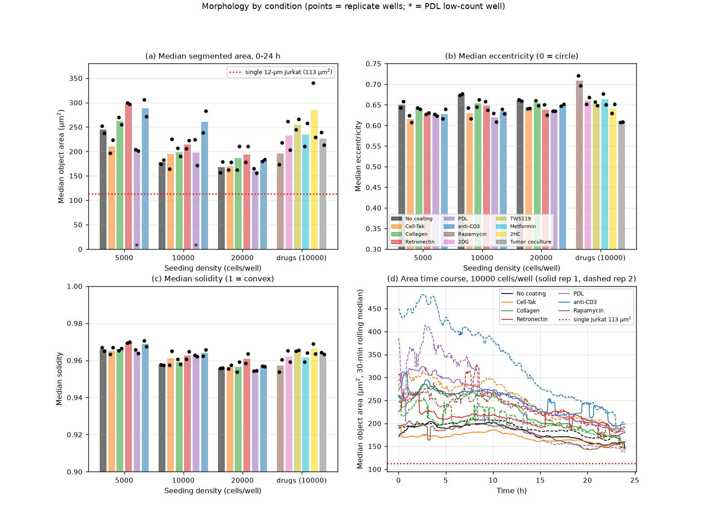
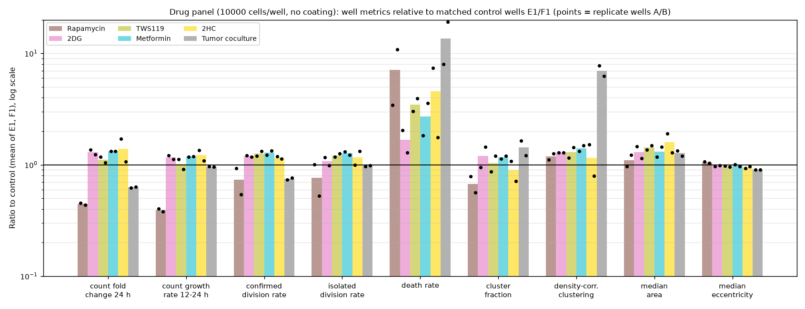

# Plate-wide analysis of the 48-well Jurkat dynamics dataset

Dataset: `2026-10-19_sample-data`, MCAM 48-well plate, 24 h label-free movies (576 frames, 2.5 min/frame, 3072 x 3072 px FOV per well, 0.5 µm/px, FOV 2.36 mm²). Pipeline: `celltrack` (Cellpose-SAM segmentation, HOCT/ILP tracking, per-well motility/transition/validation stages) followed by the plate stage `celltrack/plate.py`, then five independent analyst passes (motility, motion-state transitions, population/proliferation, tumor coculture, QC) whose full write-ups are the `findings_*.md` files next to this report. This document reconciles them and ranks the conclusions by confidence.

Replication unit throughout is the well (2 wells per condition x density). Effect sizes are condition means vs the matched No-coating wells at the same seeding density (C1/D1, E1/F1, G1/H1); drug wells are compared with E1/F1. No per-cell p-values are used; a difference is called consistent only when both replicates lie on the same side of the control.

## 1. Headline conclusions, ranked by confidence

**High confidence (both replicates, several independent readouts, survives QC filtering)**

1. **Cell-Tak and Retronectin arrest Jurkat motility at every seeding density.** Median step speed 0.30-0.38x control (1.0-1.3 vs 3.2-3.6 µm/min), MSD(10 min) 0.11-0.19x, D 0.06-0.17x; stationary-state occupancy 0.42-0.51 vs 0.12-0.13; P(stationary to fast) 0.01-0.03 vs 0.16-0.19. The arrest is a wholesale shift of the whole speed distribution (unimodal per-track stationary fraction), not a split into arrested and motile subpopulations. Tracking in these wells is the most reliable on the plate (bidir 0.86-0.93, mini-GT F1 0.90-0.98). Caveat: at ~1 µm/min the cells are within 5x of the localisation-noise floor (0.2 µm/min), so the residual speed is an upper bound on true movement. The Cell-Tak 20k pair is discordant (G2 1.10 vs H2 2.20 µm/min).
2. **Collagen has no effect on motility, state switching, or growth.** Step 1.00-1.10x, MSD10 0.89-1.19x, alpha within 0.05 of control, occupancy and switching rates within replicate spread. (G3/H3 are tier C for tracking but the 5k/10k pairs carry the conclusion.)
3. **Rapamycin (10 nM) is the only drug with any effect, and it has two: faster, more persistent migration and slower apparent growth.** Step 7.5 vs 3.3 µm/min (2.3x; tracked and tracking-free estimators agree), MSD10 2.7x, fast-state occupancy 0.75 vs 0.44, P(fast to fast) 0.83 vs 0.61, effect growing over 24 h; 24 h count fold 1.9 vs 4.3 (0.44x), 12-24 h growth rate 0.39x, isolated-cell divisions 0.76x, and the only wells whose counts plateau. The direction of both effects is high confidence; magnitudes are medium (A1/B1 are tier C: bidir 0.64, cells at 7-8 µm/min are too fast for a 2.5 min interval; restricting to bidirectionally confirmed links still gives fast occupancy 0.72 vs 0.40). The dose and well identity should be double-checked because faster migration under mTOR inhibition is unexpected.
4. **2DG (100 µM), TWS119 (1 µM), Metformin (150 µM) and 2HC (5 mM) have no detectable effect within 24 h** on speed (1.06-1.17x), MSD (0.97-1.14x), state occupancy (+0.03 to +0.07 fast), growth (1.0-1.4x, i.e. no reduction) or clustering. 2DG is the only one with a weak signal (+17% step, one replicate within 10% of control).
5. **The 4-8x increase in detected cells over 24 h is not proliferation. `count_fold_change`, `apparent_doubling_time_h` and `division_rate_per_1000cells_h` must not be read as biology.** Median fold 4.9 (apparent Td 10.5 h) is more than twice the fastest plausible Jurkat doubling; the tracker balances the gain with ~5 "divisions" per net new cell; the division rate per clustered cell-hour (290/1000/h) is physically impossible and 17x the isolated-cell rate; the share of in-cluster division calls rises 42 to 83% from 5k to 20k. See section 5 for what the gain is.
6. **PDL at 5k and 10k (C5, D5, E5, F5) is a detection failure, not a biological result.** Detected density 0.08-0.31x the same-seeding median, 9-21% of the FOV masked as "bubbles" that are in fact dense cell aggregates, median intensity 88-93 DN (vs 120-170) rising +0.27 to +0.75 over the movie, clumps segmented as single objects (fig_qc_crops_E5_vs_E1.png). PDL can be assessed only at 20k (G5 tier B, H5 tier A), where cells are arrested (step 0.24x, stationary occupancy 0.64) and cluster fraction is the highest on the plate (0.34).
7. **Tracking reliability is governed by step length relative to cell spacing (r = -0.93 with the bidirectional fraction), not by density alone.** Adherent wells link almost perfectly at any density; motile wells degrade from bidir 0.85-0.91 at 5k to 0.65-0.73 at 20k and from 0.88 (0-6 h) to 0.80 (18-24 h). The 18-24 h window of G1, G3, G6, H1, H3 and all windows of A1/B1 should not be used for speed, persistence or transition metrics. The HOCT edge confidence is saturated (>= 0.996 everywhere) and is not a usable filter; the per-link `bidir` flag is.
8. **The 3-state motion chain is not Markov at the 2.5 min frame.** The lag-4 matrix differs from the lag-1 matrix to the 4th power by 0.20 on average; cells retain their state for 33-69 min (fast, controls), 92-125 min (stationary, adhesive coatings) and ~210 min (stationary, coculture). Stationary dwell p75 is 2.5-3.75 min in controls vs 7.5 min on Cell-Tak/Retronectin and 8.75-11.25 min on PDL.

**Medium confidence (consistent across replicates but confounded, estimator-limited, or n = 2 at the margin)**

9. **anti-CD3 (5 µg/ml) produces no arrest, no activation-induced clustering beyond that of other coated surfaces, and no proliferation increase within 24 h.** Step 0.90-1.00x, stationary occupancy identical to control, MSD10 0.75-0.88x (consistent in sign across 6 wells), P(fast to fast) -0.04 to -0.08, density-corrected clustering 1.16-1.57x (but Cell-Tak and Collagen show the same 1.3-1.6x excess, so it is not anti-CD3 specific), median area +8 to +46% (confounded by clump inclusion), 12-24 h growth 0.89-0.96x, isolated divisions 1.05-1.09x. F6 (0-12 h) and G6 are tier C, so the 10k and 20k comparisons rest partly on one well each.
10. **Seeding density reduces net displacement more than step speed.** No coating 5k to 20k: step -11%, MSD10 -43%, D -50%, alpha 1.25 to 1.10, persistence 2.2 to 1.8 min while median NN distance falls 29 to 13 µm. Within wells, cells with a neighbour at 10-20 µm move ~20% slower than cells with a neighbour at 30-50 µm in every motile well, and this local crowding effect is absent on adhesive coatings and under Rapamycin. Confounds: the 20k vs 5k comparison is the one most sensitive to link quality (bidir-restricted fast occupancy 0.46 to 0.35 instead of 0.48 to 0.43), and achieved density triples within each well over 24 h.
11. **Speed peaks at 6-12 h in all 30 motile wells (+5 to +48%) and then declines; whether cells end slower than they started depends on density** (late/early MSD10 ratio 1.1-1.25 at 5k, 0.85-0.89 at 10k, 0.68-0.71 at 20k). 6-12 h is the recommended window for cross-well motility comparisons (bidir 0.86, intensity stabilised, density below the 1000 cells/mm² level where linking breaks down).
12. **Retronectin disperses cells and shows more isolated-cell divisions; Cell-Tak confines them.** Retronectin: density-corrected clustering 0.58-0.82x, isolated division rate 1.44-1.84x control at all three densities, alpha within control range (slow random walk, MSD rising 12-20x from 2.5 to 30 min). Cell-Tak: alpha 0.76-0.79 (subdiffusive), ~50% stationary occupancy, clustering 1.3-1.5x. The Retronectin division excess is at least partly a detectability effect (fewer touching daughters are rejected when cells are dispersed).
13. **In tumor coculture, Jurkat-like cells move ~30% slower than Jurkats in Jurkat-only wells, and transiently halve their speed while touching a tumor-like cell.** Whole-well step 0.55x control; a speed-driven two-component mixture labels ~17% of tracked cell-frames tumor-like (after correcting for a 6% false-positive rate on E1/F1); Jurkat-like median step 2.1-2.3 vs 3.3 µm/min (isolated cells 2.3-2.5 vs 3.3-3.4); 10% of Jurkat-like frames touch a tumor-like cell, median contact 2.5 min, 9.6% >= 15 min; in-contact speed 1.42 vs 2.23 µm/min, recovering immediately after contact (Jurkat-Jurkat contact slows by only 0.29 µm/min). The coculture bimodality seen by the transitions analyst (24% of tracks > 0.5 stationary, 22% < 0.1) is this two-population mixture. Well-level confounds (fewer Jurkats detected, 7% of FOV masked, medium conditioning) cannot be separated from a contact effect with n = 2.
14. **Most adherent tumor cells are invisible to the pipeline.** `flat = raw / temporal-median background` suppresses permanently stationary objects, and the static-object mask removes 7% of the FOV in A6/B6 (0-0.4% in E1/F1); the background images contain 126-134 static objects >= 50 µm² covering 11-12% of the FOV. Tracked tumor-like objects are only 55-105 per frame and are tracked intermittently. The tumor population therefore cannot be quantified from these outputs without re-processing (section 7).
15. **Focal-plane toggling is detectable in specific wells**: G6 (77 count-jump frames with count down / intensity up, r = -0.83), F5 (45), B1 (21), G5 (17), H2 (14), F6 (12, plus the strongest slow drift of a non-PDL well: intensity +52%, area -87%). Plate-wide slow drift: median intensity +11%, median area -32% over 24 h. Whether the area decline is optical sharpening or cells compacting cannot be decided from a single focal plane.

**Low confidence (reported for completeness; not to be used quantitatively)**

16. Death calls (702 plate-wide, median 0.43/1000 cells/h, ~1%/day) under-call, sit at the minimum passing score in ~90% of cases, and disagree between replicates by >10x in several pairs. Elevated counts in Cell-Tak 5k, Rapamycin and coculture are qualitative at best.
17. Morphology differences between conditions are <= 5% in eccentricity/solidity and within what segmentation alone can produce; segmented areas (156-341 µm²) are 1.5-3x a Jurkat cross-section because the mask includes the 0.3 NA halo, and area falls with density and time. No evidence of spreading on any coating within 24 h.
18. The late rise in tracked tumor-like objects (16-24 h) is more consistent with slow clustered Jurkats being absorbed into the tumor-like mixture component than with tumor proliferation.
19. A concentric interference-like intensity pattern is visible in flattened images (e.g. E1 at 24 h); detection density is not modulated by it.

## 2. Experimental design

From `20260818_jurkat_dynamic_MCAMwells.xlsx` (copied to `outputs/wells/`):

| Rows | Design | Columns 1-6 |
|---|---|---|
| C, D | coating x 5 000 cells/well | No coating, Cell-Tak, Collagen, Retronectin, PDL, anti-CD3 5 µg/ml |
| E, F | coating x 10 000 cells/well | same |
| G, H | coating x 20 000 cells/well | same |
| A, B | drugs, 10 000 cells/well, no coating | Rapamycin 0.01 µM, 2DG 100 µM, TWS119 1 µM, Metformin 150 µM, 2HC 5 mM, Tumor coculture (5 000 tumor + 5 000 CAR- Jurkat) |

Matched control for rows A-B is E1/F1. Replicates are the paired rows (C/D, E/F, G/H, A/B).

## 3. Methods and calibration

- Calibration (Josh Brake, email): 0.5 µm/px, 0.3 NA (~10x), ~1.2 µm lateral resolution, 2.5 min frame interval. 1 px/frame = 0.2 µm/min. A single best focal plane was retained per time point during acquisition; focus drift is therefore a known confound and is quantified in section 4.
- Per-well pipeline outputs (`outputs/wells/<well>/`): `analysis/states_hoct.parquet` (every detection with position, track id, step, state, morphology, edge confidence, bidirectional flag), motility/transition CSVs, `validation_hoct.json` (time-reversal, frame-skip and mini-ground-truth checks), `bookkeeping_per_frame.csv`.
- Plate stage (`celltrack/plate.py`): `plate_map.csv`; `well_summary.csv` (48 wells x 5 windows: all, 0-6, 6-12, 12-18, 18-24 h; 63 µm-calibrated metrics); `transition_global_long.csv` (lag 1/4/12 matrices with pooled thresholds); `speed_vs_density.csv`; `frame_series.csv`; 14 plate heatmaps and 14 condition dot plots.
- Pooled motion-state thresholds (3-component GMM on log1p step, 30 000 steps per well, equal weight per well): stationary < 1.07 µm/min < slow < 3.71 µm/min < fast (5.4 and 18.6 px/frame). Per-well thresholds are kept as secondary columns.
- Movement metrics: median per-frame step (lower bound on path speed at 2.5 min sampling); high-confidence step (identical to all-link step because edge confidence is saturated); tracking-free pair-excess step (model-free, valid only for sparse motile wells); ensemble MSD at 2.5/10/30 min, D = slope/4 over 2.5-25 min, alpha = log-log exponent; persistence time; straightness.
- Population metrics: cells/mm², cluster and touching fraction, confirmed divisions (split into isolated vs in-cluster using the per-event neighbourhood), deaths, interior appearances, border exchange, count fold, median area / eccentricity / solidity.
- Five analyst passes worked from identical tables and the per-well parquet files, each writing `findings_<topic>.md` with its own figures. Nothing in `celltrack/` or `configs/` was altered by the analysts.

## 4. Data quality and QC tiers

Tiers (`well_qc_tiers.csv`; rule in `findings_qc.md` section 6): **25 tier A, 13 tier B, 10 tier C**.

| Tier | Wells | Meaning |
|---|---|---|
| C | A1, B1 (Rapamycin: bidir 0.64, F1 0.71-0.73); C5, D5, E5, F5 (PDL 5k/10k: detection failure); F6 (focus drift +0.52, area -0.87); G3, H3 (Collagen 20k: bidir 0.65-0.70); G6 (z-toggling, 77 jump frames, bidir 0.68) | Exclude from tracking-based metrics; A1/B1/G3/G6/H3 density and count curves remain usable; PDL 5k/10k unusable for everything |
| B | A2, A5, B2, E3, F3, G1, H1, H2, H6 (moderate linking errors and/or tracked speed 0.45-0.67x track-free); F2, G5 (contrast drift); A6, B6 (mixed population, 7% masked) | Density, cluster fraction, MSD usable; speed and transitions from 0-6 h or with caution |
| A | everything else, including all controls (C1, D1, E1, F1) and 10 of 12 Cell-Tak/Retronectin wells | All metrics usable; adherent wells carry the note that speed is near the noise floor |

Key QC facts used in ranking the conclusions above:

- Whole-movie bidirectional fraction 0.64-0.93; it is predicted by the ambiguity index (step / mean cell spacing, r = -0.93), decays over the movie (0.88 to 0.80 plate mean) and is 0.57-0.69 in the 18-24 h window of motile 20k wells.
- Tracked vs tracking-free speed disagree >1.5x in 24 of 48 wells. In motile dense wells the tracker under-estimates (lost links of the fastest cells: G6 0.40, G1 0.45, E3/H3/H1 0.57); in adherent/clustered wells the tracking-free estimator is wrong (5-13 µm/min, contradicted by optical flow 0.4-1.0 µm/min and by three tracking validators). Neither estimator is a universal reference.
- No common stage drift. Well-specific flow in C6 (0.47 µm/min, 15% of the median step) and D6 (0.36), rows E-H <= 0.07 µm/min. Net border flux is negative in 48/48 wells.
- Edge confidence saturated; debris negligible (<= 0.55%); segmented area 1.5-3x the physical cell cross-section and dependent on density and time.

## 5. Where do the extra cells come from? (reconciling the population and QC analyses)

Both analysts agree on the facts: counts rise exponentially from frame 0 with no settling plateau (fold per 6 h window 1.55 / 1.34 / 1.55 / 1.51), the gain is at least twice what proliferation can deliver, the tracker books most of it as in-cluster "divisions" that cannot be mitoses, and the fold change is weakly correlated with intensity drift (r = 0.20; E1/F1/G1 grow 3.9-4.7x with flat intensity). They differ on the mechanism of the non-proliferative part:

- The population analyst attributes it to progressive splitting of large objects and unconfirmed in-cluster events: median area falls 27%, the share of objects > 300 µm² halves (31% to 14%), interior appearances are small (129 vs 174 µm²) and 80% touch another object at appearance. It brackets real proliferation at Td 18-25 h (isolated-cell divisions give a lower bound of 17/1000/h = Td 41 h; the quiet 6-12 h count slope in E1/F1 gives Td 15-23 h).
- The QC analyst attributes it to continuous arrival of real objects into the imaged well centre: the model-free fraction of image pixels deviating from background rises 2.4-7.3x in parallel with counts (coverage-fold / count-fold = 0.79 in non-PDL wells), which pure over-segmentation would not do; the central FOV (2.5% of the well floor) holds ~5% of the seeded cells at t = 0 and ~23-26% at 24 h at all three seeding densities; border flux is inward-negative so cells are not walking in from the sides, pointing to settling/convective transport from suspension.

Reconciliation: the two mechanisms are not exclusive and the evidence supports both. Image coverage growing almost in step with counts rules out over-segmentation as the main driver outside PDL, so a large part of the gain is real objects entering the focal plane. The 27% area decline and the halving of > 300 µm² objects show that resolution of clumps into single objects also contributes. Confirmed divisions have a genuine mitotic signature where they are accepted (mother +11%, daughters 0.50-0.52 of mother area, recovery to 0.75 within 2 h, in all 48 wells), so real proliferation is present but probably at the lower end of the population analyst's bracket. Practical consequences agreed by both: compare densities only within one time window (6-12 h recommended), treat `cells_per_mm2` as "cells that have reached the focal plane in the well centre", use the isolated-cell division rate only as a relative measure within a density group, and do not use fold change or total division rate as proliferation. The open question for the experimenters is whether the FOV is at the well centre and whether cells were still in suspension at t = 0 (section 8).

## 6. Results by topic

### 6.1 Motility vs coating and density

Median step (µm/min) and MSD(10 min) (µm²), condition means with fold vs matched No coating (full tables with replicates in `findings_motility.md`):

| Condition | step 5k | 10k | 20k | MSD10 5k | 10k | 20k | alpha (5k/10k/20k) |
|---|---|---|---|---|---|---|---|
| No coating | 3.63 | 3.30 | 3.23 | 1287 | 978 | 736 | 1.25 / 1.20 / 1.10 |
| Cell-Tak | 1.08 (0.30x) | 1.04 (0.31x) | 1.65 (0.51x)* | 204 (0.16x) | 106 (0.11x) | 280 (0.38x)* | 0.79 / 0.76 / 0.93 |
| Collagen | 3.64 (1.00x) | 3.54 (1.07x) | 3.56 (1.10x) | 1139 (0.89x) | 976 (1.00x) | 878 (1.19x) | 1.22 / 1.16 / 1.10 |
| Retronectin | 1.21 (0.33x) | 1.26 (0.38x) | 1.17 (0.36x) | 163 (0.13x) | 183 (0.19x) | 104 (0.14x) | 1.18 / 1.09 / 0.93 |
| PDL | 0.73 (0.20x)** | 0.80 (0.24x)** | 0.77 (0.24x) | 114** | 83** | 21 (0.03x) | 0.23 / 0.27 / 0.39 |
| anti-CD3 | 3.27 (0.90x) | 3.30 (1.00x) | 3.01 (0.93x) | 962 (0.75x) | 864 (0.88x) | 625 (0.85x) | 1.29 / 1.18 / 1.12 |

\* discordant replicates (G2 1.10, H2 2.20). \*\* detection failure, not interpretable.

### 6.2 Motion-state transitions

Occupancy (fraction of cell-frames, pooled thresholds) and lag-1 switching, selected conditions (full tables in `findings_transitions.md`):

| Condition | stationary | fast | P(stat to fast) | P(fast to stat) | P(fast to fast) |
|---|---|---|---|---|---|
| No coating (all densities) | 0.12-0.13 | 0.43-0.48 | 0.16-0.19 | 0.04-0.06 | 0.55-0.66 |
| Cell-Tak 5k/10k | 0.49-0.51 | 0.09-0.10 | 0.01-0.03 | 0.12-0.19 | 0.33-0.44 |
| Retronectin | 0.42-0.46 | 0.09-0.12 | 0.01-0.03 | 0.12-0.19 | 0.33-0.44 |
| PDL 20k | 0.64 | 0.04 | 0.01-0.03 | 0.31-0.35 | 0.22-0.27 |
| anti-CD3 | 0.12-0.13 | 0.38-0.43 | ~control | ~control | -0.04 to -0.08 vs control |
| Rapamycin | 0.04 | 0.75 | 0.32 | 0.02 | 0.83 |
| Tumor coculture | 0.34 | 0.24 | - | - | 0.52; P(stat to stat) 0.70 vs 0.38 |

### 6.3 Population: growth, divisions, clustering, morphology

- Cluster fraction scales as (cells/mm²)^1.30 on No coating; all per-window points of all wells follow the same curve, so clustering rises over time because density rises. Density-corrected: Cell-Tak 1.30-1.50x, Collagen 1.26-1.57x, anti-CD3 1.16-1.57x, Retronectin 0.58-0.82x, coculture 6-7x (tumor cells and Jurkats around them).
- 12-24 h apparent growth rates of all coatings are within 0.9-1.2x of control. Isolated-cell division rate: Retronectin 1.44-1.84x, Cell-Tak 1.03-1.35x, anti-CD3 1.05-1.09x, Collagen 0.88-1.06x.
- Within density, anti-CD3 (+8 to +46%) and Retronectin (+16 to +22%) have larger median areas; all coatings make objects slightly rounder (eccentricity 0.62-0.65 vs 0.65-0.68); solidity 0.95-0.97 everywhere.

### 6.4 Drug panel vs E1/F1

| Drug | step | MSD10 | fast occupancy | count fold 24 h | growth 12-24 h | isolated divisions | verdict |
|---|---|---|---|---|---|---|---|
| Rapamycin 0.01 µM | 2.28x | 2.68x | 0.75 vs 0.44 | 0.44x | 0.39x | 0.76x | faster and more persistent migration; slower growth (tier C tracking; verify dose/identity) |
| 2DG 100 µM | 1.17x | 1.14x | +0.07 | 1.30x | 1.16x | 1.08x | weak, one replicate near control |
| TWS119 1 µM | 1.08x | 1.06x | +0.03 | 1.11x | 1.01x | 1.22x | null |
| Metformin 150 µM | 1.06x | 1.01x | +0.03 | 1.32x | 1.18x | 1.27x | null |
| 2HC 5 mM | 1.10x | 0.97x | +0.04 | 1.38x | 1.22x | 1.16x | null |
| Tumor coculture | 0.55x | 0.53x | 0.24 vs 0.44 | 0.63x | 0.96x | 0.98x | mixed population; see 6.5 |

### 6.5 Tumor coculture (A6, B6)

Two-component GMM on per-track log area, eccentricity, solidity, intensity SD and log step: tumor-like 19% of tracks / 22% of frames (median area 262 µm², step 0.74 µm/min, 72% stationary), Jurkat-like 81% / 78% (202 µm², 2.37 µm/min). The same classifier labels 6% of E1/F1 frames tumor-like, so the corrected tumor-like share is ~17%. Jurkat-like cells are 30% slower than E1/F1 Jurkats and 35% slower than C1/D1 (the Jurkat-number-matched reference), including isolated cells. Contacts: 10% of Jurkat-like frames touch a tumor-like cell, median 2.5 min, 9.6% >= 15 min, 0.9% >= 60 min; speed in contact 1.42 vs 2.23 µm/min out of contact, recovering within one frame after contact ends. Most adherent tumor cells are absent from the tracked data (background division suppresses stationary objects; 7% of FOV masked as static; background images show 11-12% of the FOV occupied by static objects).

## 7. Disagreements between analysts and how they were resolved

| Topic | Positions | Resolution |
|---|---|---|
| Mechanism of the 4-8x count gain | Population: half proliferation (Td 18-25 h) + half segmentation gain. QC: accumulation of real objects into the FOV, not segmentation. | Both contribute (section 5). Image coverage rising with counts rules out segmentation as the main driver; area decline shows clump resolution also contributes; real divisions exist but are a minority of the gain. All derived proliferation metrics are unusable as absolute values; isolated-cell division rate usable only as a relative, within-density measure. |
| anti-CD3 clustering | Motility: "no measurable clustering". Population: 1.16-1.57x density-corrected excess. | A modest excess exists at 5k/10k but is shared by Cell-Tak and Collagen, so it is a coated-surface (or contrast) effect, not anti-CD3 activation. Reported as "no activation-specific clustering". |
| Which speed estimator to trust | Motility flagged 24 wells where tracked and tracking-free speeds disagree. QC showed the tracking-free estimate is wrong in adherent/clustered wells and the tracker is wrong in dense motile wells. | Per-well guidance in `well_qc_tiers.csv`: tracked speed for adherent wells (with noise-floor caveat), tracking-free or 0-6 h tracked speed for motile wells with bidir < 0.8. Coating effect sizes are unaffected because they are 3-10x and in the direction both estimators agree on at 5k. |
| Coculture bimodality | Transitions: coculture is the one condition that splits the population. Coculture: the split is a tumor-like / Jurkat-like mixture. | Same observation; the bimodality is the mixture, and the arrested component is partly tumor cells, partly slow clustered Jurkats. |
| Rapamycin magnitude | Motility/Transitions: 2.3x speed, +0.32 fast occupancy. QC: A1/B1 tier C, tracking unreliable. | Direction high confidence (tracked, tracking-free and bidir-restricted estimates agree); magnitude medium (+/-20%). Growth effect independent of tracking quality. |
| Retronectin division excess | Population: 1.44-1.84x isolated divisions at every density. | Kept, with the caveat that lower clustering on Retronectin raises detectability of isolated divisions. |

## 8. Open questions for Josh and Steven

1. **Field of view and settling.** Is the imaged 1.5 x 1.5 mm FOV at the well centre, and were cells fully settled at t = 0? Counts in the FOV rise 4-8x in 24 h with image coverage rising in step, and the FOV holds ~5% of seeded cells at t = 0 vs ~25% at 24 h. If cells continue to arrive from suspension (meniscus flow, convection, plate movement), density-dependent conclusions should be read as "cells that have reached the focal plane".
2. **Focus.** The single-plane-per-timepoint acquisition shows plate-wide slow sharpening (median intensity +11%, area -32%) and clear z-toggling in G6, F5, B1, G5, H2, F6. If the z-stacks still exist, re-deriving the best plane with a count-stable criterion would rescue these wells. For the coming 30 s-interval 6-well dataset a fixed-plane or focus-locked acquisition would remove this confound.
3. **PDL.** Cells on PDL at 5k/10k form tight aggregates with low contrast that the pipeline masks as static objects and under-segments. Is aggregation on PDL expected? If so the pipeline needs an aggregate-aware mask and a cluster-splitting setting (reprocessing suggested below); if not, the plating of C5/D5/E5/F5 should be checked.
4. **Rapamycin.** A 2.3x increase in Jurkat speed with a 2x reduction in growth at 10 nM is a strong and unexpected motility phenotype. Please confirm the well identities (A1/B1) and dose; a repeat with a dose series would settle whether this is real.
5. **Calibration.** 0.5 µm/px and 2.5 min/frame have been applied to all plate-level tables and figures; per-well outputs remain in pixels. Please confirm the frame interval is exactly 150 s with no gaps (576 frames = 24.0 h).
6. **Coculture.** The tumor cells are largely suppressed by the background-division step. If the tumor line is adherent and spread, we should re-process A6/B6 with a raw-intensity segmentation of the static objects and track Jurkats relative to them. Which tumor line is it, and what is its expected size and shape?
7. **Sampling interval.** At 2.5 min the fastest cells (Rapamycin, 7-8 µm/min) move more than one cell spacing per frame and linking breaks down (bidir 0.64). The planned 30 s dataset will fix this; for 24 h movies a 1 min interval would keep motile 20k wells linkable.

Suggested re-processing (not done here): aggregate-aware static-object mask and re-segmentation of C5, D5, E5, F5, A6, B6; cluster-splitting tuned on E5 frame 288; 2-frame-gap-tolerant linking or down-weighting of 18-24 h in motile 20k wells; a per-frame best-plane criterion based on count stability.

## 9. Files

| File | Content |
|---|---|
| `report.md`, `report.html` | this synthesis |
| `findings_motility.md`, `fig_motility_*.png` | speed, MSD, D, alpha, persistence by coating, density, time, drug |
| `findings_transitions.md`, `fig_transitions_*.png` | occupancy, switching matrices, dwell times, Markov tests |
| `findings_population.md`, `fig_population_*.png` | counts, growth budget, divisions, deaths, clustering, morphology |
| `findings_coculture.md`, `fig_coculture_*.png` | A6/B6 mixture model, contacts, counts |
| `findings_qc.md`, `well_qc_tiers.csv`, `fig_qc_*.png` | reliability, drift, border, tiering |
| `plate_map.csv`, `well_summary.csv`, `transition_global_long.csv`, `speed_vs_density.csv`, `frame_series.csv`, `plate_thresholds.json` | plate-stage tables (`celltrack/plate.py`) |
| `plate_heatmap_*.png`, `condition_*.png` | 14 plate heatmaps, 14 condition dot plots |
| `20260818_jurkat_dynamic_MCAMwells.xlsx` (in `outputs/wells/`) | plate map source |
